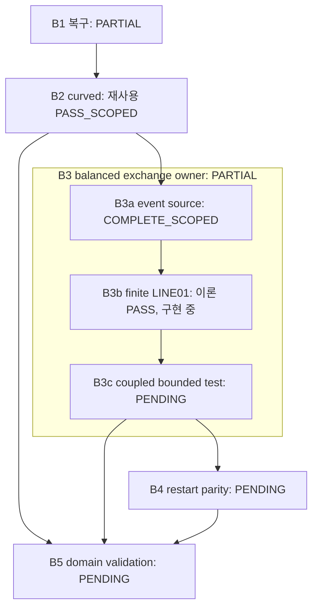

# BASS 관련 조사 합성 및 전체 목표 DAG — B3b 구현 중간 시점

이 문서는 2026-10-24 03:01:54 UTC까지 수집한 메타데이터와 이미 읽은 source·계약·보고서를 합성한다. **접근 가능한 owner 저장소 51개의 목록과 관련 6개 저장소의 branch/PR 목록을 조사했다. 전체 저장소의 모든 파일·대화 전문·백업 바이트를 읽었다는 주장은 하지 않는다.** 새 작업 `BASS_B3B_FINITE_LINE_EXCHANGE_20261024`는 이론 `PASS_SCOPED`, 구현 진행 중이다. 이 보고서 작성 자체는 새 과학 실행이나 구현 완료 판정이 아니다.

## 1. 실제 조사 범위와 목록 종료 근거

저장소 이름은 `cosmosapjw-quantum/` 아래의 정식 이름이다. 숫자는 조사 시점별 snapshot이며 여섯 저장소를 같은 순간에 동결한 원격 상태가 아니다.

| 저장소 | Branch | PR 합계 | Open / Closed | 실제 목록·pagination 범위 |
|---|---:|---:|---:|---|
| `bass` | 270 | 185 | 155 / 30 | Branch pagination exhausted 기록. PR connector 요청 한도 250에 185개 반환; 별도 PR page 배열은 보존 기록에 없음. 현재 tree 5,565 entries, `truncated=false`. |
| `rec_bianchi` | 149 | 131 | 97 / 34 | Branch 100+49, all-state PR 100+31; 양쪽 끝까지 확인. 현재 tree 5,924 entries, `truncated=false`; 실제 선택 source·계약 14개를 읽음. |
| `BASS_HE` | 99 | 94 | 94 / 0 | Branch [99], open PR [94], closed PR [0]; 각 목록 종료 확인. |
| `rei_bianchi` | 264 | 222 | 208 / 14 | Branch [100,100,64], open PR [100,100,8], closed PR [14]; 각 목록 종료 확인. PR 번호의 최댓값과 PR 개수는 다름. |
| `bass_cr` | 178 | 100 | 99 / 1 | Branch [100,78], all-state PR [100,0]; 종료 확인. 메타데이터·선택 PR 본문만 조사. |
| `WU088_HH` | 151 | 142 | 142 / 0 | Branch [100,51], all-state PR [100,42]; 종료 확인. 메타데이터·선택 PR 본문만 조사. |
| 합계 | **1,111** | **874** | **795 / 79** | 동일 branch/PR 번호의 저장소 간 중복 제거를 요구하는 종류의 합계는 아님. |

51개 owner 저장소의 전체 이름·default branch·archived 여부는 `provenance/CENSUS.json`에 있다. `bianchi_phase_r`, `cosmo_lab`도 이 inventory에 있지만, 발견되었다는 이유만으로 LINE01 receiver 의존성에 추가하지 않았다. HE/REI의 선택 source·계약 10개는 기존 cross-repository snapshots에 원문과 blob을 보존했다. 이 표의 나머지 branch 목록은 source 본문 읽기와 구분한다. [근거: CENSUS.json; REC_METADATA_CENSUS.json; CROSSREPO_INTAKE.json; SUPPLEMENTARY_METADATA.json]

| 별도 조사 대상 | 실제 도달 범위 | 해석 |
|---|---|---|
| Dropbox BASS backup 목록 | 247 entries, `has_more=false` | 해당 BASS folder 목록의 끝까지 확인. Archive 내용 전수 복구를 뜻하지 않음. |
| Drive BASS folder 응답 | 76 entries | Folder-fetch 응답에 다음 page token이 노출되지 않음. Drive 전체 또는 모든 관련 backup의 완전한 목록이라고 선언하지 않음. |
| Dropbox `REC_HISTORY` 검색 | 31 results, `has_more=false` | 해당 query 결과의 종료. 전체 REC backup 목록과 동일하지 않음. |
| 다른 대화 | `personal_context_search` 요약 및 검색 결과 | 모든 대화 transcript inventory는 제공되지 않음. 요약은 source/예약 조사 단서이며 live source·실제 provider ACK를 대체하지 않음. |

Drive의 `item_type=document` 검색이 ZIP을 제외했던 결손은 folder metadata 조회로 보완했다. 일반 `REC_HISTORY` 검색의 무관한 B3a document 반환을 REC backup 전수조사 성공으로 쓰지 않았다. 복구된 S1/S2를 포함해 과거 archive 신규 다운로드는 0이다. [근거: CENSUS.json/backup, conversations]

## 2. 새로 확인한 결과와 실제 연결 판단

| Owner / 현재 확인한 핀 | 확인한 결과 | 이번 B3b와의 관계 |
|---|---|---|
| BASS [PR185](https://github.com/cosmosapjw-quantum/bass/pull/185), `c2e6f1f80417e62c95e607c80115e89de1925ca9` | B3a `COMPLETE_SCOPED`; 과학 payload는 `f4f12a162b446f7fc42759f88d544749435fb35b`. 후속 delivery metadata HEAD와 구분. Draft/open/unmerged. | 실제 event-rate 및 source-only adapter를 재사용하는 직접 선행. |
| REC [PR131](https://github.com/cosmosapjw-quantum/rec_bianchi/pull/131), `c7cdabd871ab2ef6f722594ff063b8ce8550e6b4` | 현재 LINE01 `thick_local_step`의 실제 atomic population map 확인. Source blob `5ac2a3107b80710504e63705ff16562131b5d1cf`는 이전 핀과 동일. PR131 신규 부분은 history 입력 수용이며 새 finite bath가 아님. | 실제 유한 upper/lower population을 선택. `REC-HISTORY-02R`의 진행 중인 characteristic/Wien lane은 별도 owner로 보존. |
| HE [PR94](https://github.com/cosmosapjw-quantum/BASS_HE/pull/94), `d8bae9f7e24ad3494e399f7ab46c4167a5623d48` | Incident 20 eV의 제한된 DDCS electron window에 대한 조건부 moments와 deterministic sensitivity. Owner 보고 `PASS_SCOPED`. | Full angular support, event normalization, joint-electron law, frame/recoil 및 reservoir가 아직 공급되지 않음. 선택 LINE01의 receiver로 대체하지 않음. |
| 중앙 REI [PR222](https://github.com/cosmosapjw-quantum/rei_bianchi/pull/222), `4d78d35da27c8fc1a6fb291c748e7406e2ad9d7c` | 실제 continuum photon survival/absorption, gas state 및 source-age reference 경로 존재. REC observation [PR223](https://github.com/cosmosapjw-quantum/rei_bianchi/pull/223)은 별도 branch. | Ionic fractions·continuum absorption·history samples는 bound-bound excited-level population receiver와 같은 API가 아님. 이번 단위에 자동 연결하지 않음. |
| CR [PR100](https://github.com/cosmosapjw-quantum/bass_cr/pull/100), `8e4e06361d714939513a11f64a27f02822bde2fa` | C23E 조건부 D43K PI/RR/CX source binding의 owner 보고 `COMPLETE_SCOPED`. Full stopping/history와 source uncertainty는 별도. | 병렬 frontier 정보. REC LINE01 직접 의존성에서 제외. |
| HH [PR142](https://github.com/cosmosapjw-quantum/WU088_HH/pull/142), `1a8f98719fd3ec87d3acbfb27aeda9936b0bc613` | PHYS85 nuclear thermal/fast ownership 이론 `GO_IMPLEMENT`; exact Wolfram reference/application은 owner 기록 `NOT_RUN`. | 병렬 frontier 정보. REC LINE01 직접 의존성에서 제외. 과거 PHYS84 lease WAIT를 BASS runtime 실패로 상속하지 않음. |

다른 owner의 PASS·계산 개수·backup 보고는 해당 owner 증거를 읽은 결과다. 이번 BASS가 그 계산을 새로 수행하거나 독립적으로 재검토했다는 판정과 다르다. Conversation search에서 REC-HISTORY-02R의 02:49Z `GO_IMPLEMENT`가 관측되었으며, 새로운 history 수용으로 승격하지 않고 병렬 작업 예약에 반영했다. Generic ODE/D1의 인접 결과도 발견되었지만 BASS native receiver 결손을 닫은 것으로 사용하지 않았다. [근거: CROSSREPO_REPORT_KO.md; REC_RECEIVER_REPORT.md; CONVERSATION_SEARCH.json]

## 3. B3b가 선택한 구체적인 다음 구성

실제 LINE01은 frozen `N,H,S,f_plus`와 물질 rest frame의 proper seconds·proper volume에서 유한 원자 population을 이동시킨다. 내부에너지 상대방은 기존 upper-level excitation `E_line*n_u`다. 이번 구성은 그 실제 map의 안정한 signed net increment를 재사용하고, 방출·흡수의 적분 gross counts를 각각 유도한다. `f_plus>0`는 prescribed incoming boundary이므로 일반 gross ledger 계산과 닫힌 finite-photon-stock transaction을 구분한다.

유한 BASS 상태 transaction은 **`f_plus=0` 방출 경로만** 구현한다. 실제 upper population이 감소하고, 생성된 photon packets가 증가하며, atomic excitation과 radiation의 에너지를 함께 갱신한다. 6축 가중치 각 1/15와 8 cube-corner 가중치 각 3/40의 양의 14방향 규칙은 quadratic thick source의 number와 stress를 정확히 재현한다. 이는 observer가 바뀐 rational event kernel `K(u)`의 일반 cubature 인증이 아니다. 유한 상태의 변환은 `kappa*L^2`, 순간 rate는 `kappa*L^3/c`이며, `Source.pi`는 상태 응력이다. [근거: 새 단위 CONTRACT.md; reviews/THEORY_REVIEW.md]

이론 독립 검토는 `PASS_SCOPED`이고 실제 새 Wolfram 응답에는 19개 residual group의 0이 기록되어 있다. **구현·실행·독립 code/physics/figure 수용은 이 문서의 기준 시점에서 진행 중이며 완료로 세지 않는다.** 새 donor reservoir나 positivity clipping을 추가하지 않는다. 닫힌 finite-bath 흡수, history calibration, coupled geometry evolution은 이 계약의 완료 조건에 슬쩍 포함하거나 이미 완료한 것으로 쓰지 않는다.

## 4. 전체 BASS 목표의 DAG와 완성도

화살표는 원 계약의 연구 순서와 수용 의존성을 보존한다. 명시적으로 허용된 detached B3a/B3b 준비·국소 연구는 B1/B2의 좁은 미해결 항목을 소급 삭제하지 않고 진행한다.

| 노드 | 과학·실행 현황 | 남은 의무 / 다음 행동 | Backup·게시와의 관계 |
|---|---|---|---|
| B1 G1B recovery | `PARTIAL`, 기존 복구 증거 재사용 | S1/S2 전체 바이트 복구, 110 payload 검증, 실제 curved 명령·exit0는 확보. **당시 pytest의 정확한 argv/cwd는 여전히 미확인**이며 새 명령으로 대체할 수 없음. | PR184의 추가 recovery receipt가 실제 근거. 새 대량 복구 불필요. |
| B2 G1B curved | `REUSED_PASS_SCOPED` | Selected V/VIII, `tau=[0,0.8]`, 고정 gate `2e-8`, coarse 실패·half-step controls 보존. Common prescribed-field tail을 coupled trajectory/interval/global 인증으로 확대하지 않음. 과거 전체 raw arrays의 새로운 독립 검토를 주장하지 않음. | 기존 publication/복구와 과학 범위를 분리. |
| B3a event source | `COMPLETE_SCOPED`, 독립 physics/code `PASS_SCOPED` | 실제 detached REC instantaneous gross/net Q와 pressure-rate, 균형 U/J 및 rate/state 분리 완료. 전체 물리 receiver·coupling 완료는 아님. | `DUAL_BACKUP_ACK`, 게시 `ACKNOWLEDGED`; PR185 Draft/open/unmerged. |
| B3b finite LINE01 | **이론 `PASS_SCOPED`; 구현 진행 중** | 실제 population owner와 계약 확정. General prescribed-f gross counts 및 f=0 유한 상태 transaction을 구현·실행하고 독립 검토해야 함. | 이 합성 보고서는 새 단위 checkpoint별 ACK를 판정하지 않음. 실제 delivery receipt로 별도 기록. 최종 게시 수용은 아직 아님. |
| B3c coupled bounded test | `PENDING`, `NOT_RUN` | Source-qualified bounded coupling 계약과 실제 실행 필요. 새 cosmological IVP 수용 없음. | 이번 이론·국소 map 검증의 ACK로 완료 처리하지 않음. |
| B4 production restart | `PENDING`, `NOT_RUN` | Opt-in accepted-state adapter, source/frame/grid/epoch 검사, uninterrupted vs resumed parity 및 누적 ledger/budget 보존 필요. | Production 활성화는 별도 결정이며 현재 금지. |
| B5 domain validation | `PENDING`, `NOT_RUN` | Domain/species/window과 time/radial/angular/tail/source 오차를 분리한 정당한 범위별 수용 필요. Core constraint만으로 production 승격하지 않음. | 새 campaign은 별도 명시 예산 없이는 시작하지 않음. |

**전체 완료율은 `null`을 유지한다.** 다섯 상위 노드나 하위 노드의 상태를 임의 가중 평균한 퍼센트는 만들지 않는다. B3 전체는 아직 `PARTIAL`이며 B4/B5는 미실행이다. 기준은 고정 중앙 handoff와 B3a의 실제 `DAG.json`이고, 중앙의 오래된 `PROPOSED` snapshot을 새 B3a 완료 증거의 취소로 해석하지 않는다. [근거: B3a REPORT_KO.md, DAG.json, provenance/CENTRAL_HANDOFF.md]

## 5. 실패 이력·runtime·자원·authority 보존

- G1B recovery는 [PR184 추가 receipt](https://github.com/cosmosapjw-quantum/bass/pull/184#issuecomment-6373136365)를 재사용한다. `34.1262904040002`초는 부분 과거 wall 합계이며 잔여 예산이 아니다. `remaining_campaign_wall_seconds=null`, `remaining_campaign_cpu_seconds=null`, `budget_reset=false`를 유지한다.
- 원 event 준비 연구의 NumberQ 입력 검사 최초 7/16 실패 → NumericQ와 exact-real 조건 교정 후 16/16, 별도 4/4 및 미선언 벡터 경고 교정은 유지한다. B3a 후속 구현의 초기 12/12 뒤 독립 결손 발견 → targeted RED 실패 → 수정 후 15/15 이력도 첫 실행 전부 PASS로 바꾸지 않는다.
- 새로 실제 읽은 Drive 문서 `18hTBCoLnlKcOd1AlM48BkF6dyga0n7Xj-BiONxMAMlU`는 **별도 과거 Thomson** 경로를 `0/8 → 5/8 → 20/21 → 최종 21/21`로 보고한다. 이전 B3a가 읽은 20/21 receipt 이후 지식으로 덧붙인다. 이전 실패를 삭제하지 않으며, 원 `.wl` export의 byte identity·이번 replay·새 독립 모델 검토를 주장하지 않는다.
- 새 턴 runtime probe는 Python 3.12.14 `PYTHON_PASS`, g++ compile/run exit0와 `CPP_PASS`를 실제 반환했다. 앞선 Python/container `SERVICE_ERROR`나 다른 owner의 lease WAIT를 상속하지 않는다. 이 probe는 새 과학 결과가 아니다.
- 고정 authority는 `rei_bianchi@0f9d9df825be1dac9ca9bdf73cdc2e8908bcba17`이다. 현재 중앙 `4d78d35da27c8fc1a6fb291c748e7406e2ad9d7c`의 AGENTS blob `429a5a13ee75b1222bc50627f8d5973d01dd21c4`는 고정 authority와 동일하다. Source/contract 이후 독립 검토, 실제 최신 expected SHA를 통한 새 Draft 게시, merge·production 금지 경계는 유지한다.
- 현재 cloud skill 1.3.0 관측은 `CENSUS.json`에 기록했다. 이번 사용자 지정 full theory/coding loop의 공급된 1.0.0 범위·실제 실행 기록을 다시 쓰거나 이미 수행한 단계의 재실행 이유로 삼지 않는다.

이 합성 작업 자체의 새 IVP, 과거 campaign replay, 시험, archive 다운로드, 원격 변경은 모두 0이다. 로컬 자료 읽기와 이 보고서 작성만 수행했다. Parent의 별도 구현·검증 process 비용이나 이후 완료 판정을 이 0에 합쳐 숨기지 않는다.

## 6. 재개에 필요한 근거 위치

- 새 단위 root: `research/bass_b3b_finite_line_exchange_20261024/`.
- 목록·대화·backup 조사: 새 단위 `provenance/{CENSUS.json,REC_METADATA_CENSUS.json,CROSSREPO_INTAKE.json,SUPPLEMENTARY_METADATA.json,CONVERSATION_SEARCH.json}`.
- Source 판단: 새 단위 `provenance/{REC_RECEIVER_REPORT.md,CROSSREPO_REPORT_KO.md,SOURCE_OWNER_INTAKE.json}`.
- 현재 과학 계약: 새 단위 `CONTRACT.md`, `reviews/THEORY_REVIEW.md`, `evidence/WOLFRAM_CURRENT_RESPONSE.json`.
- 이전 수용·실패·delivery: `research/bass_b3a_event_source_20261024/{REPORT_KO.md,DAG.json,provenance/CENTRAL_HANDOFF.md,delivery/}`.

다음 행동은 이미 계약된 B3b 구현과 실제 bounded 검증을 마친 뒤 독립 code/physics/figure 판정을 받아, 확인된 최신 expected SHA에 새 lane을 게시하는 것이다. 추가 metadata 조사나 옛 증거 replay를 새 선행 gate로 만들지 않는다.
