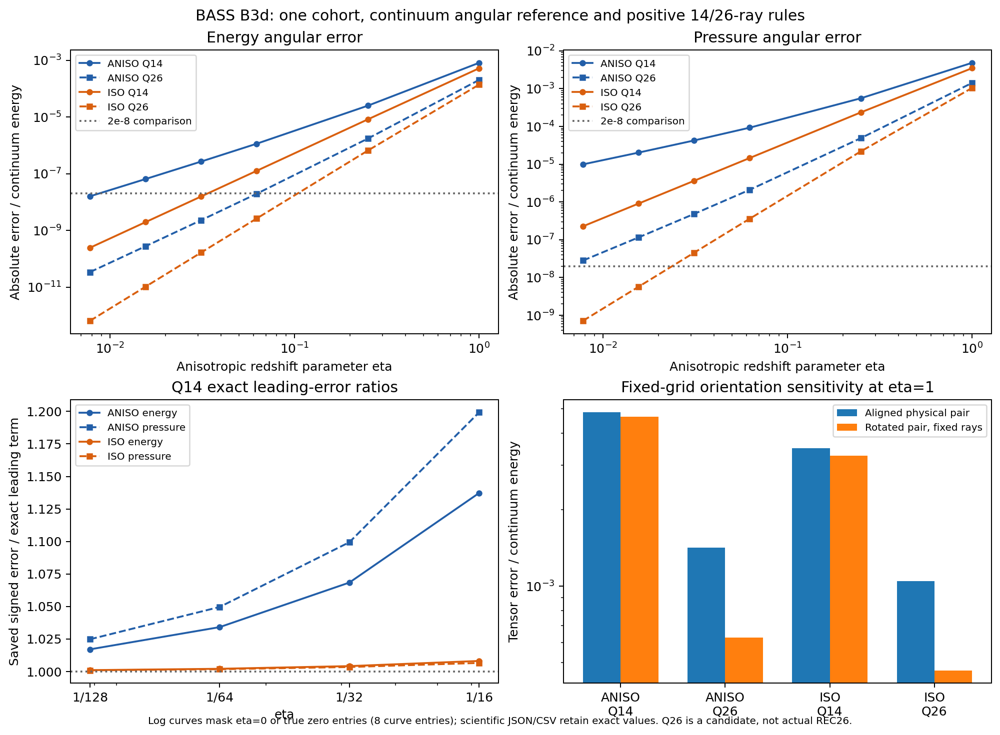

# BASS B3d — 한 photon cohort의 각도 오차

## 판정과 실제 새 기여

**BASS_B3D_ANGULAR_COHORT_20261025 = PASS_SCOPED.**
명시된 physmath-research-loop **1.0.0**을 유지했다. 수용 범위는 고정된
단일 cohort에서 연속 각도 모멘트, 실제 14방향 규칙, 후보 26방향 규칙의 차이를
시간 적분 오차와 분리해 정량화한 결과다. 독립 R6, 실제 코드·수치 C9,
수정된 실제 PNG 검토가 통과했다. 전체 BASS physical completion은 null이다.

핵심 결과는 source의 출생 모멘트가 정확해도 비등방 적색편이 뒤의 연속 각도
모멘트가 자동으로 정확해지지는 않는다는 것이다. 선택된 비등방 source에서
14방향의 에너지 오차는 작은 변형 eta의 2차, 응력 오차는 1차부터 나타난다.
26방향 후보는 각각 3차·2차로 개선하지만, 선택된 모든 비등방 사례에서
2e-8 full-tensor benchmark를 충족하는 것은 아니다.

주 비교표 28행은 **6 PASS / 22 FAIL**이다. 이 실패는 오차 정량화의 결과로
보존했다. 16개 computational gate PASS는 reference와 계산·유도·정규화의
유효성을 뜻하며 28/28 angular accuracy PASS라는 뜻이 아니다.
근거: [최종 수용](ADMISSION.json), [독립 C9](reviews/C9_FINAL_REVIEW.md),
[수치 snapshot](results/SUMMARY.json), [전체 raw 비교](results/COHORT_SWEEP.json).
SUMMARY의 PENDING_INDEPENDENT_ASTRA_REVIEW는 검토 전 numerical snapshot의
원래 표기다. 그 파일을 재작성하지 않고 최종 판정을 ADMISSION과 C9에 기록했다.

## 1. 현재 source를 읽고 바꾼 연구 방향

시작 인계는 B3c를 NOT_RUN으로 기록했지만, 현재 REC135
52226bb8d3ac99e7de2bd7934ab30e6fb3f257fe에서 이전 BASS B3c의 정확한
handoff/admission 복사본을 발견했다. 그 owner는 bounded f_plus=0
source+geometry+collisionless background를 12 IVPs로 완료했다고 보고한다.
이는 **이번 BASS 재실행이 아닌 owner-reported 결과**다.

이 발견 전에 준비한 대체 B3c1 구현은 scientific Python child와 IVP가 모두
0인 상태에서 중단했다. 동결 계약·구현·독립 검토·11개 Wolfram 잔차 그룹은
superseded_preparation에 PREPARED_NOT_EXECUTED로 보존했다. 기존 B3c의
기본 목표를 다른 fixture/solver로 반복하지 않고, 그 handoff가 지정한 다음
각도 오차 의존성을 이번 B3d로 수행했다.

BASS 실제 부모는 PR187 / 0a088e1f8fca6618107525e687f930406ca32d18이다.
이전 B3c의 거절된 Git publication은 NO_ACK로 유지하며 이번에 재시도하지
않았다. 새 연구는 별도 PR188 / research/bass-b3d-angular-cohort-20261025에
Draft로 게시한다. Merge·production 활성화는 없다.

현재 central branch 관측은 fc159d2b15843bdfe81af0840bc07392a4977680까지
진행했으나, AGENTS blob429a5a13ee75b1222bc50627f8d5973d01dd21c4와
fixed/current BASS handoff blob55c86aabe97702d6b64631c5f24a9d1a9563820e는
불변이다. REC selected3NPZ+6owner modules도 9/9 불변이다. 최신 REC135는
local thermodynamic Jacobian 완료를 보고하지만 실제 incident
trace/geodesic/direction/frame의 finite receiver 결속은 여전히 OPEN이다.
이전의 S0/NOT_RUN 관측을 현재 REC 상태로 재사용하지 않았다.

현재 읽기 범위와 구체적인 identity는
[source 갱신](provenance/CURRENT_SOURCE_REFRESH_KO.md),
[최종 source·복구 검토](reviews/CURRENT_SOURCE_AND_RECOVERY_REVIEW.md)에 있다.
전체 원격 archive, 모든 owner 파일 또는 모든 비공개 대화를 읽었다는 주장은 없다.

## 2. 초기값·frame·clock·support·에너지 귀속

Metric은 (-,+,+,+), hydrogen rest tetrad와 normal tetrad는 일치한다.
실제 H_LYA_EFFECTIVE_2P 카드의
E_b=10.198714553953742 eV=1.6340142155180418e-18 J를 사용한다.
Pstar=E_b/c, n_b=1 m^-3인 단위 cohort, L=1 m의 고정 단위 변환이다.
이 n_b는 실제 REC photon inventory나 새로운 atomic donor가 아니다.

출생 방향 n을 영구 label로 고정하고

    q_b(n)=1+n^T S_b n,    <g>=(4*pi)^(-1) integral g dOmega

로 둔다. STF S_b에 대해 <q_b>=1이다. 주 fixture는

    B=diag(3/10,-1/10,-1/5),   S_b=B/2 또는 0,
    a=2/5,   C_eta=exp(-eta B),   R_eta=exp(-a) C_eta,
    D=det R_eta=exp(-3a),
    eta=0,1/128,1/64,1/32,1/16,1/4,1.

ISO/ANISO는 출생 source의 각도 분포를 가리킨다. eta>0이면 두 source 모두
비등방 transport를 거친다. 모든 주 fixture에서 q_min>=0.9이고,
R(chi)=exp[-chi(a I+eta B)]의 각 방향 계수는 0.2 이상이다.
chi는 대수적 경로 label이며 proper time이나 실제 Einstein IVP 시간이 아니다.
모든 광자는 이 경로에서 적색편이하고, 최대 최종 E/E_b는 e^-0.2이다.
이 진술은 unresolved outgoing line의 support에 한정된다.

출생 label을 유지한 physical number measure는 **공통 D**만 곱한다.
운동량은 p=(E_b/c)R n, 에너지는 E=c|p|이다. 방향별 에너지 변화는
moment 안에서 한 번만 반영한다. 현재 방향으로 적분 변수를 바꾸는 경우에만
dOmega'=det(R)/|R n|^3 dOmega가 필요하다. q_b를 현재 방향에서 다시 평가하거나
이 Jacobian을 출생 label 적분에 중복 삽입하지 않는다.

Bianchi-I의 보존된 covariant momentum과 공통 체적 인자는
[Heinzle–Uggla, Section2 Eqs2–5](https://arxiv.org/html/gr-qc/0512031v1),
[Lee–Nungesser–Tod, Section2.2 Eq12](https://arxiv.org/pdf/1911.04937)와 일치한다.
이 문헌의 장시간 정리를 현재 유한 수치 오차 인증으로 이전하지 않았다.

정규화한 energy와 spatial pressure는

    F=<q_b |C n|>,
    P=C <q_b n n^T/|C n|> C^T,
    pi=P-I F/3.

SI tensor에는 E_b*n_b*D*exp(-a)를, BASS tensor에는 여기에 alphaL을
더 곱한다. alphaL=2.0766474428449717e-43,
rho_star=6.850896887965102e-62이다. 수밀도는
n_b D=0.301194211912202 m^-3이다.

실제 packet 검증은 k=R n, w=alphaL*E_b*n_b*D*A*q_b, mass=0을
변경하지 않은 kinetic.moments/tensor에 넣었다. Source/U/J/PiRate나 유한
atomic transaction은 생성하지 않는다. 현재 pi는 상태 STF stress다.
Lorentz state-boost 가중치나 observer event-rate clock 분모를 이
cosmological drift에 추가하지 않았다.

## 3. 정확한 각도 규칙과 선도 오차

| 궤도 | 점 개수 | 실제 Q14의 점당 가중치 | 후보 Q26의 점당 가중치 |
|---|---:|---:|---:|
| 좌표축 |6|1/15|1/21|
| edge centers |12|없음|4/105|
| cube corners |8|3/40|9/280|

Q14는 실제 parent cubature14를 그대로 호출한다. Q26은 이 단위에서 구성한
canonical positive degree7 후보이며 실제 REC35x26 입력을 사용한 것이 아니다.
공식 [SciPy1.17 문서](https://docs.scipy.org/doc/scipy-1.17.0/reference/generated/scipy.integrate.lebedev_rule.html)
및 pinned source가 order5/7과14/26 points 및 가중치를 확인한다.

구면 even moment 공식과 각 rule의 직접 유한 합으로 degree5/7 exactness를
증명했다. Q14는 degree6에서

    Delta nx^6=4/315,
    Delta nx^4 ny^2=-2/315,
    Delta nx^2 ny^2 nz^2=4/315

를 남긴다. Q26도 degree8에서 Delta nx^8=2/315가 남는다.
양성과 출생 stress의 정확성만으로 nonlinear redshift 뒤의 angular continuum
정확성이 따라오지는 않는다.

Delta=rule-continuum으로 쓰면 이번 주 fixture의 정확한 선도항은 다음과 같다.
표의 응력 선도항은 모두 STF이므로 pi의 선도항이기도 하다.

| source / rule | Delta F 선도항 | Delta P 선도항 |
|---|---|---|
| ANISO Q14 | -9 eta^2/35000 | eta diag(13,-11,-2)/10500 |
| ISO Q14 | -9 eta^3/17500 | eta^2 diag(13,-11,-2)/3500 |
| ANISO Q26 | -7 eta^3/100000 | eta^2 diag(9,-3,-6)/20000 |
| ISO Q26 | -7 eta^4/40000 | eta^3 diag(3,-1,-2)/2000 |

이는 직접 binomial 전개와 degree6/8 잔차 contraction에서 나온 계수다.
Wolfram15.0.1은 56/120개 monomial과 이 계수를 포함한18 residual groups를
모두 정확한0으로 확인했다. [독립 전체 유도](theory/INDEPENDENT_ANGULAR_COHORT_DERIVATION.md),
[실제 Wolfram 출력](evidence/WOLFRAM_ANGULAR_PARSED.json)을 보라.

이 결과는 특정 finite quadrature의 정확성 한계를 밝힌 것이다. 구면 적분
자체의 새로운 일반 불가능성 정리나 G1B collisionless radial reduction의
반례로 채택하지 않는다. 선도 계수와 범위가 고정된 이번 BASS 오차 계산이
실제 추가 기여다.

## 4. 연속 각도 reference와 실제 검증

주 reference는 mu Gauss-Legendre 64개와 azimuth128개이며 16/32/64 grid를
함께 보존했다. 별도 sign-reflected octant32x32와 axisymmetric asinh
closed form으로 확인했다. 기준식을 actual14 rule에서 재생성하지 않았다.

K40 binomial polynomial은 최대 degree84다. 이상적64x128 product rule은
이를 정확히 적분하며 delta<=tanh(1/2)에서 uniform tail bound를 얻는다.
Wolfram의 최대 ideal energy/pressure bound는 각각
7.324365550587839e-17 / 8.674355235422496e-15다.
이 상계는 ideal node의 truncation에 관한 것이며 floating node·초월함수·합산
rounding까지 interval certification한 것이 아니다.

| 검증 | 실제 최댓값 | 기준 |
|---|---:|---:|
| reference32/64 |1.9539925233402755e-14|2e-12|
| octant/full sphere |7.299574441658989e-15|2e-12|
| axial analytic/reference |1.1223186627952777e-14|2e-12|
| K40 ideal pressure bound, absolute |8.674355235422484e-15|2e-12|
| actual packet mapping |6.661338147750939e-16|512eps|
| direct spatial trace |6.661338147750941e-16|512eps|
| co-rotated rays covariance |2.162836871602664e-16|512eps|

coarse16 axial pressure 차이 약1.02e-11도 raw에 남아 있다. 이를 fine64
reference gate의 실패나 성공으로 바꿔 쓰지 않았다.

eta=1/128에서 signed leading coefficient의 상대 차이는 ANISO energy
1.7057%, pressure2.4806%, ISO energy0.1057%, pressure0.1199%로 모두5% 이내다.
첫 resolved triplet은 1/128,1/64,1/32이며 두 adjacent order 모두 통과한다.

| source | energy order 두 값 | pressure order 두 값 |
|---|---|---|
| ANISO Q14 |2.024129894,2.047183112|1.034643147,1.066995188|
| ISO Q14 |3.001497024,3.002919290|2.001247381,2.002389047|

이 차수는 eta 변형에 관한 차수다. ODE 시간 수렴 차수라고 쓰지 않는다.
Q26의 resolved 값도 exact higher order와 일치하지만 ISO-Q26 energy의
eta=1/128 오차6.51255342974353e-13은4096eps 아래다. 해당 첫 order는
실제로 null/ROUNDING_UNRESOLVED다. 그 점으로 slope를 만들지 않았다.

## 5. 2e-8 angular benchmark의 실제 실패

모든 angular error는 양의 continuum F로 나눈다. P/pi의 작은 개별 성분이나
거대한 rest energy로 나누지 않는다. full tensor는 max absolute component norm이다.

| source | eta | Q14 energy error | Q14 tensor error | Q26 energy error | Q26 tensor error |
|---|---:|---:|---:|---:|---:|
| ANISO |1/128|1.5963590e-8|9.9132556e-6|3.4017192e-11|2.8152151e-8|
| ISO |1/128|2.4548929e-10|2.2690367e-7|6.5125534e-13|7.1393939e-10|
| ANISO |1|8.1016960e-4|4.8345876e-3|2.0196018e-4|1.4195314e-3|
| ISO |1|5.1933871e-4|3.4894767e-3|1.3790447e-4|1.0455184e-3|

28행 가운데 eta=0의4행과 ISO-Q26의 eta=1/128,1/64 두 행만 통과한다.
Q14는 모든 nonzero eta12행에서, Q26은 ANISO6행 및 나머지 ISO4행에서
benchmark를 넘는다. [전체 CSV](results/angular_errors.csv)에 실패를 모두 보존했다.
26방향의 작은-eta 오차 차수 개선이 유한 영역의 일괄 accuracy 보장은 아니다.

고정 grid에 대해 물리 pair만 회전한4개 진단도 별도 보존했다.
전체 물리량과 ray를 함께 회전시키면 covariance 잔차는2.2e-16 이하다.
같은 회전 좌표에서 fixed-ray 결과와 co-rotated-ray 결과의 직접 tensor 차이는
ANISO Q14/Q26 각각0.00845739658 /0.000731027748,
ISO Q14/Q26 각각0.00609380659 /0.000533379366이다.
이는 grid 방향 의존성이다. max-component norm 자체가 rotation-invariant라는
주장은 하지 않으며, 서로 다른 좌표에서의 bar 높이 차이만으로 원인을 추론하지 않는다.

그림은 실제 raw 수치로 생성했다. log plot에서 eta=0/true zero만 mask하며
원 JSON/CSV의 값은 유지한다. 2000x1471 PNG를 독립적으로 실제 열어 검토했다.

## 6. 실제 실행·실패·한정 교정

한 custom focused test script, 한 cohort sweep, summary/plot 세 번이 실제
실행되었다. pytest/unittest의 임의 method 개수로 부풀리지 않는다.
테스트는 56/120 monomial exactness, 네 rule/source 행, 여섯 invalid input,
실제 packet mapping과 source copies7/7을 확인한다.

| 실제 child | exit | 의미 |
|---|---:|---|
| attempt01 tests/test_angular_cohort.py |0|focused checks|
| attempt02 code/run_sweep.py |0|14 main fixtures,2 rotation fixtures 및 reference|
| attempt03 code/summarize.py |1|NumPy Boolean JSON serialization failure|
| attempt04 code/summarize.py |0|bool 변환 한 줄 교정 후 저장·그림|
| attempt05 code/summarize.py |0|독립 그림 검토의 tick 겹침만 교정|

attempt03 원본 source, traceback, receipt와 diff는 results/failure_03에 있다.
attempt05는 좌하단의 major tick을 실제 eta 분수로 표시하고 minor label을 끈
두 plotting statement만 바꿨다. 원 PNG/source와 diff는 results/figure_label_repair에 있다.
두 교정으로 equation·tolerance·quadrature·source·raw sweep이 변하지 않았다.
tests/sweep은 각각 한 번만 실행했다. 다섯 numerical JSON/CSV는 tick 교정
전후 byte-identical이며 raw sweep SHA256은
3b8cc8007266ff2419c04baf48a3eea6c45eb49c85a67627dc250285ad5beb71이다.

최종 cohort code SHA256:
04c4b45452c0120e4042d76f3a7ef257e236dd1cb813fce732121081c080bf17.
최종 PNG SHA256:
07ac5d367da17eb4bdba283f895ac3a6386504c75c8d8af0248a4f7dcf3e16be.

## 7. 자원과 stage·delivery 상태의 분리

Python 실제5children의 합은 wall8.168898051000724s / CPU8.162283s다.
실패와 두 summary 재실행을 포함한다. B3d Wolfram을 더하면
wall8.752321051000724s / CPU8.78189s다. 미실행으로 전환된 B3c1의
별도 Wolfram0.082713s/0.082161s까지 현재 turn에 포함하면
**wall8.835034051000724s / CPU8.864051s**다.

이 값은 scientific process의 측정 subtotal이다. 도구 대기·intake·편집·게시
전체 경과시간은 포함하지 않는다. 이전 B3c의 첫 실패 kernel timing은 unknown인
별도 owner 기록이다. Historical remaining wall/CPU=null, budget_reset=false를
유지한다.34.1262904040002s는 부분 과거 합계이며 잔여 예산이 아니다.
현재 guard120wall/60CPU와도 과거 예산을 혼동하지 않는다.

새 IVP0, source transaction0, old campaign replay0, old archive/NPZ download0.
독립 scientific reviewer execution0. Lower-tier coding agent에 요청한 모델과
독립 검토의 실제 역할은 구별하며 different-model scientific review는 NOT_RUN이다.

S0의 실제 Git은 ce0b8b61bdb172734076900ebe3ad131bba87326 /67blob readback
PASS이고, Drive success와 Dropbox completed도 확인했다. S1은 독립 검토가
끝난 scientific snapshot, S2는 최종 handoff다. 실제 commit/hash/provider ACK는
DELIVERY_RECEIPTS와 최종 PR188 본문이 기록한다. Self-referential archive hash를
archive 안에 넣지 않는다. Remote full archive restore는 NOT_RUN이다.

R1–R10/C1–C10의 이번 단위 작업과 전체 DAG의 physical completion을 분리한다.
최종 단계별 표는 STAGE_STATUS_KO.md와 STAGE_LEDGER.json에 있다.

## 8. 보존한 이전 근거와 다음 입력

PR184의110payload/curved command exit0 receipt는 재사용했다. B1의 과거
pytest 정확 argv/cwd는 UNKNOWN이다. B2의 selected V/VIII,tau[0,.8],
gate2e-8을 전역 범위로 확대하지 않았다.

B3a의 Q=integral p dR, K(u)=c integral pp/(-u.p)dR에서 observer clock
분모가 변한다. State boost 가중치를 invariant event rate에 적용하지 않는다.
NumberQ7/16 실패→NumericQ exact-real16/16 및 별도 source4/4 이력은 보존한다.

B3b2의 실제910packet은 hydrogen-frame scalar/unpolarized isotropic bootstrap
INITIAL-DATA이고 coupled_macro_endpoint=false다. 전체 coupled trajectory나
LINE01 f_plus가 아니다. 에너지 owner E=c*p와 inverse의 실제 overflow 교정,
최초10-test와 이후3inverse+1actual/36inverse refresh의 구분을 유지한다.
최종11-method 전체 suite를 재실행했다고 주장하지 않는다.

다음 BASS 연구는 현재 실제 incident trace를 finite receiver cell/face의
spectral/time/angular support, frame, clock, finite donor와 결속하고
atomic term의 독점 owner를 정해야 한다. Cell mean을 f_plus로 바꾸거나
없는 bath·bandwidth·donor·clipping을 만들지 않는다.

독립 angular 후속 의무는 실제 기존 B3c cohort의 S_birth와 anisotropic
redshift history를 새 reference 계약에 결속하는 일이다. 이번 고정 eta 표를
그 trajectory의 검증으로 이전하지 않는다. Q26으로 교체하기만 하면 충분하다는
판정도 하지 않는다. 현재 raw/owner 계약이 공급되지 않은 부분은 OPEN으로 유지한다.
B4restart, B5general domains, calibrated REC coupling은 별도 미완 의무다.
