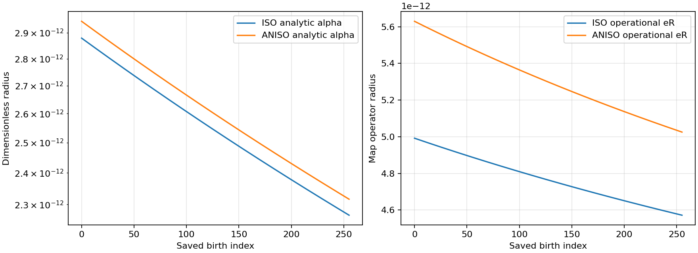
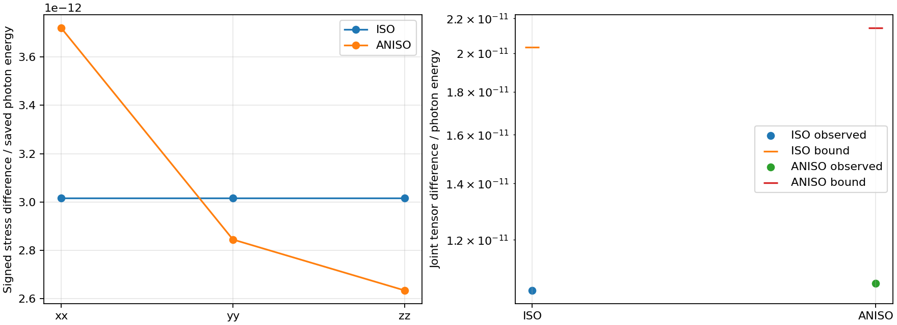

# B3g 중간시점 복원·최종 운반 및 B3i 응력 입력 결과

작성일: 2026-10-27 (Asia/Seoul). 원자료와 실행 시각은 각 기록의 UTC를 유지한다.

## 결과와 적용 범위

실제 저장된 B3c의 512개 출생 cohort에 중간시점 geometry를 재구성하여
최종시점까지의 운반 행렬 R과 부피 인자 detR를 결속했다. 이전에는
midpoint beta가 저장되지 않아 최종 운반이 입력 의존 상태였으나, 원래
RK4의 정확한 좌표 항등식과 유한 stage 상계를 이용해 새로운 적분 없이
이 수치 복원 문제를 진행했다. 원래 geometry 바이트를 되찾았다는 뜻은
아니며, 재구성값·해석적 나머지·경험적 부동소수점 여유를 각각 저장했다.

원래 14방향 광자 모델의 최종 응력과 비교한 상대 joint 잔차는 ISO에서
1.0446478827350775e-11, ANISO에서 1.0653175742913758e-11이다.
두 경우 모두 계산한 수치 일치 상계 안에 있다. 그 응력을 물질의 lower
rest와 excitation 부문과 구분해 기존 B3i adapter에 넣었으며, 두 최종
geometry endpoint의 방정식 우변을 확인했다. 새 IVP, native source solve,
유한 흡수 거래, 기존 campaign 재실행은 0이다.

고차 양의 각도 적분도 같은 출생 입력과 고정된 geometry에서 평가했다.
512개 개별 cohort와 두 양의 혼합 모두 기존2e-8 수치 예산 기준을 만족한다.
이 판정에는 해석적 각도 상계, 중간시점 수치 복원 반경, 기존2e-12
경험적 binary64 여유가 포함된다. 물리적 eS/en/eE/geometry 반경은 null이며,
물리적 전체 오차2e-8 인증이나 연속 비선형 궤적의 interval 인증은 미완료다.
최종 과학 판정은 ADMISSION.json과 별도 R9 독립 검토를 따른다.

## 핵심 수치 결과

| 관측량 | ISO | ANISO |
|---|---:|---:|
| 실제 저장 출생 수 | 256 | 256 |
| 최대 alpha 해석적 복원 반경 | 2.878896659994195e-12 | 2.945033800483283e-12 |
| 최대 beta 성분 해석적 복원 반경 | 2.2582139353962876e-12 | 2.838418265247154e-12 |
| 최대 수치 운반 행렬 반경 eR | 4.9917770149642565e-12 | 5.629548970010874e-12 |
| 복원 finite14 대 저장 응력의 상대 joint 차이 | 1.0446478827350775e-11 | 1.0653175742913758e-11 |
| 위 비교의 수치 일치 상계/광자 에너지 | 2.0328860752328997e-11 | 2.1426296174718444e-11 |
| 고차 각도 적분 혼합의 operational 수치 예산 | 3.020869003168952e-11 | 1.846001725178548e-9 |
| 개별 cohort 중 기존2e-8 수치 기준 통과 | 256/256 | 256/256 |

비교 분모는 저장된 광자 에너지 밀도다. 큰 원자 정지 에너지로 광자
오차를 희석하지 않았다. 위 beta 최대값은 beta3 반경=e(beta1)+e(beta2)를
포함한다. 수치 행렬 반경에는 별도로 기록한 경험적 좌표 여유가 포함된다.

원자료: results/MIDPOINT_ROWS.json, MIDPOINT_ROWS.csv, SUMMARY.json.
10개 focused controls는 results/tests.stderr에 실제 통과 기록이 있다.

## 새로 확인한 각도 모델 차이

ANISO에서 고차 각도 적분과 기존 finite14 결과 사이에는 복원 잔차보다
훨씬 큰 차이가 있다. 같은 고정 birth/history에서의 값은 다음과 같다.

| 고차 적분 − finite14 | ANISO |
|---|---:|
| Delta T00 [J/m3] | +4.249665994393581e-5 |
| Delta Txx [J/m3] | -0.007368368020408411 |
| Delta Tyy [J/m3] | +0.006235741462489841 |
| Delta Tzz [J/m3] | +0.0011751232178340842 |
| 에너지 차이/저장 광자 에너지 | 1.5066381907383537e-7 |
| joint tensor 차이/저장 광자 에너지 | 3.447529542803539e-5 |

ISO의 같은 joint 차이는 2.7037131614889446e-16으로 산술 수준이다.
ANISO의 차이는 비등방 운반 후의 각도 표현 차이다. 출생 순간 R=I에서
degree-four를 정확하게 적분하는14방향 규칙도, 운반 후의
v_i v_j/|v|와 |v|를 그대로 정확하게 적분하지는 않는다. 따라서 기존
finite14 결과의 약1e-11 복원 일치와 고차 적분기의2e-8 예산 통과는
서로 다른 검증이다. finite14 자체가 continuum과2e-8로 일치한다는
판정은 이번 결과에서 성립하지 않는다.

고차 결과는 기존 finite14로 진화한 geometry를 고정한 후처리다. 이 값을
기존 궤적의 자체 일관된 대체 해로 승격하지 않는다. 향후 geometry
결합에서는 선택한 각도 모델을 명시하고 그 모델에 맞는 입력과 시간
오차를 함께 다루어야 한다. 이 차이는 새로운 불가능성 정리가 아니라,
실제 cohort에서 확인한 다음 모델 선택·수치 해상도의 진단이다.

## 복원식과 상계가 나온 경로

원래 producer는 T(dt/2) → source(dt) → T(dt/2)의 분할을 사용하며,
source는 geometry를 그대로 둔다. 첫 수송 반단계의 길이는 source
receipt에 저장된 source_subflow_duration_tau/2다. 누적 timestamp의
차는 별도 진단값으로 남겼다.

classical RK4에서 x'=v, v'=f이면 네 stage A,B,C,D에 대해

    x1 = x0 + delta*(v0+v1)/2 + delta^2*(fA-fD)/12

가 정확하게 성립한다. alpha에서는 v=h, beta에서는 v=sigma다.
저장된 H와 top-level S를 h=HL/c, sigma=hS로 변환하여 v1을 얻는다.
source가 S를 수치적으로 대칭화/STF 정규화한 효과는 경험적 산술 여유에
따로 속한다. 이 역변환을 원래 sigma 바이트의 복원으로 기록하지 않았다.

원래 cold matter와 양의 massless packet에서 다음 stage 상계를 얻는다.

    rho_m,max = rho_m,0 * exp(3*delta*Hbar)
    rho_g,max = rho_g,0 * exp(delta*(4*Hbar+Bbar))

고정 Hbar=1.01, 모든 대각 shear 한계0.2에서 네 explicit stage가 상자
안에 머무는 조건을 각 실제 시작점마다 확인했다. h−delta*Mh>0.2로
모든 방향의 양의 팽창도 보장한다. 이 유한 stage 귀납은 저장 표본을
연속 시간의 미분 상계로 해석하지 않는다. 해석적 반경은
delta^2*Vh/12와 delta^2*Vsigma/12이며, 전체 유도와 적용 조건은
theory/RK4_MIDPOINT_RECONSTRUCTION_LEMMA.md에 있다.

최종시점을 고정하면

    R_i = exp[-(alpha_f-alpha_b)-(beta_f,i-beta_b,i)]
    D   = exp[-3*(alpha_f-alpha_b)]
    eR  = max_i R_i*expm1(ealpha+ebeta_i)

로 나머지를 운반 행렬의 반경으로 바꾼다. beta3=-beta1-beta2와 그
반경의 합을 유지해 determinant의 STF 전제를 보존했다.

## 응력과 four-force의 구분

각 출생의 n_b는 ledger.down_m3에 이미 proper-time 적분된 값이다.
다시 dt를 곱하지 않았다. 광자 tensor는 E_b*n_b*D와 양의 각도 measure로
계산하며 signed pi를 유지한다. lower-rest R, excitation X, radiation의
세 부문을 따로 B3i에 전달했다.

T는 J/m3의 누적 상태 응력이다. x0=ct convention에서 cQ는
J/(m3 s)의 four-force rate다. 이번 최종 상태에는 source kick이 이미
반영되어 cQ=U=J=0을 사용했다. rate를 T나 pi에 다시 더하지 않았고,
excitation 교환을 열 가열로 해석하지 않았다.

두 algebraic core RHS 비교의 최대 정규화 잔차는
1.9576932666551466e-16이다. raw hdot 잔차 최대2.220446049250313e-16,
sigma-dot 잔차 최대2.7755575615628914e-17이며 drho/dflux 비교 잔차는0이다.
수치 복원으로 인한 signed hdot 변화는 ISO -1.2133533281092943e-21,
ANISO -1.2260195312390126e-21이다. 이는 단일 우변의 입력 변화이며,
새로운 geometry 궤적의 차이를 측정한 값이 아니다.

## 실제 그림과 독립 검토

왼쪽은 256개 출생 위치별 alpha의 해석적 stage 복원 상계이고, 오른쪽은
경험적 산술 여유를 포함한 수치 eR이다. 둘 다 물리 오차 반경이 아니다.
후반 출생에서 상계가 작아지는 모습은 저장된 geometry와 각 stage의
실제 시작 모멘트를 사용한 결과다.

왼쪽은 복원 finite14와 저장된 finite14의 signed spatial 차이이고,
오른쪽은 energy/spatial joint 차이와 그 수치 상계다. 모든 분모는
광자 에너지다. 이 그림은 위의 continuum−finite14 모델 차이를 그린
그림이 아니며, 그 차이는 별도 표와 raw SUMMARY에 보존했다.

R6는 별도 agent가 원 source와 수학식을 검토했다. C9는 코드와 입력
경로를 읽고 다음 두 오류를 실제 실행 전에 찾아 한 번의 수정 묶음으로
닫았다. 첫째, 거의 상쇄되는 STF 미분량을 그 결과 자체로 정규화하던
비교를 양의 방정식 항 크기로 바꿨다. 512 epsilon 기준은 그대로다.
둘째, child 실행 전 STARTED를 기록하도록 수정해 중단 시 미상 비용과
미완료 attempt가 사라지지 않도록 했다. 최종 R9는 구현자가 아닌
검토자가 실제 raw와 두 PNG를 읽어 PASS_SCOPED, blocking finding 0으로
판정했다. Root는 그 판정을 받아 ADMISSION.json에 현재 과학 범위를 확정했다.

## 실행 비용과 보존

| 새 실행 | Child CPU [s] | Child wall [s] | 종료 |
|---|---:|---:|---:|
| 10 focused tests | 1.002403 | 1.020943735999026 | 0 |
| 512 cohort consumer | 3.524320 | 3.544990869002504 | 0 |
| 2 PNG 생성 | 2.651191 | 2.6799030840011255 | 0 |
| 합 | 7.177914 | 7.245837689002656 | 모두 완료 |

새 단위20CPU/60wall초, child별10CPU/20wall초 안에서 한 번씩 실행했다.
별도로 측정한 wrapper CPU는0.130123초다. 직전 완료 단위의
CPU3.7263/wall3.739223223001318초를 그대로 보존했으며, 두 단위의 알려진
child 합은 CPU10.904214/wall10.985060912003973초다. 이 값은 더 오래된
미상 overhead를 포함한 프로젝트 전체 비용의 주장과 구분된다.
historical remaining CPU/wall은 null, budget_reset=false다.
기존 실패·UNKNOWN_NO_ACK·과거 거절 기록과 완료 실행은 재작성하지 않았다.

## B3h 실제 입력 조사와 다음 연구 경계

최신 native REC LINE02/HISTORY01 source와 COM cell 입력은 기존 소스와
같다. REC PR138은313-query 결속을 개선했으나 물리 반경을 공급하지 않았다.
REI PR235의 이동 저장고는 전자 kinetic-energy cutoff 문제이고, PR236의
PW19 HeII source는 z=2.479의 열린 signed photon-energy ledger다.
어느 것도 선택된 native effective-H Lyalpha의 유한 incoming photon stock을
대체하지 않는다. 각 branch와 source identity는 B3H_SELECTED_INPUT_INTAKE_KO.md에 있다.

실제 HISTORY01 boundary의 f_out=(1−A)f_in+A*f_s, A=1−exp(−tau/q)를
이용하면, 양의 유한 crossing measure dmu에 대해

    N_in=integral(f_in dmu), D_up=integral(A f_in dmu),
    D_down=integral(A f_s dmu), 0<=D_up<=N_in

이라는 보존된 다음 연결이 가능하다. 필요한 것은 선택 채널의 실제
finite time tube·공통 부피 대응·atomic stock/energy owner다. 임의 dt나
무한 bath로 채우지 않았다. 선택하지 않은 모든 미래 provider를
이번 B3g/B3i 작업의 일괄 선행조건으로 추가하지 않았다.

B3g는 저장된 모델의 최종 운반 재구성까지 진행했다. B3i는 그 radiation
tensor의 geometry 소비를 검증했다. 물리 input calibration과 native 유한
흡수는 계속 입력 의존이며, 전체 물리 완료율은 null, L4=false,
B4/B5는 NOT_RUN이다. 소스 게시·백업의 실제 증거는 별도
DELIVERY_RECEIPTS.json과 PR 기록에서 확인한다.
