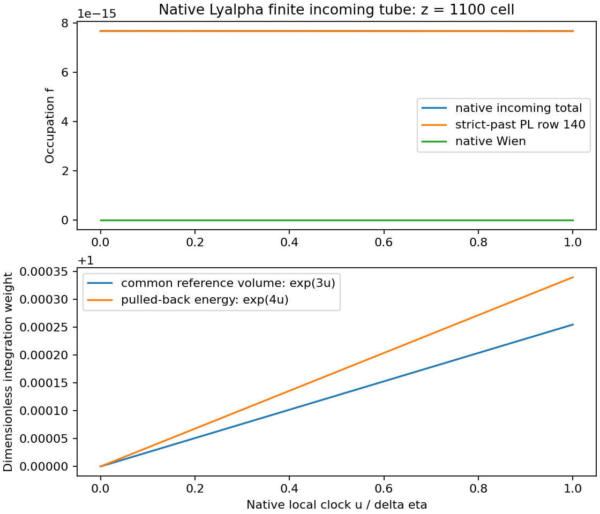

# B3h: 실제 native Lyα finite incoming photon tube

2026-10-27, Asia/Seoul. 판정: **ROOT_ADMITTED_PASS_SCOPED**.

실제 REC history의 native cell `[5126,5127]`에서 incoming photon tube, incoming-face crossing measure, 공통 부피, proper duration과 복사 sector tensor를 구성했다. 기존 B3g 운반 코드를 그대로 사용해 이 shell의 비충돌 운반까지 계산했다. 독립 검토를 마쳤고 새 8개 controls가 통과했다. 같은 interval의 절대 atomic stock과 non-Lyα/QSS 보충 장부가 아직 없어 원자 transaction과 새 B3i RHS는 `NOT_RUN_INPUT_DEPENDENT`이다. 전체 B3h 상태는 `PARTIAL_NATIVE_FINITE_PHOTON_TUBE_ATOMIC_INPUT_OPEN`이다.

## 1. 재사용한 완료 결과와 실제 입력

기존 science A2 `af14fc72d99f6d0e396f60aedadcdb5d05213280`, delivery F2 `009a1238c09adf889c7421132f530b960cdafb07`의 **512개 실제 cohort midpoint 재구성·최종 운반과 2개 B3i RHS**를 완료 결과로 재사용했다. 해당 tests/consume/plot은 재실행하지 않았다.

새 입력은 REC PR139 `d6dbe39a4923439547c01695d9020ba39367ea90`의 `data/pr05b2_source_history_v060.npz`이다. 원본은 35,239,470 bytes, SHA256 `d4f82542e13fed4ff0bb60b17865d8b9de5e090a2366108169c3da7a21fcb4b1`이다. 7,489개 native knots 중 z=1100을 포함하는 실제 인접 cell을 선택했다. virtual row140의 source knots 5123..5126, 원래 clock·constants와 snapshot META를 손실 없는 float.hex로 보존한 입력은 [FINITE_TUBE_INPUT_SLICE.json](inputs/FINITE_TUBE_INPUT_SLICE.json), SHA256 `0eb250e965ad3496d00b53d5a165bafc93de8506baa9dad8e04de2bbd3614cdd`이다.

native interpolation clock은 원래 binary64 eta0,h를 정확한 실수로 해석한 `eta0+i*h`이다. 저장 eta 배열의 최종 반올림 차이를 raw에 따로 기록했다. 초기 intake의 오른쪽 기준 제안은 보존하고, 고정된 consumer 계약에서 **왼쪽 hypersurface 기준 부피**를 선택했다. 원래 HyRec October-2012의 T0=2.728 K, kBoltz=8.617343e-5 eV/K, cosmology, H 및 nH 법칙을 그대로 사용했다. 기준 snapshot의 실제 z는 1099.9986525171403이다.

## 2. 구성과 source 대응

선택 모델은 native scalar FLRW 등방 정지계 `q=1`이다. `u=eta-eta_ref`, `0<=u<=h`, `h=8.49e-5`, `G=3e6*LYA_FACT=1.3988697202667691e22 m^-3`라 두면

\[
J_V=e^{3u},\qquad H\,dt=d\eta,\qquad
d\mu_0=G e^{3u}\,du\,\frac{d\Omega}{4\pi}.
\]

실제 incoming face는 `Esource=10.199581 eV`, `E21=10.198714553953742 eV` 사이의 characteristic이며,

\[
\delta=\log(E_{source}/E_{21}),\qquad
f_{in}(\eta)=e^{-E_{21}/T_R(\eta)}+
\operatorname{PL}[d_{140}](\eta-\delta).
\]

이는 native Wien departure convention이다. native source PL knot가 tube 내부를 지나므로 그 지점에서 두 적분 구간으로 나눴다. `delta-h=5.278877465967507e-8>0`이고 각 piece의 오른쪽 source sample도 해당 arrival보다 과거임을 확인했다. source endpoint와 arrival의 같은 시각을 허용하는 근사로 바꾸지 않았다.

각 incoming photon을 왼쪽 slice로 되돌리면 `E0=E21_J*exp(u)`이고,

\[
N_0=G\int_0^h e^{3u}f_{in}(u)\,du,\qquad
U_0=G E_{21,J}\int_0^h e^{4u}f_{in}(u)\,du,
\]

\[
T_0=\operatorname{diag}(U_0,U_0/3,U_0/3,U_0/3),\qquad \boldsymbol F_0=0.
\]

이 tensor는 선택된 incoming shell의 sector tensor다. shell 전체를 비충돌 상태로 오른쪽 slice까지 운반하는 control에는 `R=exp(-h) I`, `detR=exp(-3h)`를 적용한다. 따라서 `N1=exp(-3h)*N0`, `U1=exp(-4h)*U0`이다. 이 식은 기존 B3g 운반 모듈에 native FLRW map을 넣어 검증했으며, 과거 anisotropic finite14 trajectory를 새 geometry로 바꾸지 않았다.

## 3. 실제 수치 결과

| 항목 | 결과 |
|---|---:|
| crossing capacity μ | 1.187791651352076e18 m⁻³ |
| incoming N0 | 9117.092768838671 m⁻³ |
| pulled-back U0 | 1.4898091530925236e-14 J/m³ |
| proper duration ∫dη/H | 1708251102.5026681 s |
| 전체 구간의 f 양성 하한 | 7.672046131261324e-15 |
| 왼쪽 nH normalization | 250250485.05511948 m⁻³ |
| uncollided N1 | 9114.770941007773 m⁻³ |
| uncollided U1 | 1.4893032998028835e-14 J/m³ |

`nH`는 총 effective-H 정규화이며 상위/하위 원자 준위의 절대 stock을 제공하지 않는다. 실제 결과와 구간별 strict-past/positivity 근거는 [TUBE_RESULT.json](results/TUBE_RESULT.json), 그림의 원자료는 [TUBE_TRACE.csv](results/TUBE_TRACE.csv)에 있다.

## 4. 에너지와 four-force의 구분

왼쪽 기준 inventory와 각 photon이 자신의 line face에 도착했을 때의 에너지는 다르다. 안정적인 양의 integrand로

\[
W_{loss}=G E_{21,J}\int_0^h e^{3u}\operatorname{expm1}(u)f_{in}(u)\,du
=U_0-E_{21,J}N_0
\]

를 계산해 `6.323424461041997e-19 J/m³(V0)`를 얻었다. 대응하는 signed radiation change는 음수이다. 반면 shell 전체를 오른쪽 slice까지 운반할 때의 공통 초기 부피당 signed change는 `expm1(-h)*U0=-1.2647942796986586e-18 J/m³(V0)`이다. 두 값은 비교하는 endpoint가 다르다. 둘을 atomic heat 또는 recoil로 넣지 않았다.

원래 direct bound-bound convention은 local radiation `+E21*D`와 atomic internal `-E21*D`를 짝지으며 direct recoil/kinetic heat 및 electron/ion yield는 0이다. 이것은 해당 근사의 owner 규칙이며 실제 interval의 stock이나 보충량을 대신하지 않는다. 새 계산에서 T의 단위는 J/m³이고, cQ의 단위는 J/(m³ s)이다. 이번에는 atomic cQ나 새 B3i RHS를 평가하지 않았다. 향후 finite kick을 state에 반영한 뒤 같은 transfer를 추가 rate로 다시 적용해서는 안 된다.

## 5. 독립 수치 검증과 한계

주 계산은 PL departure의 stable exponential-times-linear endpoint 적분과 Wien term의 양의 24-point Gauss 적분이다. 독립 reference는 원래 binary64 입력을 정확한 정수 비로 해석한 70-digit mpmath piecewise quadrature다. 고정 수용 기준은 N/U/duration 상대차 `2e-11`, 비충돌 transport 상대잔차 `2e-13`이다.

| 항목 | signed primary/reference relative difference |
|---|---:|
| N | -2.688299962984027459e-17 |
| U | -4.706966050752376951e-17 |
| proper duration | -4.182979965611604898e-16 |

주 raw의 N/U 비교는 reference를 binary64로 먼저 투영해 0을 표시했다. raw는 그대로 보존하고 [NUMERICAL_COMPARISON_DETAIL.json](results/NUMERICAL_COMPARISON_DETAIL.json)에서 저장 고정밀 문자열과 exact binary64 decimal을 비교했다. 추가 적분은 없었다. 작은 crossing work를 큰 두 수의 차로 검산한 값은 direct positive integral에 대해 상대 `-2.21499056513567648e-12` 차이를 보이며, 이는 cancellation 진단이다.

이 수치는 **주어진 유한 represented input의 수치 구현**을 검증한다. physical `eS/en/eE/geometry/temporal/total` 반경은 모두 null이다. 기존 ANISO continuum–finite14 joint 차이 **3.447529542803539e-5**, finite14 재구성 잔차 **약1e-11**, continuum 계산의 수치 예산 **2e-8**을 별개 항목으로 유지한다.

## 6. 실제 atomic 입력 조사와 다음 실행점

REC PR139의 실제 history, 원래 HyRec source, native line owner, HISTORY01 boundary, PR05C1 macro 및 PR43 owner를 읽었다. history에는 `outgoing_lyman=xr_p/(3*x1s)` 비율이 있지만 interval의 절대 x1s/xr_p와 stock/refill arrays는 없다. 단일 snapshot을 전체 구간에 고정하면 다른 모델이 된다. PR05C1은 frozen coefficients/incoming 아래 electron 변수와 algebraic 2p를 처리하며 실제 direct-Lyα 대 non-Lyα 누적 준위 장부를 제공하지 않는다. PR43은 momentum owner 작업이다. 조사 범위를 넘어 모든 자료의 부재를 주장하지 않는다.

다음 최소 반환은 **동일 interval의 실제 x1s/xr_p 또는 동등한 절대 준위 상태, 초기·종료·prefix atomic stocks, non-Lyα/QSS 보충 장부와 대응 에너지 owner**이다. source opacity는 그 x1s로 `r0=LYA_FACT*H/(nH_cm3*x1s)`, `tau=A_EFFECTIVE/r0`를 계산할 수 있다. H·nH·공통 부피와 direct-line recoil-free 규칙은 이미 확보했으므로 새 미상 공급자로 요구하지 않는다.

실제 입력이 오면 native HISTORY01의 `A=-expm1(-tau)`, `D_up=∫A f_in dμ`, `D_down=∫A f_s dμ`를 사용하고 모든 prefix의 stock balance를 검사한다. 기존 B3b의 packet/stock/sector 의미를 재사용하되, 다른 stimulated bath 법칙인 LINE01 `gross_counts/commit_emission`을 native absorption에 호출하지 않는다. [NEXT_ATOMIC_RETURN_CONTRACT.json](NEXT_ATOMIC_RETURN_CONTRACT.json)이 구체적인 반환 필드와 에너지·B3i 연결을 고정한다. 선택하지 않은 미래 공급자는 추가 선행조건이 아니다.

## 7. 실행·검토·비용

처음 tests는 mpmath 부재로 `PACKAGE_MISSING` 실패했다. 실패 로그·원래 freeze·비용을 보존했고 workspace에만 `mpmath==1.3.0`을 설치한 뒤 승인된 tests_env_repair 한 번으로 8/8 controls를 통과했다. 과학 입력·수용 기준은 바뀌지 않았다. 새 actual consume 한 번과 저장 데이터 plot 한 번을 수행했다.

| 실행 | child CPU s | child wall s |
|---|---:|---:|
| 초기 PACKAGE_MISSING tests | 0.208552 | 0.21896447199833347 |
| tests_env_repair, 8/8 PASS | 0.274600 | 0.32040532199607696 |
| 새 finite tube consume | 0.254249 | 0.2688453830051003 |
| 새 plot | 2.049421 | 2.0729449639984523 |
| 누계, 실패 포함 | **2.786822** | **2.881160140997963** |

측정 wrapper CPU는 0.677662 s이다. 저장 결과의 Decimal 보충 산술은 별도 in-process CPU 0.000415 s/wall 0.000580568 s이며 interpreter/import/serialization 비용은 포함하지 않는다. 기존 알려진 child CPU 10.904214 s/wall 10.985060912003973 s, midpoint wrapper CPU 0.130123 s를 유지하고 나머지 overhead와 잔여 예산은 null이다. 새 bounded guard는 과거 예산을 reset하지 않는다.

Astra가 식·계약·수용 기준을 작성했고, 요청 model gpt-6.1-sol 구현자가 실행했다. 실제 runtime model identity는 노출되지 않아 null이다. 별도 Astra 검토자는 코드·실제 raw·원문·PNG를 직접 읽었고 과학 재실행은 0회였다. [INDEPENDENT_REVIEW.md](reviews/INDEPENDENT_REVIEW.md)와 [ADMISSION.json](ADMISSION.json)에 범위와 판정을 고정했다.

## 8. 중앙 반영·전달

최신 중앙선은 우리 이전 `12f6007a` 뒤의 CR_N5를 포함한 `5abe0d19df95db730e3e33bae0373c81ba37ce89`이다. 이 상태를 base로 B3h 관측·다음 행동만 갱신한다. 원래 88개 계약, 나머지 87개 노드, B3g/B3i, CR_N5와 병렬 작업을 보존한다. 이 부분 결과는 원래 완료 노드를 늘리지 않으므로 중앙선 선언은 **27/88, 증분0**, 전체 물리 완료율 null, L4=false, B4/B5 NOT_RUN이다. 다른 미병합 브랜치의 별도 진행률을 합산하지 않는다.

게시에는 expected SHA와 force=false를 사용한다. 실제 science/central/final 전달 SHA, source ZIP의 바이트·SHA256, Drive/Dropbox 실제 ACK는 후속 [PUBLICATION_RECEIPTS.json](delivery/PUBLICATION_RECEIPTS.json) 및 [FINAL_RECEIPTS.json](delivery/FINAL_RECEIPTS.json)에 기록한다. ZIP 내부에는 그 ZIP 자체의 최종 ACK를 소급해 넣지 않는다. 다음 재개 지점은 [HANDOFF_KO.md](HANDOFF_KO.md)이다.
