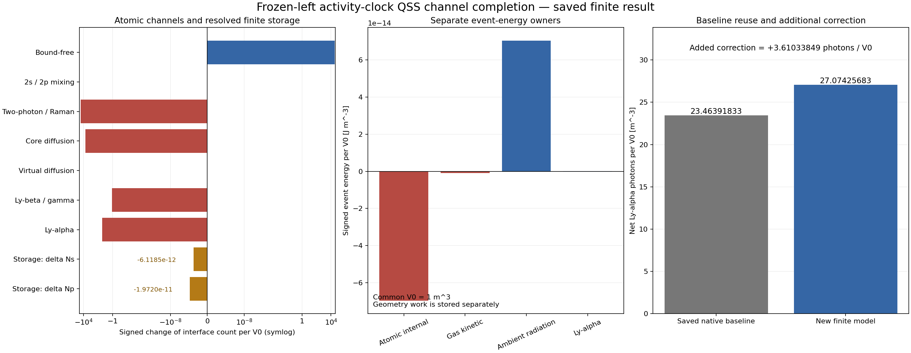

# Native effective-H의 유한 원자·복사·열 교환과 B3i 소비

2026-10-27. 과학 판정: **PASS_SCOPED_FINITE_NATIVE_SOURCE_DYNAMIC_COMPLETION**.
선택한 B3h 노드를 완료로 채택하여 **원 DAG 27/88 → 28/88, 증가 +1**이다.
정확한 판정과 근거 identity는 [ADMISSION.json](ADMISSION.json), 독립 검토는
[INDEPENDENT_REVIEW.md](reviews/INDEPENDENT_REVIEW.md)에 있다. 이후 원격 게시,
중앙 반영과 실제 백업 ACK는 `delivery/`의 실제 receipt에 별도로 결속한다.

## 1. 이번에 확보한 결과

실제 native 두 시점 5126·5127과 기존 유한 incoming Lyα tube를 출발점으로,
source의 원자 채널·에너지 모멘트를 복원하고 하나의 명시적인 유한 동역학을
구성했다. 유한 원자 재고와 기체 열, 주변 복사, Lyα 광자를 같은 기준 부피에
결속했다. 원자수와 사건 에너지를 보존하고, B3g의 팽창 운반을 적용한 뒤,
다섯 sector의 응력 텐서와 four-force를 **새 B3i RHS 한 번**에 실제로 넣었다.

새 결과는 native 원본의 시계열 전체를 다시 푼 결과가 아니다. 왼쪽 실제
source의 non-Lyα 채널 비율을 Lyα activity에 대해 고정한 유한 모델이다.
원 native incoming Lyα 이력과 공통 부피·시간 관계는 그대로 유지한다.
이 선택과 absolute diffusion의 Wien 항 복원, finite memory를 함께 포함한
결과가 기존 QSS 기반 광자 결과에 대한 새 보정이다.

| 관측량 | 기존 완료 결과 | 이번 선택 모델 |
|---|---:|---:|
| Lyα incoming count, 기준 부피당 | 9117.092768838671 | 같은 저장 결과 재사용 |
| Lyα outgoing count, 기준 부피당 | 9140.556687173560 | 9144.167025667558 |
| Lyα 순 하향 교환 count | 23.4639183348891 | 27.0742568288872 |
| outgoing count 추가 보정 | — | +3.61033849399816 |
| 왼쪽 기준 outgoing 에너지, J/m³ | 1.4936433534460712e-14 | 1.4942333212803939e-14 |
| 그 에너지의 추가 보정, J/m³ | — | +5.899678343227504e-18 |
| 오른쪽 운반 후 outgoing 에너지 밀도, J/m³ | 1.493136198283061e-14 | 1.493725965798324e-14 |

기존 raw의 binary64 순교환 값은 23.46391833488862이다. 위 비교에는 보존된
독립 고정밀 reference 23.463918334889087…를 썼으며, 두 표현의 차이를 숨기지
않았다. **+3.61034는 모델 선택에 따른 차이이다.** 수치 잔차, 물리 오차
반경 또는 정확도 개선을 인증하는 수치로 해석하지 않는다.

## 2. 최신 근거를 조사하고 재사용한 범위

시작점은 이전 inverse 전달 F=`6bf4a5d90b05f7e583be698854e521d259287837`,
source S=`0bdbd2ad1357c4b3141d3488a94534d082d1a0cf`였다. 원래 사용자가
고정한 A2=`af14fc72d99f6d0e396f60aedadcdb5d05213280`와
F2=`009a1238c09adf889c7421132f530b960cdafb07`의 512 실제 cohort 운반과
두 B3i 소비도 그대로 재사용했다.

12:16–12:21 UTC의 조사에서 보이는 owner repository 목록의 끝까지 도달했다.
51개 repository 중 공개 35개, 비공개 16개라는 집계만 공개 기록에 남겼다.
선택된 일곱 과학 repository의 branch/PR metadata는 모두 마지막 페이지까지
읽었다. 아래 수치는 이번 새 branch/PR205 생성 전 관측값이다.

| Repository | Branch | PR |
|---|---:|---:|
| bass | 289 | 204 |
| rec_bianchi | 157 | 139 |
| rei_bianchi | 282 | 239 |
| BASS_HE | 107 | 102 |
| bass_cr | 187 | 109 |
| WU088_HH | 159 | 150 |
| vigilode | 218 | 90 |
| 합계 | 1399 | 1033 |

변경된 BASS DV2-D, 중앙 parallel PR240, CR PHYS02, WU R6,
Vigilode PR90의 실제 고정 파일을 읽어 영향 범위를 정리했다.
REC 157 branch tip·139 PR head는 이전 inventory와 같았다. BASS DV2-D의
순간 Bianchi-V 생성자, CR의 자체 100K bath 결과, WU의 구간 Gibbs 결과,
HE PHOTON05의 운동학 결과는 각각 보존하고, 선택한 native H 입력과
실제로 연결되지 않는 결과를 이미 연결된 공급자로 간주하지 않았다.
중앙 parallel 작업의 자체 32/88과 canonical 27/88은 서로 다른 집계였다.

Dropbox BASS168·REC163·CR162와 Drive BASS116·REC56·CR144 목록도
기존 조사와 비교했다. Drive HE는 1000개 응답 제한에 도달하여 전체 폴더
전수 완료라고 하지 않았다. 제공된 20개 프로젝트 파일의 이름·크기와 기존
member inventory는 재사용했고, 새 전체 byte hash를 확인했다고 주장하지
않았다. 대화 검색 도구는 실제로 unavailable을 반환했다. 제공된 대화
문맥은 사용했지만 다른 모든 대화를 읽었다고 하지 않는다.

세부 원전·고정 SHA·접근 범위는 `survey/LATEST_SOURCE_DELTA_REPORT.md`,
`survey/INTAKE_REPORT_KO.md`, `survey/BACKUP_SOURCE_INTAKE.json`에 있다.
중앙 작업은 `152b82cac23fedcb75a9effe0c159bae3d800c01` 뒤에서 시작하며,
CR_N5와 CR proper return을 포함한 최신 병렬 결과를 보존한다.

## 3. 실제 source에서 새로 얻은 원자 계수

입력은 REC commit `d6dbe39a4923439547c01695d9020ba39367ea90`의 원 C 식,
원 rate·two-photon 표, 두 시점의 311개 incoming/average/outgoing trace다.
오른쪽 native snapshot은 reconstruction 후 검증에만 사용했다.
Phase A는 한 번 실행했고 **67/67 검사**를 통과했다.

### 3.1 물질 온도와 원 block

새 diffusion 경계 bin100·179의 두 trace ratio로 각각 광학깊이와 물질 온도를
역산했다. binary64와 독립70자리 비교의 상대차는 1.33e-13 이하였다.
두 bin을 source `rec_Tmss` 식과 대조한 뒤 downstream 계수에는 검증된
source 온도를 썼다.

| Knot | source Tm, eV | bin100 역산 Tm | bin179 역산 Tm |
|---|---:|---:|---:|
| 5126 | 0.25884325362029575 | 0.2588432535166457 | 0.25884325350862136 |
| 5127 | 0.25882127610727856 | 0.25882127625683937 | 0.2588212760895028 |

오른쪽 source Tm은 holdout과 일치했다. cancellation에 민감한 Tvv, sv,
one-minus-P의 최대 상대차는 약1.55103138e-8로 고정5e-8 기준 안에 있다.
모든 source operand가 bitwise 같다는 주장은 하지 않는다.
오른쪽 proper-time Schur 행렬은 다음과 같다. 단위는 s⁻¹이다.

\[
M_1=\begin{pmatrix}
2506.471805114865&-777.683181197143\\
-2333.049543591412&938.572506241979
\end{pmatrix}.
\]

두 고유값은 약3281.0312와164.0131이다. 양수 Thomas 분모와 M-matrix 부호를
확인했다. Real-row gross 상대잔차는 최대5.27e-15, virtual-row는2.204e-10이다.

### 3.2 성공한 effective bound-free 채널의 에너지 모멘트

원 effective recombination 계수를 고정 radiation temperature에서

\[
\alpha_i(T_m,T_r)=C T_m^{-3/2}\int W_i(\epsilon;T_r)e^{-\epsilon/T_m}d\epsilon
\]

로 쓰면, 포획되는 전자·양성자 상대운동 에너지의 평균은

\[
K_{{\rm rec},i}=\tfrac32T_m+T_m^2
 (\partial_{T_m}\ln\alpha_i)_{T_r}.
\]

역 effective kernel의 detailed balance를 적용하면

\[
K_{{\rm ion},i}=\tfrac32T_r+T_r^2
 (\partial_{T_m}\ln\alpha_i)_{T_m=T_r,\,T_r\;fixed}.
\]

두 번째 미분은 \(\alpha(T,T)\)의 total derivative가 아니다. 원 표의 log-Alpha
interpolation polynomial을 고정 Tr에서 해석적으로 미분했다.

| 시점·채널 | Krec, eV | Kion, eV |
|---|---:|---:|
| 5126, 2s | 0.199931687876992 | 0.199933765484176 |
| 5126, 2p | 0.154098098174049 | 0.154099667016183 |
| 5127, 2s | 0.199916753770003 | 0.199918833255704 |
| 5127, 2p | 0.154086585979874 | 0.154088156237136 |

\(\chi=E_I-E_{21}\), 성공한 재결합·광이온화 count rates를 R,I라 하면

\[
\dot E_{atom}=-\chi(R-I),\quad
\dot E_{gas}=-K_{rec}R+K_{ion}I,\quad
\dot E_{rad}=(\chi+K_{rec})R-(\chi+K_{ion})I.
\]

합은 사건별로0이다. 이 식은 source rate에서 얻은 실제 선택 채널의
에너지 계정이며, 미지의 보존 잔차를 임의 공급원으로 바꾸지 않는다.
Interface에 도달하지 않는 continuum-return cycle은 이번 선택에서 제외된
다른 채널이다. 그것의 전체 공급자 완성을 이 유한 교환의 선행조건으로
추가하지 않았다.

Primary 근거는 Ali-Haïmoud & Hirata의
[Ultrafast effective multi-level atom method for primordial hydrogen recombination](https://arxiv.org/abs/1006.1355),
HyRec의 [원 방법론](https://arxiv.org/abs/1011.3758), 그리고
[Effective conductance method for the primordial recombination spectrum](https://arxiv.org/abs/1211.4031)이다.
실제 SciSpace·Exa 원문 확인과 Wolfram symbolic check 입력·출력은
`theory/PRIMARY_EVIDENCE.json`, `theory/WOLFRAM_NEW_CHECKS.json`에 있다.
첫 Wolfram 호출의 protected-symbol naming 오류와 그 한정 수정도 보존했다.

## 4. 유한 동역학과 보존식을 함께 구성한 방법

### 4.1 source의 departure 변수와 절대 diffusion

Source는 \(x_r=p-q_r\), \(x_v=X_v-q_v\)를 사용한다. Reference q는 Tr의
Wien 값이고 diffusion detailed balance는 Tm에 있으므로 둘이 같지 않으면
\(d=-T_{diff}q\)가 남는다. 이 알려진 항을 복원한 absolute 모델을 선택했다.
Virtual 변수를 양수 tridiagonal inverse로 소거해 \(X_v=a+Bp\)를 만들었다.
각 채널의 positive gross maps를 먼저 만들고 같은 stoichiometry로 M,b를
구성했다. 원 source의 rounded diagonal 재조립 차이는 별도 수치 진단이다.

실제 선택 채널은 성공 bound-free, 2s↔2p, two-photon/Raman, core diffusion,
virtual diffusion, Lyβ/γ와 direct Lyα이다. 총 **1414개 non-Lyα gross affine
maps**가 비음수이며, direct Lyα incoming은 실제 이력을 별도로 사용한다.
Virtual proxy 311개를 추가 원자 준위나 독립 초기 photon stock으로 세지 않는다.

### 4.2 native crossing clock

\(u=\ln(a/a_0)\), \(0\le u\le h=8.49\times10^{-5}\)이고
\(g(u)\)는 실제 두 x1s endpoint의 선형 보간이다. 기준 부피는1m³,
\(N_{H,0}=250250485.05511948\), proper duration은 저장값
\(1.708251102502668\times10^9\)s다.

\[
R_\alpha=\frac{\mathrm{LYA\_FACT}\,H}{n_Hg},\quad
ds=R_\alpha dt,\quad n_H=n_{H,0}e^{-3u},\quad
f_{out}=\frac{p_p}{3g}.
\]

따라서 원자 current와 photon incoming-face measure는 정확히 같은 식이다.

\[
N_{H,0}R_\alpha dt(p_p-3gf_{in})
=G e^{3u}du(f_{out}-f_{in}),\qquad G=3\times10^6\mathrm{LYA\_FACT}.
\]

왼쪽 non-Lyα map/Ralpha0를 고정하면

\[
\frac{dp}{ds}=b_{nL}+3gf_{in}e_p-\bar M p
\]

의 행렬은 상수다. 이번 activity 길이는 약1.850439236e9이며,
실제 열 합으로 얻은 contraction 상수는148.68192648이다.

\(K=\bar M^{-1}\)에 대해 smooth segment의 particular solution은
\(Kb-K^2b_s+K^3b_{ss}\)로 계산하고, 초기 완화층과 실제 incoming knot의
연속성을 보존했다. 미분 잔차는 \(K^3b_{sss}\)이며 physical source가 아니다.
구간 재시작의 carry-in 오차도 지수 감쇠와 함께 운반했다.

큰 cosmological 시간 폭에 explicit stiff step을 나열할 필요가 없다.
다음 항등식이 좁은 초기 완화층까지 포함한 population 적분을 준다.

\[
I_p=\int p\,ds
=K\{b_{nL}S+e_pN_{in}^{saved}/N_{H,0}-(p_1-p_0)\}.
\]

같은 Ip로 모든 gross counts를 계산하여 큰 왕복 횟수의 상쇄와 작은 excited
storage를 하나의 원자수 계정에 연결했다. 복사는 \(e^u\), 기체 열은
\(e^{2u}\)로 가중한 적분 항등식과 명시적 remainder bound를 사용한다.
새 smooth 적분만 MP16/24점 Gauss와 Cauchy remainder로 확인했다.

### 4.3 finite atomic stock

초기 source g=1−xHII는 opacity parameter다. 유한 ground 재고는
\(N_g=N_H-N_c-N_s-N_p\)로 별도 정의하여 작은 excited stock도 원자수에
포함했다. 아래 수치는 source 평균장으로부터 얻은 유한 기대 count이며,
정수로 반올림하지 않았다.

| 재고, 기준 부피당 | 초기 | 최종 |
|---|---:|---:|
| Ground H | 213949742.19972766 | 213981698.80862751 |
| 2s | 1.643748471157452e-6 | 1.643742352629844e-6 |
| 2p | 4.941629582012267e-6 | 4.941609861635354e-6 |
| Ionized H 및 electron | 36300742.85538524 | 36268786.24648538 |

Net continuum 감소는31956.60889985789개다. 두 interface의 작은 저장 변화는

\[
\Delta N_{2s}=-6.11852760838301\times10^{-12},\quad
\Delta N_{2p}=-1.97203769125562\times10^{-11}.
\]

원자 채널 count로 얻은 변화와 이 finite endpoint storage의 차이는 각각
약−3.930e-64, +2.891e-64이다. 큰 gross count만을 분모로 둔 검증으로
이 작은 storage를 가리지 않았다. Ground와 continuum의 gross debit,
interface의 양수 비교해, 팽창 가중치를 포함한 gas·ambient debit 한계도
실제 검사에서 통과했다.

## 5. 열·동반 복사·직접 Lyα를 구분한 에너지 계정

Direct native Lyα의 recoil 열은 선택한 source 모델에서0이다.
그러나 전체 선택 채널의 기체 열 교환은0이 아니다. Bound-free는 위 kinetic
moment를 쓴다. Core→virtual diffusion의 \(E_{21}-E_b\)와 virtual scattering의
\(E_b-E_c\)는 gas에 귀속한다. Two-photon/Raman의 같은 형태의 energy difference는
companion radiation에 귀속한다. 이 두 owner를 합치지 않았다.

주변 복사 재고는 실제 왼쪽 평균 departure를 energy node 사이에서 선형 보간하고
source Wien background를 더한 finite spectrum이다. Node 범위 밖은 source
Planck bath를 사용한다. 그 spectrum에서 선택한 Lyα characteristic shell을
한 번 제거하고 실제 저장 incoming cohort를 넣어 중복을 피했다.
모든 bin에서 양수성을 해석적으로 확인했다. 이 spectral completion 자체는
명시적인 모델 선택이며 물리 오차가 인증된 연속 spectrum이라는 주장은 아니다.

| Sector | 사건 교환 에너지, J/V0 | 기하 work, J/V0 |
|---|---:|---:|
| Cold rest carrier | 0 | 0 |
| Atomic internal | −6.962340429615759e-14 | 0 |
| Gas thermal | −8.692142933008802e-16 | −3.236594506618775e-15 |
| Ambient radiation | +7.044837886892548e-14 | −5.228949650571158e-6 |
| Selected Lyα | +4.423972053298817e-17 | −1.266588893332820e-18 |

사건 에너지 합의 관측 잔차는9.597e-82J/V0다. 큰 ambient Planck 재고의
팽창 work는 작은 원자 교환보다 훨씬 크므로 사건 교환과 분리했다.
오른쪽 density에 \(V_1/V_0=e^{3h}\)를 곱한 공통 부피 에너지로 비교했다.
Dust·atomic internal work는0이고 gas/radiation work는 각각 알려진
adiabatic 가중식에서 직접 구했다. 미설명 보존 잔차를 work로 정의하지 않았다.
전체 공통 부피 work identity 잔차는2.279e-73J/V0다.

## 6. Sector T와 four-force의 실제 B3i 결속

오른쪽 proper volume에서 \(T^{00}=U\), \(T^{ii}=p\)이고 모든 sector는
등방이다. Gas는 \(p=2U/3\), radiation은 \(p=U/3\), rest/internal은 dust다.
Four-force는 사건 에너지의 finite-step 평균을 같은 오른쪽 부피로 변환한
명시적인 source다. 원 native solver의 pointwise RHS export라고 하지 않는다.

| Sector | T00, J/m³ | 각 공간 대각 pressure, J/m³ | cQ0, J/(m³ s) |
|---|---:|---:|---:|
| Rest dust | 4.9513808238427465e-2 | 0 | 0 |
| Atomic internal | 7.899815968125767e-11 | 0 | −4.0746745821632375e-23 |
| Gas thermal | 1.9054309556307252e-11 | 1.2702873037538168e-11 | −5.087032763150225e-25 |
| Ambient radiation | 6.157121433976291e-2 | 2.0523738113254305e-2 | +4.122955802488079e-23 |
| Outgoing Lyα | 1.493725965798324e-14 | 4.9790865526610795e-15 | +2.589107306660677e-26 |

\(Q^0=cQ^0/c\), 단위는 J/m⁴다. 공간 four-force가0이라는 사실은 공간
stress 또는 radiation pressure가0이라는 뜻이 아니다. 보존된 `si_to_core`,
`FixedScale`과 원 `core.rhs`를 사용했다. 새 호출 수는 **1**이며, 독립적으로
쓴 등방 core 식과 각 자체 scale에서 비교했다. 관측 binary64 차이는0이었고
고정 허용값은5e-12였다. 이 관측0을 모든 물리 오차가0이라는 주장으로
확대하지 않는다. 이 selected packet에 전체 Friedmann closure를 요구하지 않았다.

## 7. 수치 검증·자원·그림

Phase A1회와 Phase B1회는 모두 exit0이며, 과학 재시도는0이다.
Phase A는67검사, Phase B는379검사를 통과했다. Phase B raw 파일은
3,554,206bytes, SHA256
`a0fa9b5237481e66f178f19eb1589607412d9d1188d7fb571e5df03b67fd93ac`다.
독립 검토자는 과학 실행을 반복하지 않고 변경 코드·원 source·실제 raw·ledger와
원 B3h gate를 대조했다.

| 실행 | Child CPU, s | Child wall, s |
|---|---:|---:|
| Phase A source operands | 1.129564 | 1.245074523 |
| Phase B finite transaction 및 새 RHS | 3.347319 | 3.376505556 |
| 새 saved-only 그림의 첫 render | 9.253270 | 9.477698659 |
| 한정된 그림 축·범위 수정 | 1.859278 | 1.892822857 |
| 합계 | **15.589431** | **15.992101595** |

새 cumulative allocation은 CPU60s/wall180s/RSS768MiB/one thread였고,
위 child 합계 뒤의 미사용분은44.410569 CPU초·164.007898405 wall초다.
Wrapper·포장·network/model 작업은 별도 기록하며, 이 child 합계를 모든
준비 비용의 총합이라고 하지 않는다. 기존 allocation의 미상 잔여는 null이며
새 예산으로 덮어쓰거나 재개하지 않았다.

첫 그림은 실행 exit0 뒤 실제 시각 검토에서 겹친 눈금과 잘린 막대가 발견됐다.
그림은 검수 완료로 채택하지 않았고, 원 PNG를 보존한 채 저장된 결과만 읽는
한 번의 렌더링 수정을 명시적으로 승인했다. 기존 또는 새 과학 계산을 다시
돌리지 않았다. 최종 그림은 다음 파일이다.

실행 당시 입력·코드 freeze, phase별 stdout/stderr와 append-only ledger,
조건부 numerical bounds는 모두 source ZIP에 보존한다. 최종 그림 시각 검토는
별도 `reviews/VISUAL_REVIEW.md`로 남겨 고정 과학 review를 다시 바꾸지 않는다.

## 8. 오차·모델 선택·완료 판정의 경계

이번에 계산한 analytic remainder와 MP allowance는 이미 채택된 incoming
moment 숫자를 고정 입력으로 둔 조건부 수치 결과다. 저장된65자리 string의
half-last-unit은 표현 반올림만 제한한다. 옛 mp.quad의 미기록 remainder를
새로 인증하지 않으며, 옛2e-11은 acceptance tolerance로만 보존한다.
그 전체 inherited error와 물리 source error는 null이다.

| 양 | 뜻 | 이번에 물리 반경으로 승격했는가 |
|---|---|---|
| 3.447529542803539e-5 | ANISO continuum–finite14 joint 차이 | 아니오 |
| 약1e-11 | 기존 finite14 수치 재구성 잔차 | 아니오 |
| 2e-8 | 기존 continuum 계산의 수치 예산 | 아니오 |
| 이번 약1e-64 count residual | 같은 finite MP ledger의 산술 보존 | 아니오 |
| +3.61033849 photons/V0 | 이번 선택 모델과 기존 결과의 차이 | 아니오 |

eS/en/eE/geometry/temporal/total의 물리 반경은 모두 null이다.
Global physical completion도 null, L4_ready는 false다. 기존512cohorts·두 RHS,
이전 inverse/tests/consume/plot/native solver 재실행은0이다.

그럼에도 B3h의 원 scope는 ‘고유 원자 owner를 갖는 하나의 유한 native 광자
흡수/방출 교환’이다. 실제 native source, 양수 gross currents, 유한 donor,
닫힌 에너지/four-force와 원 source의 spontaneous/stimulated 구분을 확보했고,
한 번의 B3i 소비까지 마쳤으므로 그 기존 유한 scope는 완료로 채택했다.
전체 미래 공급자나 모든 물리 반경 인증을 이 scope의 새 일괄 선행조건으로
추가하지 않았다. 다른87노드와 기존 source 계약·의존성은 유지한다.

## 9. 재사용과 다음 선택 연구

이 유한 transaction은 완료 근거로 재사용한다. 다음 작은 연구를 선택한다면
이미 확보한 양끝 gross channel maps를 proper time에서 양수 선형 보간하여
왼쪽 비율 고정을 완화할 수 있다. 기존 `theory/FINITE_DYNAMIC_CLOCK_CONTRACT.md`의
변수 M(t), finite-memory approximation, carry-in error bound가 출발점이다.
새 trajectory와 photon correction만 계산하고 이 결과와 비교한다.
원 native 오른쪽 QSS endpoint를 새 동역학의 끝값으로 강제하지 않는다.

이 후속 선택은 이번 완료 판정의 미완료 조건이 아니다. 새로운 식·비교·예산을
고정할 때 처음 바뀌는 이론 단계에서 재개한다. 완료된 native inversion,
source operands, incoming tube, 이번 transaction/RHS와 그림을 자동으로
재실행하지 않는다. 정확한 다음 인계와 게시·백업 identity는 `HANDOFF_KO.md`
및 `delivery/`의 최종 실제 receipt를 참조한다.
