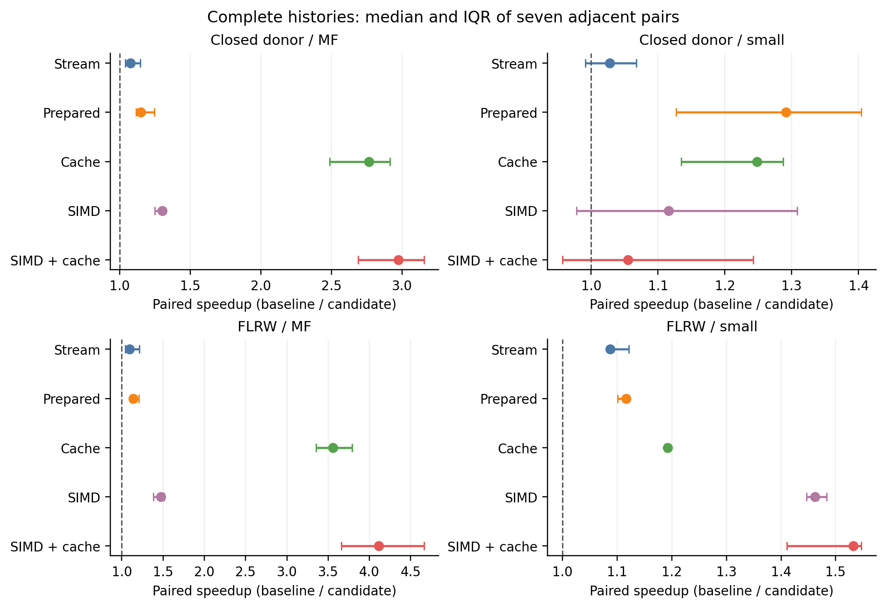
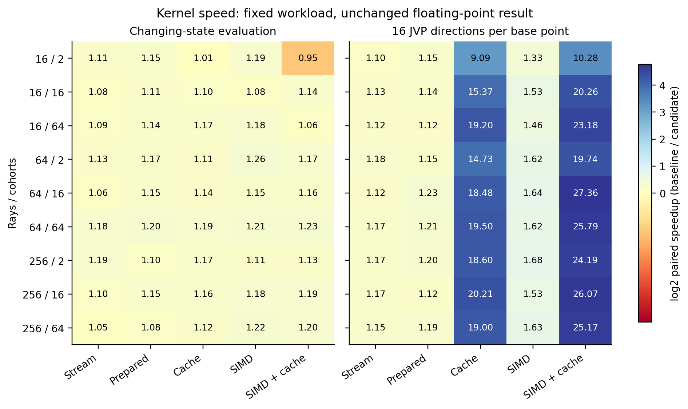
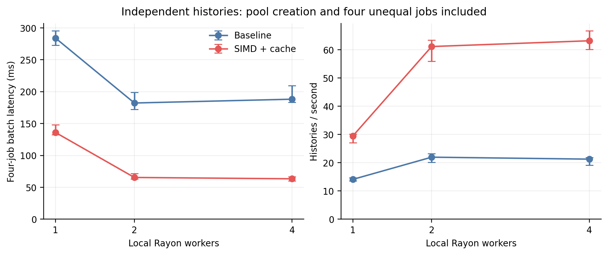

# S10 최적화 연구 결과 — 같은 과학 출력에서 비용 줄이기

> **후속 C9 완료:** 한 번의 독립 검토에서 155/155 checks와68/68 science gate PASS. 문서 표현 finding1건은 같은 pass에서 수정 확인해 닫았다. [독립 review receipt](evidence_s10/c9_review_r1/C9_REVIEW_RECEIPT.json), [검토 당시 결과보고서](evidence_s10/c9_review_r1/REVIEWED_S10_RESULTS_KO.md). 아래 C7/C8 checkpoint 당시 진행 상태 문장은 역사 기록이며, 최신 상태는 DAG와 이 안내를 따른다.

## 현재 판정

**고정 네 입력의 전체 과학 출력을 유지한 상태에서 matrix-free history의 SIMD+exact-cache 중앙 가속비 2.973배와 4.115배를 관측했다.** 같은 방법의 small/clock4 closed-donor 이력은 1.055배, IQR 0.957–1.243으로 일관된 이득을 인정하기 어렵다. 작은 changing-state kernel 한 조건의 중앙 가속비 0.950도 그대로 보존한다. 이번 결과는 opt-in 연구 client와 명시한 입력·CPU·compiler 범위이며 원 owner나 production 기본 경로를 교체하지 않는다.

Release 구현 검증11/11, kernel bit proof108/108, 전체 대표 RAW24/24 동일, 모든 serial/parallel 출력 동일성 및 기존 science gate68/68을 통과했다. 사전등록한 표본은 전부 수집했고 추가 timing/ODE 재시도는 없다. C9 실제 독립 검토는 이 C7/C8 checkpoint 당시 진행 중이다. 과학적 유효성·source provenance·게시·두 provider의 백업 상태는 각각 판정한다. Drive 내용 쓰기는 아직 blocked이므로 이중 백업 완료라고 표시하지 않는다.

## 1. 재사용한 완료 증거와 source

- 기준 S9 source: `4b30957cb008aad8019bb1a673937fc67bd017e8`; 실제 결과 publication: `a40311796f9aac5ea5e0e58c630bee2a78443353`.
- 이번 최적화 source: `d5a173644f5c7c0dbe9eb8757dfc4ccad6c4f4c8`, tree `95785be65c196c68d61b79dafb32f4cedfd7702d`.
- Frozen source/input manifest SHA256: `4ac631dced7e1d4fdc8ce63d076dfe15bb38bde7040029644e2c34f30b1ebc17`.
- 원 REI spectral owner: `0e25846433170d0f420c4cda44a0bedbf02cd177`; 실제 VigilODE: `a21d573980f66fe02891bd216153443b5352f921`.
- Timing binary SHA256: `375d95ae4dfdd96fef96c8b96a17fa966e0cd6b14063b14a79d867c2233f8265`.
- 별도 allocation binary SHA256: `4ab9bf3013f0ef599a9bd06b5e6458f04ca697c727250e58bc8750ca6f8474b3`.

S6–S8 완료 자료를 확인·재사용했고, 미실행이었던 S9의 고정8이력은 이 세션 앞 단계에서 한 번 실제 실행하여 8/8완료·140/140 quality 판정·독립 검토를 게시했다. 이번 성능 반복은 그중 네 입력을 사용한다. 496회 benchmark history 호출을 새로운 물리 사례496개로 세지 않는다. 기존 네 입력의 저장 debug RAW와 이번 release baseline도 timing 필드 외 전체 scientific binary64 값이 실제로 같았지만, 이 사실을 다른 빌드/입력에 일반화하지 않는다.

## 2. 외부 문헌·코드를 어떻게 재사용했나

[R2 조사](evidence_s10/r2/R2_REUSE_KO.md)는 SciSpace2회·Exa3회 검색, primary URL25회 취득 시도 중23회 내용 수신, 고유22URL, 실제 관련 절을 검토한9개 source 묶음을 보존한다. 후보·검색 수를 논문 완독 수로 표현하지 않는다. [원 검색·취득 receipt와 버전](evidence_s10/r2/REUSE_SOURCES.json)을 함께 남겼다.

Collange 등의 reproducible reduction 논문과 He–Ding의 compensated summation 논문에서 독립 원소 계산·합산 순서·오차 축적의 차이를 가져왔다. 이번 코드는 superaccumulator를 도입한 것이 아니라 원 Neumaier의 성분별 순서와 괄호를 그대로 유지한다. LLVM의 vectorizer 문서와 Rayon의 reduction 계약을 근거로 병렬 horizontal reduction을 피하고 ray별 elementwise SIMD만 사용한다. EPIRK-W/K 논문은 다른 point의 Jacobian 재사용에는 별도 order 조건이 필요함을 확인하는 근거로 썼다. 현재 cache는 같은 point의 같은 함수값만 읽는다.

실제 코드에서는 고정된 원 S9/VigilODE API를 재사용했고, 기존 lock/vendor의 Rayon1.12.0과 stable Rust `std::arch`를 사용했다. 원 lock의97개 package record는 유지하고 local root crate만 추가했다. Pulp0.22.3·Wide·nightly portable SIMD는 조사한 대안이며 이번 직접 도입으로 세지 않는다. 논문의 외부 benchmark 수치를 BASS 속도 추정치로 가져오지 않았다. `Wolfram` 실제 호출은 아래 두 미분 항등식·범위·reflection을 검산했고 CAS의0을 binary64 동일성 증거로 대체하지 않았다.

## 3. 수식과 구현 계약

Non-tilted axisymmetric Bianchi I, signature(-,+,+,+), a_perp=a exp(-b), a_parallel=a exp(2b), s=dot b, Sigma=sqrt(3)|s|/H를 유지한다. 한 cohort에서 d=b-b_birth, z=mu², a=exp(2d)(1-z), c=exp(-4d)z, R=sqrt(a+c), N=c-a/2, D=N/R이다. 그러면

\[
R_b=-2D,\qquad D_b=-\frac{a^2/2+7ac+2c^2}{(a+c)^{3/2}}.
\]

q=c/(a+c)에 대해 D_b=-R(1/2+6q-9q²/2), q∈[0,1]이므로 양의 weight에서는 -5E/2 ≤ partial_b Pi ≤ -E/2다. [유도와 overflow/cache 경계](S10_THEORY_KO.md), [Wolfram 원 receipt](evidence_s10/WOLFRAM_KERNEL_IDENTITIES.json)를 참조한다. 이 대수 변형 자체는 이번 실행 kernel에 적용하지 않고 원 multiply/divide 그래프를 보존했다.

| 구현 | 비용을 바꾸는 부분 | 보존 조건 |
|---|---|---|
| stream | ray/cohort 임시 Vec를 세 개 보정 accumulator로 대체 | 각 성분의 원 합산 순서·분기·최종 sum+correction |
| prepared | immutable mu², weight를 SoA로 준비; 1-z는 평가 시 계산 | 원 birth data 불변; 지수는 차이 d와 x-u로 계산 |
| cache | bank-local RHS/Ft와 J 계수의 두 제한 slot | x,h,b,y의 정확한 to_bits key; 새 방향에는 새 Jv; 새 bank에는 새 cache |
| simd | 4×f64 ray별 sqrt/div/mul | 원 괄호, ordered scalar reduction, scalar fallback/tail |
| simd_cache | 위 SIMD와 exact cache 결합 | 위 두 조건 모두 |
| independent batch | local Rayon pool의 독립 history | birth/segment 내부는 순차, 입력 순서로 결과 수집 |

기존 광자장·물리적 anisotropic stock·birth weights·reflection·source frame·spectral owner를 바꾸지 않았다. 새 명시적 isotropic birth는 원 P24와 exact moment gate3/10^15를 그대로 통과해야 한다. Cache는 근접 state의 재사용, solver tolerance 변경 또는 approximate Jacobian이 아니다. 실제 SIMD는 AVX packed 연산에 보수적인 AVX2 runtime guard를 사용한다. 해당 binary symbol의 packed sqrt/div와 FMA 없음은 확인했지만 전체 upstream binary의 instruction을 모두 제한했다고 주장하지 않는다.

## 4. 고정한 측정 설계와 실제 완료 수

| 측정 | 실제 완료 | 표본의 의미 |
|---|---:|---|
| targeted C6 | 11 tests PASS | 코드의 경계/불변성 위험; run30회=정상23+예상입력실패7 |
| kernel strict proof | 108 records ×64 queries | 9 node/cohort grid ×2 traces ×6 modes |
| kernel timing | 1,260 batches | 각 조건/후보의 인접 baseline-candidate7쌍 |
| fresh diagnostics | 108 records ×64 calls | hit/miss/full evaluation; timing 밖 |
| evaluator preparation | 378 samples | 54조건×7; bank clone/drop 제외 |
| serial whole history | 24 warmup +280 timed calls | 4고유입력×6대표RAW; 후보별7쌍 |
| independent parallel | 6 warmup +42 timed batches | workers1/2/4, baseline/simd_cache, 4입력=batch |
| allocation probe | 108 records ×64 calls | 별도계측binary; 추가history0 |

Compile과 timing은 동시 실행하지 않았다. Pair는 고정 rotation과 AB/BA 순서를 사용했고 N=7의 median·Q1·Q3는 `(N-1)p` 선형보간이다. IQR은 신뢰구간이 아니다. Candidate마다 인접 baseline을 사용하므로 서로 다른 후보의 baseline median을 합쳐 재계산하지 않는다. 병렬의 worker1 대비 비율은 다른 block의 관측이며 인접한 인과 pair로 표현하지 않는다.

## 5. 전체 history 성능

값은 baseline/candidate의 **각 pair 비율을 먼저 계산한 뒤 취한 중앙값**이다.

| 고유 입력 | stream | prepared | cache | simd | simd_cache |
|---|---:|---:|---:|---:|---:|
| Closed donor · MF | 1.076 | 1.150 | 2.766 | 1.303 | 2.973 |
| Closed donor · small/clock4 | 1.027 | 1.292 | 1.248 | 1.115 | 1.055 |
| FLRW · MF | 1.091 | 1.137 | 3.556 | 1.474 | 4.115 |
| FLRW · small/clock4 | 1.088 | 1.116 | 1.192 | 1.462 | 1.532 |

SIMD+cache의 시간과 변동 범위는 다음과 같다. 두 시간 중앙값의 비율은 paired ratio 중앙값과 반드시 같지 않다.

| 입력 | baseline 중앙 ms | 후보 중앙 ms | paired 가속비 | 가속비 Q1–Q3 |
|---|---:|---:|---:|---:|
| Closed donor · MF | 184.480 | 59.332 | 2.973 | 2.690–3.153 |
| Closed donor · small/clock4 | 72.815 | 65.428 | 1.055 | 0.957–1.243 |
| FLRW · MF | 20.568 | 4.853 | 4.115 | 3.659–4.660 |
| FLRW · small/clock4 | 4.295 | 2.802 | 1.532 | 1.411–1.547 |

MF에서는 반복 JVP가 같은 base state의 J를 사용하므로 exact cache의 이점이 크다는 해석과 일치한다. 실제 solver counter는 closed MF JVP14,335회, FLRW MF7,830회이고 small/clock4에서는 JVP0회다. Kernel의 별도 fresh diagnostic은 64 JVP 호출에서 full evaluation64→4, cache hit60을 확인했다. 다만 전체 history의 kernel 시간 점유율 f를 profiler로 측정한 것은 아니므로 Amdahl의 f나 모든 가속 원인의 비율을 역산해 확정하지 않는다.

Closed small/clock4에서는 prepared의 관측 중앙값1.292가 SIMD+cache1.055보다 높았다. 서로 다른 후보의7쌍만으로 일반적인 순위를 확정하지 않는다. 이 입력에 SIMD+cache가 일관되게 빠르다고 승인하지 않으며 기존 baseline과 옵션을 유지한다.

점은 median, 막대는Q1–Q3이고 각 panel의 x축 범위가 다르다. 1보다 작으면 후보가 느리다. 모든 representative receipt는 같은 release에서 timing 필드 외 전체 scientific bytes가 같았다.

## 6. 커널, 준비 비용과 실제 할당

| 후보 | changing-state 9조건 중앙비 범위 | JVP-reuse 9조건 중앙비 범위 |
|---|---:|---:|
| stream | 1.050–1.185 | 1.097–1.184 |
| prepared | 1.081–1.203 | 1.117–1.230 |
| cache | 1.014–1.187 | 9.091–20.208 |
| simd | 1.077–1.259 | 1.326–1.676 |
| simd_cache | 0.950–1.230 | 10.280–27.361 |

JVP-reuse는 한 base point에16개 방향을 적용하는 명시적 workload다. 이 조건의10–27배를 전체 이력의 가속비로 표현하지 않는다. Cache계열18조건 중17조건은 candidate batch 중앙 시간이1ms보다 짧아 timer/scheduler 변동에 주의해야 한다. 사전등록대로 표본을 늘리지 않았다.

Changing-state n16/cohort2의 simd_cache는 중앙0.949817, Q1–Q3=0.926012–0.963709였다. 속도 목표의 실패/회귀로 남기며 과학 정확도 실패와 구별한다. 다른 상태라서 cache miss가 나는 조건에서 lookup·lock·dispatch 비용이 작은 kernel 비용에 비해 클 수 있다는 설명과 일치하지만 이 항목별 wall time을 따로 측정한 것은 아니다.

별도 allocation binary에서 baseline의64회 evaluation은 grid에 따라192–4,160 allocation/reallocation 요청,52,224–25,264,128 requested bytes를 만들었다. 다섯 최적화 mode의 같은 evaluation 구간은 **모두0회·0bytes**였다. 이는 ray/cohort 임시 Vec가 빠진 실제 관측이며 whole-history 전체 할당0 또는 peak RAM 감소량을 뜻하지 않는다.

준비 비용을 숨기지 않았다. baseline/stream의 evaluator setup 요청은72bytes이고 prepared/cache/simd/simd_cache는680–265,288bytes,6–130회 요청이다. Caller의 bank clone은 이 setup 계측 밖이다. Prepared계열의 준비 중앙 시간은 약0.10–52.5us이고 baseline/stream은50–160ns 범위로 매우 짧아 해상도 한계가 크다. 준비를 여러 evaluation에 걸쳐 상환하는 구조이며 원 immutable bank를 대체하지 않는다.

Cell 숫자는 직접 가속비, 색은log2 가속비다. 두 workload를 구분하며 cache가 생략한 ray 연산을 모두 수행한 것처럼 throughput을 만들지 않는다.

## 7. 독립 history 병렬화

| workers | baseline batch ms | baseline histories/s | simd_cache batch ms | simd_cache histories/s |
|---:|---:|---:|---:|---:|
| 1 | 283.956 | 14.087 | 135.935 | 29.426 |
| 2 | 182.194 | 21.955 | 65.454 | 61.112 |
| 4 | 188.164 | 21.258 | 63.336 | 63.155 |

새 local pool 생성·teardown을 포함한 네 개의 서로 길이가 다른 job batch다. worker2와4에서 simd_cache의 중앙 batch는65.454ms와63.336ms로 차이가 작다. 이번 workload의 실용적인 후속 기본 선택은2 workers이며,4 workers는 더 많은 자원을 쓰는 별도 옵션으로 보존한다. 다른 CPU나 균등한 대규모 job집합으로 일반화하지 않는다. 다른 worker block의 ratio에2보다 큰 값이 나온 것을 초선형 scaling의 증명으로 해석하지 않는다.

막대는7개 batch의Q1–Q3다. 그림은 시간 단축·throughput을 함께 보이고, 직렬 내부의 birth 순서나 합산 순서를 바꾼 병렬화가 아니다.

## 8. 과학 판정과 보존된 실패

| release baseline 입력 | 최대 h,b,y/reference 절대차 | 최대 Hamiltonian 상대오차 | 최대 clock 절대차 |
|---|---:|---:|---:|
| Closed donor · MF | 1.432743e-13 | 3.941328e-13 | 0.000000e+00 |
| Closed donor · small/clock4 | 1.710854e-13 | 4.706398e-13 | 1.332268e-15 |
| FLRW · MF | 3.352318e-13 | 7.877560e-13 | 0.000000e+00 |
| FLRW · small/clock4 | 3.681500e-13 | 8.730987e-13 | 9.992007e-16 |

Fine reference gate1e-9, Hamiltonian/cohort energy1e-11, event energy1e-13, donor endpoint3e-14, clock1e-12, exact moment3/10^15를 유지했다. 전체68개 quality 판정은 같은 관측자료의 검사 수이며68개의 독립 과학 실험이 아니다. 최대 cohort energy identity 상대오차2.8503909994791273e-15, event energy2.1805516491514178e-16, donor endpoint0이다. 양의 background/stock, 정확한 reflection·moment, immutable old-stock/birth hashes, fresh event workspaces, 실제 analytic JVP/Ft/direct work를 확인했다.

| 종류 | 실제 상태 |
|---|---|
| 신규 compile/test/strict identity/science gate failure | 0 |
| C6 예상 input failure | 7; 오류 우선순위/실패 receipt 검사 목적 |
| 성능 회귀 | changing n16/cohort2 simd_cache 중앙비0.950 |
| 이득 불확실 | closed small/clock4 simd_cache IQR이1을 걸침 |
| 짧은 timing | cache JVP micro17조건<1ms, preparation 대부분sub-us; 추가표본 없음 |
| upstream 경고 | 원고정VigilODE dead-code4개, build log 보존 |
| 문헌 취득 실패 | SUNDIALS 두 경로 CRAWL_NOT_FOUND 보존; 근거에서 제외 |
| plot 환경 경고 | 기본 config 경로 read-only, 임시cache로 성공; 그림 실패0 |
| cloud 쓰기 | Drive provider 무응답으로 새 이중백업 미완료; 실패 receipt 보존 |
| 기존 과학 실패 | S6 rate38/344, P4악화 사례, S7각도FAIL2rows, S8 lower-resolution8fails/INNER_P2_PRECISION_LIMIT를 지우지 않음 |

## 9. 자원·게시·다음 판정

Rust1.94.1/LLVM21.1.8, release opt-level2, codegen-units1, LTOoff, fast-math/RUSTFLAGS없음, locked/offline vendor, build jobs2였다. 첫 release build164.782초, 별도 allocation build4.843초. 실제 micro14.917초, history18.688초, parallel7.952초, allocation0.215초로 각job1800초 아래였다. 원 source37파일과 owner/runtime bytes는 사후 다시 일치했다. [process·binary·source·자원 receipt](evidence_s10/run_20261020_r1/EXPERIMENT_POSTCHECK.json)를 보존한다.

실제 cgroup8CPU/8GiB 아래에서workers1/2/4를 사용했고 추가worker16/RAM16GiB/disk4GiB 상한을 유지했다. Child RSS 관측은 Linux의 최대 개별 child 값이며 동시 process-tree 합산 peak가 아니다. Cgroup snapshot은 page cache와 공유 process를 포함하고 OOM/OOM-kill은0이다. Runtime+execution 일반 파일 logical bytes는4GiB보다 작다. 전체 source/vendor/binary를 단계별 ZIP에 복제하지 않고 연구 payload와 검증 receipt만 백업한다.

C7/C8는 완료 결과·raw·그림·DAG를 이 checkpoint로 게시한다. C9 독립 검토는 별도 원자료 재계산으로 진행하고, C10에서 채택 범위와 복사 인계를 확정한다. Dropbox 전체 ZIP bytes/SHA256/CRC/manifest readback과 Drive blocked를 따로 기록한다. 첫 결과 확인용으로 기존 캠페인을 다시 실행하지 않는다.

P6 제약 알고리즘, 더 넓은 finite-d continuum/angular 보증, 실제 MD14 donor normalization/에너지 상대차의 full-history 전파, reactive finite-bin spectral history 수렴, 실제 native Einstein/source closure는 계속 미완료다. S6의 고정owner GL8–Simpson32 source-cell 차이5.369926725506957e-12 설명은 재사용하고 full spectral history 수렴으로 확대하지 않는다. 이번 연구는 production/full EoR/merge를 승인하지 않는다.

## 원자료

- [사전등록](evidence_s10/c4/BENCHMARK_PROTOCOL.json) · [구현](s10_optimization/src/kernel.rs) · [C6](evidence_s10/c6/tests_r1.log)
- [성능 원표본](evidence_s10/run_20261020_r1/measurements/MICRO_SAMPLES.jsonl) · [whole history](evidence_s10/run_20261020_r1/measurements/HISTORY_SAMPLES.jsonl) · [parallel](evidence_s10/run_20261020_r1/measurements/PARALLEL_SAMPLES.jsonl)
- [분리한 allocation 계측](evidence_s10/run_20261020_r1/measurements/ALLOCATION_PROBE.json) · [전체 분석](evidence_s10/analysis_r1/S10_ASSESSMENT.json) · [그림 caption/source hashes](evidence_s10/figures_r1/FIGURE_MANIFEST.json) · [실제 시각 검토](evidence_s10/figures_r1/VISUAL_AUDIT.json)
