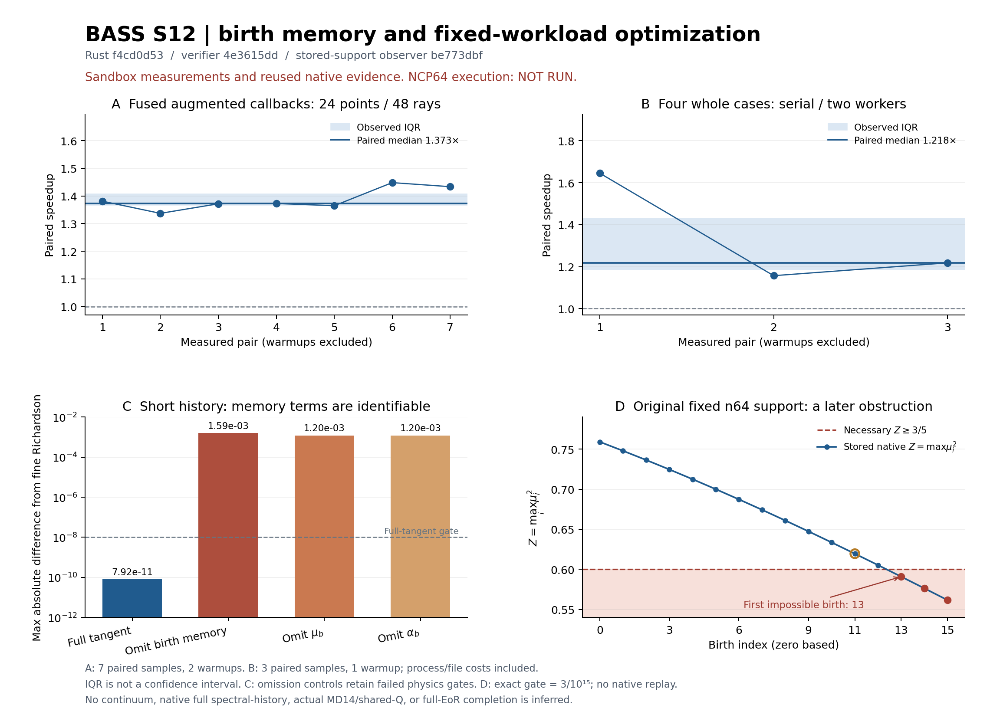

# S12: 출생 기억 parameter tangent와 제한된 계산 최적화

2026-10-20 UTC / 2026-10-21 KST. 이번 명시적 요청에 따른 C1–C10 한 단위의 결과다. 완료한 S9/S10/S11, 기존 S8 및 과거 NCP 캠페인을 재실행하지 않았다. 실제 NCP S12 실행은 서비스 quota 때문에 `NOT_RUN`이다. 새 확장 입력의 준비와 실제 실행을 구분한다.

## 1. 재사용과 새 작업의 경계

연구 전에 PR174/175, research refs96개, 최근 PR10개, main, 연결된 대화 검색, Dropbox·Drive `/BASS_BACKUPS`와 관측된 하위 폴더를 대조했다. 이 관측 범위에서 S11 이후 새 BASS 계산 결과는 발견하지 못했다. 검색 범위 밖의 모든 대화·저장소까지 없다고 단정하지 않는다. `s12_birth_memory/intake/`가 실제 검색 범위와 identity를 기록한다.

중단돼 있던 S11 최종 게시는 [댓글6301060073](https://github.com/cosmosapjw-quantum/bass/pull/174#issuecomment-6301060073)으로 마무리했다. S11의 과학 source, 결과, 배송 metadata는 각각 `7fb9b83c`, `85d5833b`, `44bac536`이다. 원 S10의 양쪽 provider9ZIP·4,399,983bytes·중복 포함 payload383항목 및 최종 JSON 검증은 완료 상태로 보존한다. 새 S11/S12 Drive write는 응답·ID를 얻지 못했으므로 이중 배송 완료로 쓰지 않는다.

새 S12의 Rust 과학 source는 `f4cd0d53760783e6a58c3b0a98c64311ca489d28`이며 tree는 `a9048818707ef3f446528631c3b5d6c8171116cc`이다. Python reference의 parity 평가 순서와 Linux PID namespace 자원 관측을 수리한 검증 source는 `4e3615dd75ff1a1efc2792edb3ba5b702a8a9b06`이다. 이 수리에서 Rust source, binary, 입력, 물리식과 tolerance는 바꾸지 않았다.

고정 owner는 `0e25846433170d0f420c4cda44a0bedbf02cd177`이다. 기존 photon field, physical anisotropic stock과 이전 birth weights를 보존한다. 보정 대상은 새 명시적 등방 birth angular quadrature뿐이며, 양의 물리 weights·reflection parity·source frame을 유지한다. 부호가 있는 parameter derivative는 음수 물리 weight가 아니다.

## 2. 새 Rust client에 추가한 물리

기하는 non-tilted axisymmetric Bianchi I, signature `(-,+,+,+)`이고

\[
a_\perp=a e^{-b},\qquad a_\parallel=a e^{2b},\qquad
s=\dot b,\qquad\Sigma=\sqrt3|s|/H
\]

를 유지한다. S9/S10의 기존 state JVP는 고정 bank에 대한 미분으로 유효하다. 이번에는 새 Rust client에서 초기 shear parameter \(\theta=y_0\)가 각 출생의 상태와 quadrature에 남기는 기억까지 추적한다. 출생 좌표와 donor amplitude는 고정한다.

출생 \(u_j\)에서

\[
B_j=\partial_\theta b(u_j),\qquad
\mu_{j,\theta}=\mu_{j,b}B_j,\qquad
\alpha_{j,\theta}=\alpha_{j,b}B_j
\]

를 계산해 해당 cohort에 고정 저장한다. 현재 \(b_\theta\)의 기하 효과와 과거 \(B_j\)의 효과는 분리한다. \(d=b-b_j\)와

\[
W=e^{2d}(1-\mu^2),\quad V=e^{-4d}\mu^2,\quad
R=\sqrt{W+V},\quad D=(V-W/2)/R
\]

를 사용하면 \(R_d=-2D\)이다. cohort amplitude를 \(C_j\)라 할 때 기억 forcing은

\[
M_E=\sum_j C_j\sum_i
\left(\alpha_{i,\theta}R_i-\alpha_iB_jR_{i,d}
+\alpha_i\mu_{i,\theta}R_{i,\mu}\right),
\]

\[
M_\Pi=\sum_j C_j\sum_i
\left(\alpha_{i,\theta}D_i-\alpha_iB_jD_{i,d}
+\alpha_i\mu_{i,\theta}D_{i,\mu}\right)
\]

이며 \(E_\theta=-2\Pi b_\theta+M_E\),
\(\Pi_\theta=\Pi_b b_\theta+M_\Pi\)다. 따라서 augmented tangent에는

\[
S'=J S+(-M_E/h,\,0,\,M_\Pi/h)^T
\]

를 넣는다. 현재 \(b_\theta\)를 기억 forcing에 다시 넣지 않는다. 정확한6상태 Jacobian은 \(\begin{pmatrix}J&0\\L&J\end{pmatrix}\)이며 아래 왼쪽 block \(L\), explicit-\(x\) 미분, 자율7상태 clock 열을 포함했다. 제약 접선

\[
C_\theta=2h h_\theta-2y y_\theta+2\Pi b_\theta-M_E,
\qquad C_\theta'=-2C_\theta
\]

도 독립적으로 점검했다. 전체 유도와 covariance 기반 quadrature derivative는 `s12_birth_memory/THEORY_KO.md`에 있다.

SciSpace·Exa로 원문과 공식 문서를 대조하고 Wolfram에서51개 항등식을 확인했다. 최초 CAS 문법 실패도 원본에 보존했다. 문헌은 Serban–Recuero의 memory/hybrid sensitivity와 공식 CVODES 문서다. 블록 대각 modified Newton 근사를 정확한 augmented Jacobian으로 취급하지 않는다. 논문 전문은 저장하지 않고 필요한 식의 위치와 해석만 `PRIMARY_LITERATURE.json`에 남겼다.

## 3. 실제 샌드박스 결과

| 항목 | 실제 결과 | 승인 범위 |
|---|---:|---|
| Rust build | PASS, 147.5999567초 | 고정 source/dependency와 두 binary |
| core 검증 | 269/269 | 24점·48ray, RHS/Jacobian/JVP/explicit derivative, 음성 입력 |
| 새 짧은 history suite | 72/72 | 14개 Rust case, 독립 Python reference, 최종 checkpoint restore |
| Python–Rust state6 최대 scaled 차이 | 3.483131098619846e-15 | 새 primary P24 history |
| MF6–clock7 state6 최대 scaled 차이 | 1.623443460779953e-15 | 같은 새 primary history |
| baseline–fused history state6 차이 | 0 | 실제 출력의 binary64 일치 |
| fine Richardson 최대 절대 오차 | 7.923659645081571e-11 | 기존1e-8 gate, h/b/y 접선 |
| finest centered FD 최대 scaled 오차 | 5.2611342089052926e-11 | 추가1e-6 gate |
| source-frame GL b0 gauge | 0 | 실제 비교한 gauge 오차 |
| 실행 인프라 수리 후 | 14/14 | 재개·실패 보존·자원·timeout·bundle 검증 |
| 독립 물리 검토 | 585/585 | 구현자와 분리한 식·원자료·hash 검사 |
| 저장 support의 독립 exact 검토 | 565/565 | solver 없이 actual binary64 support의 증명 |

검사 범위가 겹치므로 이 숫자들을 합쳐 독립 표본 수로 쓰지 않는다. build의 core binary SHA256은 `25905570282ffe68696481d82f9b6f89107c2f838e5e58dfb17de0987c324fe5`, history binary는 `81ac86ad59d9d58bf01e0411fec807f07a05950e632ef8aa920d747f4b750518`이다.

세 omission control은 의도한 물리 실패를 남겼다. 전체 접선과 birth-memory 누락의 최대 차이는 `0.0015948771414237006`, \(\mu_b\) 누락은 `0.0011966517151371647`, \(\alpha_b\) 누락은 `0.0011963180299893739`이다. 각각 full-vs-Richardson 오차의10배보다 크다. 구조 검증 통과가 물리 승인으로 바뀌지 않으며, 실패한 event \(\Pi_\theta\) gate도 보존했다.

최종 checkpoint SHA256은 `4cef9d72e39ade7ec4ed3ed814181392fff541ec8030cd61627e8b08f54baa4b`이다. 같은 source/input/binary의 최종 상태 직렬화와 restore만 확인했다. 중간 birth 경계에서 중단된 실제 실행의 재개까지 확인한 것은 아니다.

## 4. 속도 결과와 측정 조건

| 비교 | paired median | 관측 IQR | 실제 workload |
|---|---:|---:|---|
| baseline3회 ray 순회 → fused1회 | 1.372535191944467배 | [1.3680560824512806, 1.4071498342403799] | 24점·48ray, sample당2000반복, warmup2쌍·측정7쌍 |
| case 직렬 → 2worker | 1.2180376690502004배 | [1.1874303525148253, 1.4316390045734226] | 4개 고정 pack, repeat128, warmup1쌍·측정3쌍 |

각 paired ratio의 중앙값이며 두 wall-time 중앙값의 비와 구별한다. IQR은 신뢰구간이 아니다. case 비교는 subprocess와 파일 비용을 포함한 whole-batch wall time이며 모든32개 과학 stdout의 pack별 전체 bytes가 일치했다. 각 case 내부의 ray/cohort 합산 순서와 compensated sum은 유지했다. 이 측정은 샌드박스의 고정 workload에만 해당한다. NCP64 결과나 임의 workload의 가속비로 일반화하지 않는다.

그림 A/B는 모든 측정 pair와 중앙값/IQR, C는 각 접선과 fine Richardson의 차이, D는 원 native support의 \(Z=\max\mu_i^2\)다. C의 omission 막대는 omitted-vs-Richardson이므로 위 full-vs-omitted 수치와 미세하게 다르다. CSV와 PDF/SVG, input/output SHA256 및 독립 검토를 함께 보존한다.

S10의 closed2.973배·FLRW4.115배는 기존 고정 workload의 결과로 재사용한다. closed-small 이득의 불확실성과 changing n16/cohort2의 `0.9498173837599284배` 회귀도 유지한다. S11의49점 finite-d grid에서 P246 bias 최대값이 P24보다 `1.54913989382294배` 나빴던 결과 역시 보존한다. finite grid 최대값을 연속 구간의 supremum으로 바꾸지 않는다.

## 5. 원 native n64 case의 뒤쪽에는 엄밀한 obstruction이 있다

S8 `b9_n64_P2P4`는 birth11에서 `INNER_P2_PRECISION_LIMIT`로 중단됐다. S11은 그 지점의 P24 projector를 수리했지만 전체16birth가 가능하다는 증거는 아니었다. S12에서는 완료된 같은 schedule의 prior-mode raw support만 읽어, 원 실패 지점의64개 \(\mu\)가 bit 단위로 일치함을 확인했다. 원 weights는 재사용·초기화·재가중하지 않았다. geometry의 mode 독립성은 고정 owner와 원 probe source로 확인했다.

\(z_i=\mu_i^2\), \(Z=\max_i z_i\)라 하자. 양의 정규화 weights가 P2/P4를 맞추려면

\[
\langle z\rangle=1/3,\qquad\langle z^2\rangle=1/5.
\]

모든 support에서 \(z(Z-z)\ge0\)이므로

\[
0\le Z\langle z\rangle-\langle z^2\rangle=Z/3-1/5,
\qquad Z\ge3/5
\]

가 필요하다. 실제 birth13에서 \(u=0.675\), \(b=1.0350000000000001\),
\(Z=0.5908471918238073<3/5\)이다. 기존 정규화/P2/P4 tolerance `3/10^15`를 포함한 exact rational upper bound도 `-0.0030509360587296598`로 음수다. 단순히 부동소수점 근사로 경계 밖이라고 판정한 결과가 아니다.

검사는 이 한 필요조건뿐 아니라 actual finite support의 모든 moment-polygon facet을 exact rational로 확인했다. birth0–12는 strict interior, birth13–15는 기존 gate에서도 불가능하다. birth11의 \(Z=0.6195099475928701\), birth12의 `0.6052690616044833` 뒤에 발생하는 다른 문제다. exact observer는 `be773dbf36bbe74b42e89e51c61dcd56ef2e6687`, 원 저장 raw SHA256은 `fdc70eaaea45804aa16e60bba495b283eb5e4a18a576f52d5519bfd5a1f05839`다. observer 실행은0.1666초, compiler/ODE/projector/기존 캠페인 호출은0회다.

따라서 이 **고정 support·고정 schedule의 원 native16birth case**를 NCP 실행 가능 목록에서 제외했다. 음수 weights나 tolerance 완화로 우회하지 않는다. 이는 모든 n64 또는 새 Rust n64 history에 대한 불가능성 주장이 아니다. 향후 새 등방 birth support를 바꾸려면 별도 물리 계약과 사전 등록이 필요하다. 현재 단계에서 old stock 또는 이전 birth weights를 바꾸지 않는다.

## 6. 실패와 복구는 원본을 남겼다

첫 history attempt의5개 Rust case는 통과했지만 Python reference가 parity 평가 순서에서 실패했다. 수리 후5개 raw의 source/input/binary/manifest와 새 assessor를 재확인해 재사용하고, 남은9개 Rust case·Python1회·최종 restore1회만 실행했다. R2의16개 논리 record는5개 재사용과11개 신규 process다. 실제 전체 두 attempt는 Rust14회, Python2회(실패1·성공1), restore1회다.

인프라 첫 attempt는12/14였다. `/proc`에 표시된 host PID와 local PID namespace 차이를 식별하도록 수리한 뒤14/14를 얻었다. 기존 owner의 host PGID를 추측해 signal하지 않는다. case 병렬 첫 attempt는 manifest 경로 오기로 실제 core child0회에서 끝났고, 올바른 고정 경로를 사용한 다음 attempt만32개 출력을 만들었다.

native compile-only의 RAM admission·owner manifest scope·LLD thread resource·stale Git blob 거절도 각각 원본 receipt에 남긴다. compile-only 수리와 native physics 실행은 구별한다. 독립 물리 검토 첫 attempt는 요청17시각과 event가 포함된21행의 shape를 구별하지 못해 멈췄으며, 같은17시각을 선택한 reviewer 수리 후585/585를 얻었다. 과학 실행을 다시 하지 않았다.

## 7. NCP 준비와 남은 물리 의무

NCP template은 자동 build1개, 새 extended history14개, 고정64pack 성능 비교1개, ensemble 판정1개의17job DAG다. 실제 CPU affinity/quota·가용 RAM·기존 부하를 관측하고 최대64worker/128GiB 요청 범위에서 실행한다. 개별 job1800초와 작업 disk4GiB를 제한한다. nested numerical thread는1이다. 완료 source/input/binary/dependency/artifact가 정확히 일치하는 PASS만 skip하고, 실패 attempt와 raw output은 남긴다.

한 번 봉인한 manifest의 worker 수와 실행 identity는 재개할 때 바꾸지 않는다. 현재 자원이 줄면 admission을 보류한다. current delivery source와 과학 source `f4cd0d53`의 binding은 분리한다. private toolchain의 공식 archive 또는 실제 기존 executable identity를 확인하고, 사용자 선행 build 명령 없이 build dependency부터 진행하도록 준비했다. 실제 NCP는 quota 때문에 호출하지 못했으며 현재64CPU/128GiB hardware identity도 새로 관측하지 못했다. 2026-10-15의 과거 NCP 결과는 완료된 증거이며 현재 미실행 목록이 아니다.

남은 의무는 실제 MD14 정규화와 native Einstein/shear shared-Q 결합, evolving reactive full finite-bin spectral history, 더 넓은 finite-d/angular 고차 moment와 P6의 적용 영역·오차 검증이다. 새 Rust full birth-memory tangent는 이번 manufactured short-history 계약에서 검증했으며 실제 native reactive closure까지 확장한 것은 아니다. moving event time과 parameter-dependent donor normalization의 접선도 현재 범위 밖이다.

`5.369926725506957e-12`는 제한된 source-deposition 설명으로 유지한다. P2/P4 일치만으로 continuum 또는 full native finite-bin 보존을 승인하지 않는다. REI production, full EoR, merge로 확대하지 않는다. C8 실행 도구의 최종 제한 검증, C9 provenance, C10 게시·백업의 구체적 완료 상태는 `DAG.json`, `RETURN_TO_CHATGPT.json`, `PUBLICATION_CLOSEOUT.json`과 `s12_birth_memory/delivery/`의 실제 readback으로 결정한다.

## 8. 게시 후 C8 제한 검증과 최종 검토

C8 실행 source `8247645d04695bdbfa48eb2fe74757dacf7d2636`을 게시하고 full Git tree와 실제 ref/PR HEAD를 확인한 뒤, 제한 검증을 각각1회 실행했다.

- **Launcher19/19 PASS**: 과학15파일과 delivery96파일의 합집합109개를 bytes/SHA256/Git blob으로 확인했다. 실제 하위 process는 Rust/Cargo version probe2개와 NCP 전용 template의 sandbox profile 거절1개다. Outer AS2GiB·timeout120초·affinity2, wall0.674514초다. 명시적 synthetic64CPU/128GiB fixture로 자원 축소와 봉인 worker 폭 유지·admission 보류를 검사했다. 이 fixture는 실제 NCP hardware 또는 full positive CLI/resume의 증거가 아니다.
- **집계기62/62 PASS**: 저장된 짧은14case/17시각의 FD/Richardson·driver·baseline·omission 배열 연산, 실제 고정 extended 입력 manifest와 기존 upstream178파일, malformed 입력 거절을 검사했다. 외부 Python1회, 내부 subprocess/solver/compiler/projector/network0회다. 실제 extended14 및 production 전체 receipt chain은 미실행으로 유지했다.
- **Native compile-only PASS**: 고정 owner57파일·614,313bytes를 전후 확인하고13.491861557초에 컴파일을 완료했다. Native binary SHA256은 `dd836e7388794624f45bcc63c2e1ebecc9bde68e17b9842b1889d520690d6ed4`다. 실제 기본 invocation은 `BLOCKED_KNOWN_FIXED_SUPPORT_INFEASIBLE`로 compiler/download/history 이전에 거절됐다. Native history0회이며 이 compile-only를 반복할 의무가 없다.
- **C9 provenance23/23그룹·664파일**, 후속 supplement5/5그룹·117파일을 별도로 보존했다. Root의 C8 source/receipt 확인13/13도 별도 범위다. 최초 provenance reader의 과거 receipt schema 오류와 metadata writer의 필드/path 오류는 원본·수리 기록을 남겼으며 과학 실행을 다시 하지 않았다. 그림79/79, 초기 결과문서31/31의 독립 검토도 남겼다. 각 검토자의 구현 참여 범위와 자기 코드 승인 제외를 보고서에 명시했다.

22:14:14 UTC의 RESOURCE_CLOSEOUT snapshot에서 sandbox CPU cap8, RAM cap8GiB, task allocated disk2,522,431,488bytes였다. 이 snapshot을 전체 시간의 연속 peak로 주장하지 않으며 개별 process receipt의 admission·elapsed·RSS를 함께 읽는다. 완료 캠페인 재실행과 실제 NCP 실행은0회다. 이후 작업은 결과 파일의 게시·백업/readback과 metadata뿐이다.

배송은 단계별 고정 ZIP과 final JSON으로 닫는다. 원 S10은 양쪽 완료, 새 S11/S12는 Dropbox의 실제 full-byte readback과 Drive의 pending 상태를 각각 기록한다. 최종 metadata의 containing HEAD/tree와 마지막 ZIP/JSON identity는 자기참조 없이 최종 PR174 배송 댓글 및 외부 readback이 소유한다.
