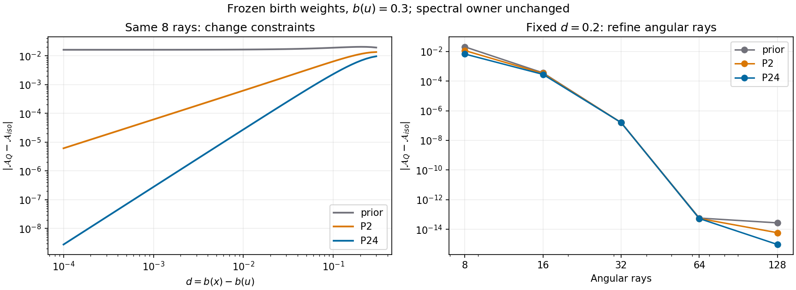

# S3 실행 결과: birth isotropy, shear response, angular refinement

2026-10-19. 물리 범위는 non-tilted axisymmetric Bianchi I, signature `(-,+,+,+)`,
`a_perp=a exp(-b)`, `a_parallel=a exp(2b)`, `s=dot b`, `Sigma=sqrt(3)|s|/H`이다.
새로 태어나는 명시적 등방 source의 angular quadrature만 보정한다.
원 REI spectral owner는 `0e25846433170d0f420c4cda44a0bedbf02cd177`로 고정한다.

## 1. 직접 유도와 독립 검산

완전한 유도, source-age 선도항, 보존 항등식, exact support 정리는
[S3_THEORY_KO.md](S3_THEORY_KO.md)에 있다. 다음은 원 kernel을 직접 미분한 결과다.
여기서 위 첨자 `(k)`는 Taylor 계수가 아니라 d에 대한 k차 미분값이다.

```math
D(0,\mu)=P_2,
\qquad D^{(1)}(0,\mu)=-\frac85P_0-\frac{10}{7}P_2+\frac{36}{35}P_4,
```

```math
D^{(2)}(0,\mu)=\frac{16}{7}P_0+\frac{12}{7}P_2-\frac{216}{77}P_4+\frac{216}{77}P_6,
```

```math
D^{(3)}(0,\mu)=-\frac{96}{35}P_0+\frac{200}{77}P_2-\frac{43632}{5005}P_4
-\frac{864}{77}P_6+\frac{1728}{143}P_8.
```

Frozen birth weights에 대해 `F=<R>`, `G=<D>`, `A=G/F`, `M_l=<P_l>`이다.
`R'=-2D`이며 `M2=0`이면 `A'(0)=-8/5+(36/35)M4`이다.
`M2=M4=0`이면 `A''(0)=16/7+(216/77)M6`이다. 따라서 탄생 시 P2와 이후
응답 정확도는 서로 다른 조건이다. P4 제약은 첫 응답 계수를 교정하지만
P6 및 그 이상의 응답을 자동으로 교정하지 않는다.

Exact rational polynomial 계산과 별도 80-digit Decimal exp/sqrt 검산을 실제
수행했다. d=0 derivative 0~3의 central check(h=1e-7) 최대 차이는 약
`2.07459e-12`다. 이는 finite-difference truncation을 포함한 검산값이다.

양의 reflection-paired 반례도 직접 확인했다.

| 지지 z=mu²와 z별 총 weight | 일치하는 moments | continuum과 다른 응답 |
|---|---|---|
| z={1/6,1/2}, weights={1/2,1/2} | M2=0 | M4=-77/288, A'=-15/8; slope bias=-11/40 |
| z={0,1/2,1}, weights={2/5,8/15,1/15} | M2=M4=0 | M6=-11/80, A''=19/10; A error=-(27/140)d²+O(d³) |
| GL4, birth b=0 | M2=M4=M6=0 | M8=-143/490; A error=-(144/245)d³+O(d⁴) |

원 광자장을 매 시점 다시 project하면 추가 `sum dot(alpha) R` 항이 발생한다.
이 구현은 birth weights를 고정해 collisionless identity
`dot U + 4 H U + 2 s DeltaP = 0`을 유지하는 구조다. 실제 source-history convolution과
coupled Einstein evolution은 이 단일-birth 캠페인에서 실행하지 않았다.

## 2. 양의 P2/P4 알고리즘과 실패 조건

`angular_p24.py` 및 std-only `balance_p24.rs`는 같은 고정 support/prior에
`alpha_i=q_i exp(lambda2 P2_i + lambda4 P4_i)/Z`를 적용한다.
Inner scalar solve는 P2를, outer solve는 제약된 P4를 맞춘다. Outer derivative는
`Var(P4)-Cov(P2,P4)^2/Var(P2)>0`이다. 이 exponential information projection은
기존 convex 이론의 적용이며 새로운 entropy 정리라고 주장하지 않는다.

`z=mu²`, target mean `t=1/3`, second moment `v=1/5`로 바꾸어
support feasibility를 먼저 검사한다. 세 개 이상의 서로 다른 z에서는
`z_min<t<z_max`, `L(t)<v<U(t)`가 엄격한 양의 해의 정확한 조건이다.
`L`은 인접 support chord의 최댓값이고 `U`는 양 끝점 chord다.
Exact rational support 1023개를 별도 barycentric enumeration과 비교해
판정 불일치 0개를 확인했다. 유효한 rank1 해도 존재한다. 다만 f64의 거의
일치하는 rank1 입력은 현재 `FEASIBILITY_UNRESOLVED_RANK1`로 남기며,
수학적 불가능으로 잘못 선언하지 않는다. 경계의 roundoff 불확실성도 unresolved다.

모든 accepted weights는 엄격히 양수이고 reflection parity를 유지한다.
직접 P2/P4 moment gate는 각각 `3e-15`이며 이 값을 넓히지 않았다.
음의 weight, ray 삭제, target 변경으로 지지 실패를 우회하지 않는다.

## 3. 실제 angular 캠페인

`n_mu={8,16,32,64,128}`, birth `b={-.6,-.4,-.3,-.2,0,.2,.3,.4,.6,.8,1}`,
`d={-.2,-.1,-.05,-.02,-.01,0,.01,.02,.05,.1,.2}`를 측정했다.
각 동일 (b,n)에서 prior/P2/P24를 비교해 constraint와 refinement를 분리했다.

| 모드 | 시도 | 측정 성공 | 구체적 support 실패 |
|---|---:|---:|---|
| prior | 55 | 55 | 0 |
| P2 | 55 | 48 | mean support 실패 7 |
| P24 | 55 | 43 | mean 실패 7, upper-hull 실패 5 |
| 전체 | 165 | 146 | 19 |

146개 rule의 1606개 response point를 저장했다. 예를 들어 n=8,b=0.4에서는
P2 해가 있지만 P24 target이 upper hull 밖이다. 실패는 성공 행에 섞지 않았다.
독립 검토는 저장된 binary64 입력을 Fraction으로 정확하게 바꾸어 55개 지지의
43개 strict interiors 및 12개 P24 지지 실패와 모든 직접 moments를 검산했다.
모든 accepted gate는 3e-15 이하였고, P24 성공 지지의 최소 hull margin은
0.013494465708051672로 roundoff guard에서 충분히 멀었다.

같은 birth b=0.3, 같은 관측 d=0.2에서의 `|A_Q-A_iso|`:

| n_mu | P2-only | P2/P4 |
|---:|---:|---:|
| 8 | 1.147667639e-2 | 6.688501221e-3 |
| 16 | 3.29404253e-4 | 2.83195803e-4 |
| 32 | 1.582720707e-7 | 1.579665306e-7 |
| 64 | 5.390e-14 | 5.312e-14 |
| 128 | 5.884e-15 | 9.437e-16 |

n=8,b=0.3에서 P2-only M4=-0.05946222340038122이므로 A'=-1.6611611440689655다.
P24는 A'≈-1.6을 회복하지만 M6=-0.1984198108084396이 남아 A''=1.729108063186708이다.
이는 continuum16/7과 다르다. 새 제약이 모든 고차 moment나 finite-d 오차를
항상 개선한다고 주장하지 않는다. 위 작은 오차도 해당 격자와 기준 함수에
대한 측정값이며 전체 continuum accuracy 보증으로 승격하지 않는다.



Adaptive quadrature와 별도 GL256의 A 차이는 최대5.551115123125783e-16,
small-d 80-digit Decimal 기준과의 차이는 최대5.551115123125783e-17이었다.
Central derivative(h=1e-5)와 해석식 차이는 최대5.660458768375065e-10이다.
Figure의 추가 d=0.13994804935909905에서는 SciPy roundoff warning 1건을 보존했다.
이를 없애기 위해 reference tolerance를 완화하지 않았다.

## 4. 실제 테스트와 언어 간 검증

| 검증 | 실제 결과 | 증거 |
|---|---|---|
| 기존 balance.rs의 미실행 5개 | 5 PASS, 원 파일 무변경 | evidence_s2_rust/RETURN_RUST.json |
| 새 Python S3 | 14 PASS | evidence_s3/campaign/TEST_S3.log |
| 독립 std-only Rust P24 | 16 PASS | evidence_s3/rust_p24_execution.json |
| Rust CLI 입력/출력 계약 | valid 1 + negative 7 PASS | evidence_s3/rust_p24_cli_artifacts/RETURN.json |
| Python/Rust 동일 입력 | 43 PASS | evidence_s3/campaign/RETURN_RUST_PARITY.json |
| 저장 측정 재사용 경로 | 최종 13 PASS | evidence_s3/reuse_guard_validation_r2/RETURN_REUSE_GUARD.json |

43개 실제 Rust 출력과 Python weight의 최대 차이는3.3306690738754696e-16,
Rust의 직접 moment residual 최대값은2.856655884064807e-15이다. 기존 Python15와
PR173 native58/negative5는 완료된 원본 증거를 재사용했고 새 검증으로 세지 않는다.

첫 캠페인은 모든 측정을 저장한 뒤 figure의 mathtext 표기에서 실패했다.
물리 계산을 재실행하지 않고 저장된 측정값으로 figure와 보고서를 복구했다.
실제 measurement producer, report producer, 최종 reuse-guard source를 구분해
각 SHA 및 source snapshot을 보존했다. 독립 검토가 발견한 재사용 입력 검사
F1과 reference-cache 일관성 F2를 실제 수정하고 13개 targeted regression으로
닫았다. 현재 저장 결과의 물리 값은 이 두 문제의 영향을 받지 않았다.

## 5. 범위 및 이어지는 의무

S3의 직접 유도, positive full-rank P24 구현, 단일-birth 수치 캠페인과
언어 간 검증은 완료했다. 별도 native 새 source adapter의 실제 유한-bin transfer와
전단 tangent 결과는 [NATIVE_ADAPTER_KO.md](NATIVE_ADAPTER_KO.md) 및
`evidence_native_s3/run01/`에서 구별해 보고한다. Python P2/P4 일치만으로
native photon/energy 보존을 승인하지 않는다.

남은 의무는 finite-d continuum angular error의 범위 및 수렴성, exact rank1의
실행 certificate, 고정 spectral owner의 독립 refinement/잔차 설명,
source-age 합성 및 coupled shear feedback이다. REI production/full EoR/merge는 승인하지 않았다.

근거 원문: Fleury–Pitrou–Uzan, arXiv:1410.8473, Sec. IV.A Eq.4.4;
Csiszár–Shields, Information Theory and Statistics, Theorem3.2.
직접 미분·support 판정·새 측정의 원자료는 `evidence_s3/`에 있다.
