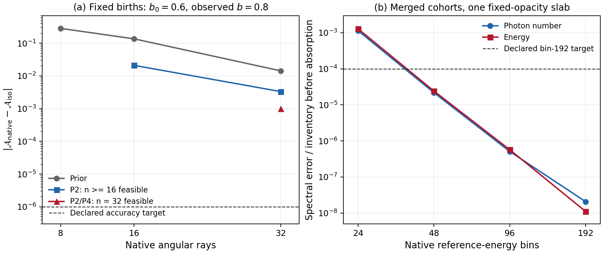

# S7 native cohort·수송·흡수 검증

## 범위와 실행 전 계약

이 경로는 고정 REI owner `0e25846433170d0f420c4cda44a0bedbf02cd177`의
`AxbiSource`, `CovariantTransport`, `AtomicProvider`를 무변경 컴파일한다.
S3 native adapter, P2/P24 알고리즘, S6 검증을 수정하거나 다시 실행하지 않는다.
새 실행 입력과 gate는 `evidence_s7_native/PREREGISTRATION.json`에 고정했고,
[사전등록 게시 커밋 2865f60](https://github.com/cosmosapjw-quantum/bass/commit/2865f60bf0a247eaab4997c222ad82ae22a4c8fa)의
파일 내용·blob readback 뒤에 캠페인을 실행했다. R2는 같은 native 결과를
재사용하는 validator 산술 교정이며 아래에 따로 기록한다.

물리는 non-tilted axisymmetric Bianchi I, signature `(-,+,+,+)`,
`a_perp=a exp(-b)`, `a_parallel=a exp(2b)`, `s=dot b`,
`Sigma=sqrt(3)|s|/H`를 유지한다. 여기의 기하는 처방된
`a=exp(x)/21`, `b=b0+0.2x`, `H=1e-16 s^-1`이다.
Einstein 결합 native 이력이나 반응성 EoR 이력을 실행했다는 뜻이 아니다.

## 1. 실제 owner 이력과 출생 조건

출생 `u∈[0,0.8]`에 midpoint quadrature를 쓰며,
`z=21 exp(-u)-1`, `dt=du/H`를 owner `AxbiSource::at_redshift`에 넣는다.
모든 출생은 원래 50,000 K source cell과 원래 photon fraction을 사용한다.
새 locally isotropic source의 birth angular weights만 prior/P2/P24 중
지정된 방법으로 정한다. 이미 생성된 cohort의 reference-energy cell,
number, support, weights는 이후 기하 관측과 흡수 reference 계산 동안 고정한다.

기존 anisotropic stock은 반사 대칭인 극 방향 두 ray에 각각 `q=5 eV, N=0.0025/H`,
적도 근처 두 ray에 각각 `q=40 eV, N=0.001/H`인 별도 delta population이다.
기존 stock을 재가중하지 않고 매 새 birth를 실제 adapter로 더한다.
영향받지 않은 cell은 bitwise 같아야 하며, P2/P24에서는 전체 cell이
`old + independently formed birth`와 정확히 같아야 한다.
원래 prior injector는 source panel을 순서대로 더하므로 합의 결합순서에 따른
반올림을 별도 상대 ledger gate `1e-11`로 검사한다.

## 2. Per-H 양과 물리적 밀도

Owner의 inventory는 photon/H 및 eV/H이다. 무충돌에서 N/H는 일정하고

\[
 U_H(x)=\sum_k U_{H,k}(u_k)e^{-(x-u_k)}
         \sum_i \alpha^E_{ki}R\bigl(0.2(x-u_k),\mu_{ki}\bigr),
\]

\[
 \Delta P_H(x)=\sum_k U_{H,k}(u_k)e^{-(x-u_k)}
         \sum_i \alpha^E_{ki}D\bigl(0.2(x-u_k),\mu_{ki}\bigr).
\]

여기서 `alpha^E`는 출생 직후 실제 native ray energy를 정규화한 측정값이며,
원래 angular `alpha`와 별도로 저장한다. Python은 이 기록을 읽어 native
관측값을 독립 계산한다. 출생 사이에는

\[
 U_H'+U_H+2b'\Delta P_H=0.
\]

물리적 밀도는 `U=nH0/a^3 U_H`이므로 `U'+4U+2b'ΔP=0`이 된다.
Native per-H inventory에 `a^-4`를 직접 곱하지 않는다.
Native 기하 평가의 5점 미분(`h=1e-3`, `5e-4`)으로 연속식을 검산한다.

## 3. 오차 분리

총 51개 입력은 같은 물리적 설정을 중복 실행하지 않는다.

| 축 | 고정한 것 | 바꾼 것 |
|---|---|---|
| Angular | K=16, bin=96, panel/segment=32 | n_mu=8/16/32; prior/P2/P24; b0=0/0.6/0.9 |
| 출생시간 | n_mu=16, bin=96, panel=32, b0=0 | K=8/16/32/64/128; prior/P2/P24 |
| 흡수 bin | n_mu=16, K=16, P24, panel=64 | bin=24/48/96/192 |
| 흡수 panel | n_mu=16, K=16, P24, bin=96 | panel=8/16/32/64 |
| 흡수 이력·angular | 기준 slab와 나머지 축 고정 | K=8/16/32 및 n_mu=8/16/32 각각 |
| 큰 b 실제 흡수 | n_mu=32, K=16, P24, bin=96, panel=64 | b0=0.6, 관측 b=0.8 |

동일한 출생시간 grid에서 isotropic continuum angular kernel(GL256)과
비교한 `δA`가 angular 오차다. 별도로 같은 finite angular rule을
출생시간 GL96/192로 적분하여 native midpoint 이력의 수렴을 검사한다.
P24의 feasibility 실패는 실패한 첫 birth와 실제 mu support,
독립 mean/lower/upper hull 판정과 함께 남긴다.

## 4. 실제 finite-bin 흡수와 독립 spectrum 기준

관측 시점 `x=1`에 한 번, 고정 opacity와 원래 owner backward-Euler
survival operator를 적용한다. `dt=1e12 s`, `nH=nH0/a^3`,
`(nHI,nHeI,nHeII)=(0.01,0.005,0.002)nH`이다.
흡수율·원자수·열 이력의 자체 결합은 이 실험에 포함하지 않는다.

한 경로는 모든 cohort를 native finite-bin 두 moment 상태로 합친 뒤
`prepare/evaluate`한다. 다른 경로는 같은 operator를 각 cohort에
따로 적용한 뒤 더한다. 두 결과의 차이는 합쳐진 spectrum의 closure 손실이다.
세 번째 독립 기준은 출생 source cell의 원래 연속 blackbody shape를
고정 birth alpha와 함께 직접 적분한다. 원래 photon fraction/GL8 source
normalization과 원래 `AtomicProvider::cross_section`을 그대로 사용하고,
현재 물리적 threshold가 출생 energy에서 위치하는 곳마다 적분 구간을 나눈다.
GL32/64의 차이를 별도로 기록한다.

숫자와 에너지 ledger는 각각
`N_before-N_after-sum(absorbed)` 및
`U_before-U_after-binding-heat`를 검사한다. 기존 gate는 `1e-11`이다.
반응 이후 spectrum의 정확도는 ledger 보존만으로 승인하지 않는다.
별도 탐색 목표는 bin192에서 `|δN|/N_before`, `|δU|/U_before≤1e-4`,
큰 b의 n32 P24에서 `|δA|≤1e-6`이며, 미달하면 실패 그대로 남긴다.

## 5. 실행

NCP의 일반 git checkout에서는 연구 경로에서 다음 명령을 그대로 쓴다.

```bash
python3 run_native_cohorts.py \
  --out /absolute/scratch/bass_s7_native_run \
  --workers 4 --timeout 1800
```

기존 REI checkout이 있으면 `--rei-repo /absolute/rei_bianchi`를 더한다.
57개 owner 파일을 이미 갖고 있으면 `--owner-root /absolute/exact_owner`를 쓴다.
Compiler가 PATH에 없으면 `--rustc /absolute/rustc`를 지정한다.
Owner commit/file blob/SHA256는 자동 검사한다. 사전등록이 git에 clean하게
게시되지 않았으면 실행을 거절한다. API 기반 workspace에서는 실제 원격
readback의 repo/path/commit/blob/SHA256를 담은 `--publication-receipt`를 허용한다.

최대 추가 worker 16, RAM 16GiB, 출력 disk 4GiB, 개별 job 1800초다.
이 실험은 native thread 1, owner staging worker 4를 기본으로 한다.

## 6. 실제 run01 결과

원래 owner 57개 파일을 검증하고 무변경 컴파일했다. 새 native 실행은 1회,
51개 case 중 42개를 끝까지 측정했고 9개는 구체적인 positive support 실패였다.
Native 실행 자체는 모든 case를 기록하고 exit 0으로 완료했다. 이후 Python
validator가 아래의 부동소수점 moment 경계 문제 때문에 exit 2를 반환했다.
이 원래 판정은 [run01 receipt](evidence_s7_native/run01/RETURN_NATIVE_COHORTS.json)와
[원래 분석](evidence_s7_native/run01/ANALYSIS.json)에 그대로 남겼다.

Raw JSONL은 1,794,091 bytes이며 SHA256은
`4b544414a434abfb56edbf38c89807aa221b3083185bcfc2499e9f53f6db8122`다.
Git에서는 [lossless gzip](evidence_s7_native/run01/NATIVE_COHORTS.jsonl.gz)(365,100 bytes)으로 보관한다.
[RAW_STORAGE](evidence_s7_native/run01/RAW_STORAGE.json)에 압축 hash, 복원 byte 수와 raw hash가 있다.
원래 실행의 11개 입력 파일도 `run01/source_snapshot/`에 각각 기존 SHA256과
대조하여 보존했다. 이 중 runner/test 원문은 이미 독립 readback한 S7 stage1
백업에서 복원했으며 현재 수정본으로 바꾸지 않았다.

### 6.1 Conservation과 이력

| 사전 gate | 실제 최대값 | 결과 |
|---|---:|---|
| Native frozen R,D kernel 상대차 ≤3e-14 | 3.686e-16 | PASS |
| 매 birth의 기존 stock + 증분 ledger 상대차 ≤1e-11 | 8.876e-15 | PASS |
| Per-H energy 연속식 상대 잔차 ≤1e-11 | 4.968e-13 | PASS |
| Native absorption N/U ledger 상대차 ≤1e-11 | 3.036e-16 | PASS |
| 독립 source spectrum GL32/64 차이 ≤1e-11 | 8.097e-16 | PASS |
| Midpoint 출생시간 doubling 비율 3.5–4.5 | 3.898–4.000 | PASS |

K=8에서 K=128로 늘릴 때 P24의 native ΔP/H와 같은 finite angular rule의
연속 출생시간 기준 사이 차이는 `−2.8706e-4 → −1.1602e-6 eV/H`로 줄었다.
이것은 angular refinement와 별도로 측정한 출생시간 quadrature 오차다.
다른 source history나 결합 geometry의 시간 오차까지 승인하는 값은 아니다.

### 6.2 큰 누적 b에서의 실제 native angular 오차

아래는 같은 16개 birth와 같은 source spectrum에서 측정한
`δA=A_native−A_continuum`이다. 모든 case의 `b'=0.2`와 `d=0.2(x−u)`는 같다.
`b0`는 고정 native reference ray grid에 대한 누적 비등방을 바꾸므로,
continuum kernel 자체를 바꾸지 않고 grid의 조건이 나빠지는 효과를 보여준다.

| b0 / 관측 b | n_mu | prior δA | P2 δA | P24 δA |
|---|---:|---:|---:|---:|
| 0 / 0.2 | 8 | −1.9591e-4 | −9.6427e-5 | −4.7633e-5 |
| 0 / 0.2 | 16 | −7.6497e-9 | −6.1435e-9 | −4.7284e-9 |
| 0 / 0.2 | 32 | −2.36e-16 | −2.50e-16 | −2.50e-16 |
| 0.6 / 0.8 | 8 | −2.8416e-1 | mean 불가능 | mean 불가능 |
| 0.6 / 0.8 | 16 | −1.3635e-1 | −2.1087e-2 | upper hull 불가능 |
| 0.6 / 0.8 | 32 | −1.4285e-2 | −3.3193e-3 | **−9.9453e-4** |
| 0.9 / 1.1 | 8 | −3.5893e-1 | mean 불가능 | mean 불가능 |
| 0.9 / 1.1 | 16 | −3.1438e-1 | mean 불가능 | mean 불가능 |
| 0.9 / 1.1 | 32 | −1.9217e-1 | 9번째 birth에서 mean 불가능 | upper hull 불가능 |

큰 b의 n32/P24 사전 정확도 목표 `|δA|≤1e-6`은 **실패**했다.
실제 `|δA|=9.94529756587e-4`로 목표의 약 995배다.
Panel을 32에서 64로 바꾼 별도 native slab case도 같은 angular 실패를 보였다.
양의 P2/P4 조건은 이 grid의 continuum angular 정확도를 승인하지 못한다.

9개 feasibility 실패는 독립 Python hull 검사와 일치했다. 예를 들어
`b0=0.6,n16,P24` 첫 birth에서 가능한 upper `E[z²]`는
`0.18387221855494668`로 목표 `1/5`보다 `0.016127781445053335` 작다.
`b0=0.9,n32,P2`는 0-based birth index 8, `u=0.425`에서
`max z=0.3304721961595297<1/3`가 되어 실패했다.
음의 weights나 허용오차 변경으로 이 실패를 우회하지 않았다.

### 6.3 Finite-bin merged spectrum의 흡수 오차

다음은 n_mu=16, K=16, P24, panel=64의 고정 angular rule에서,
원래 source-cell spectrum의 직접 GL64 적분과 native merged-cohort
흡수 상태를 비교한 값이다. Number는 `N_before`, energy는 `U_before`로 나눴다.

| n_energy | (N_native−N_reference)/N_before | (U_native−U_reference)/U_before | (N_merged−N_separate)/N_before |
|---:|---:|---:|---:|
| 24 | −1.14056e-3 | −1.28616e-3 | −1.08741e-3 |
| 48 | −2.18353e-5 | −2.42079e-5 | −2.69526e-5 |
| 96 | −5.09602e-7 | −5.69825e-7 | +7.06510e-8 |
| 192 | −2.07098e-8 | −1.10523e-8 | +1.45162e-8 |

Bin192의 사전 목표 `max(|δN|/N_before,|δU|/U_before)≤1e-4`는 통과했다.
그러나 bin24에서는 ledger가 1e-11보다 훨씬 잘 보존되어도 실제 photon/energy
흡수 상태의 오차가 1e-3 수준이다. Source-age를 합친 두 moment spectrum은
각 cohort를 따로 유지한 spectrum과 다른 흡수 응답을 갖는다.

같은 bin96에서 panel을 8→16→32→64로 늘려도 photon 상대 오차는
`−5.096022564e-7` 수준에서 변하지 않았다(차이 2.03e-16 이내).
이는 S6에서 해결한 source-cell Simpson 기준값 오차와 이번 native
merged-spectrum reconstruction 오차를 분리한다. K=8/16/32와 n_mu=8/16/32의
별도 slab case도 기록했다. Angular 변경으로 spectral 오차가 단조 감소한다고
가정하지 않았고, 단일 frozen-opacity slab의 성공을 전체 reactive history로 확대하지 않았다.



왼쪽은 고정 birth grid의 angular 오차와 support 실패를, 오른쪽은 같은 finite
angular rule에 대한 spectrum 오차를 보여준다. 같은 native 계산의 서로 다른
정확도 의무다. 그림은 저장된 run01 분석을 읽어 그렸고 물리 캠페인은 재실행하지 않았다.

### 6.4 실제 자원과 테스트

총 27.3575 s 중 원래 owner compile 10.3067 s, 새 probe compile 1.6739 s,
native 측정 7.8978 s였다. Child peak RSS는 337,564 KiB,
Python peak RSS는 42,644 KiB, 전체 출력은 11,867,400 bytes였다.
Native thread 1, BLAS thread 1, owner staging worker 상한 4였다.
새 Rust cohort 테스트 5개 PASS(기존 21개는 filter되어 실행하지 않음),
R1 Python guard 11개 PASS를 게시 후 측정했다. R2 코드 guard는 14개 PASS다.

## 7. 원래 moment 실패와 R2 산술 교정

`birth_time_031`의 P2 birth index 11(`u=0.2875,b=0.0575,n_mu=16`)에서
R1 NumPy validator는 `ΣαP2=−3.0080105073437835e-15`를 계산해
고정 gate `3e-15`를 넘었다. 같은 저장 μ,α에 Rust 곱셈 순서를 사용하면
`−2.987193825632062e-15`, **정확한 dyadic 유리수 연산**으로 계산하면
`−2.9993863364154428e-15`다. 참된 저장-discrete moment는 원래 gate 안이다.

[Exact audit](evidence_s7_native/EXACT_MOMENT_AUDIT_RUN01.json)는 808개의
constrained birth 전체에서 P2 최대 `2.9993863364154428e-15`,
P24 조건의 P4 최대 `2.952205259391513e-15`로 전부 `3/10^15` 이하임을 확인했다.
이는 validator의 multiplication association에 따른 경계 false rejection이다.

R2는 저장 binary64 μ,α를 정확한 `Fraction`으로 바꾸고 원래 functional
`Σα_i P_l(μ_i)`를 정확히 계산한다. **Gate `3/10^15`, 양성, 반사 대칭,
별도 normalization 조건과 모든 물리적 목표는 그대로다.** α를 몰래
재정규화하지 않는다. Exact normalization과 normalized moment는 진단으로
따로 기록하고 원래 f64 moment도 보존한다. 이 교정은 저장된 ray/weight에
관한 것이며 continuum μ나 continuum angular 정확도 인증이 아니다.

`PREREGISTRATION_R2.json`은 run01 결과를 본 뒤 작성한 **분석 산술 교정 계약**임을
명시한다. 원래 physical prediction의 사전등록을 소급 주장하지 않는다.
Raw SHA, 원래 execution receipt SHA, 원래 사전등록 SHA, 원래 구현 게시 커밋,
불변 native dependency를 모두 검사한 뒤 같은 결과를 재분석한다.
원래 native 캠페인·source injection·projection은 다시 실행하지 않는다.

R2 게시/readback 이후의 명령은 다음과 같다. `.gz`는 runner가 직접 읽고
압축 hash와 복원 내용 hash를 검사하므로 사전 압축 해제는 필요 없다.

```bash
python3 run_native_cohorts.py \
  --revalidate-existing evidence_s7_native/run01 \
  --out /absolute/scratch/bass_s7_native_analysis_r2 \
  --timeout 1800
```

현재 이 문서의 상태: **R2 코드·14개 guard·계약 준비 완료, R2 게시 후 재분석 대기**.
큰 b에서의 `9.9453e-4` 정확도 실패는 산술 교정 대상이 아니며 그대로 유지한다.

## 8. 남은 의무

큰 누적 |b|에서 n_mu≤32로는 부족한 angular 정확도는 실제 native 결과로 확인했다.
새 angular refinement 지원과 그 별도 검증이 필요하다. 이번 frozen-opacity
slab의 bin 수렴은 full absorption history, ionization/thermal feedback 또는
source-history별 전역 오차 인증을 대신하지 않는다.
Native Einstein 결합 full history는 이 probe에서 실행하지 않았으며,
REI production/full EoR/merge를 승인하지 않는다.
