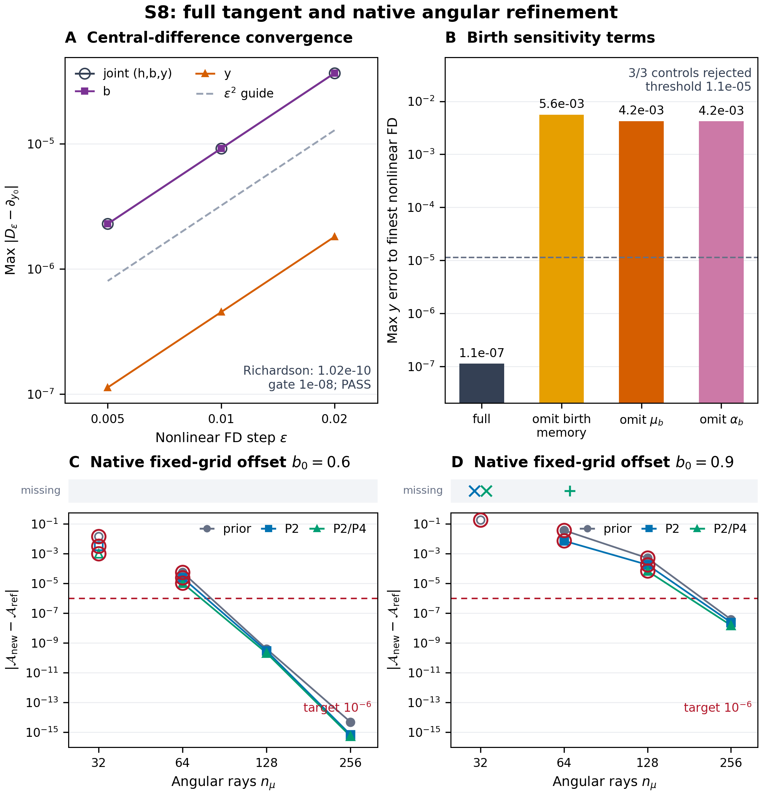

# S8 실제 결과 — 전체 출생 기억 tangent와 native angular refinement

S8의 두 실험을 완료했다. 닫힌 manufactured donor 모형의 전체 tangent는 계획한 8개 적분과 10개 최종 gate를 통과했다. Native angular refinement는 18개 입력 중 17개를 측정했고, 가장 세밀한 n_mu=256의 6개 angular target을 모두 통과했다. n_mu=64의 P2/P4 입력 하나에서는 양의 해가 가능한 지지 안에서 `INNER_P2_PRECISION_LIMIT`가 발생했다. 이 실패와 작은 격자의 정확도 미달은 그대로 남긴다.

이 문서의 과학 source는 `4508e5de9a9f2c5ad1fc7c9a9f53983305e8f613`, 직렬화 복구 source와 사전등록은 `2e6b4a150559b0bea52938896a901f6d438f3582`다. 최종 결과·그림·메타데이터의 commit은 이 문서를 담은 commit이며, 게시 후의 정확한 HEAD/tree와 두 cloud identity는 PR174의 해당 closeout comment 및 archive `GIT_READBACK.json`에 기록한다. 자기 파일에 자기 commit hash를 넣는 순환은 만들지 않는다.

## 1. 유지한 물리 계약과 새로 검증한 조건

물리 범위는 non-tilted axisymmetric Bianchi I, signature (-,+,+,+)다. `a_perp=a exp(-b)`, `a_parallel=a exp(2b)`, `s=dot b`, `Sigma=sqrt(3)|s|/H`를 유지했다. 새로 태어나는 명시적 locally isotropic source의 angular weights만 보정한다. 기존 등방·물리적 비등방 photon stock은 원래 directions와 weights를 보존한 채 collisionless transport를 받는다.

S3에서 이미 유도·실행한 결과를 재사용했다. 정규화된 양의 weights에 대해 M_l=sum(alpha_i P_l(mu_i))라 쓰면

\[
D(0,\mu)=P_2(\mu),\qquad
D_d(0,\mu)=-\frac85-\frac{10}{7}P_2(\mu)+\frac{36}{35}P_4(\mu),
\]

\[
D_{dd}(0,\mu)=\frac{16}{7}+\frac{12}{7}P_2(\mu)-\frac{216}{77}P_4(\mu)+\frac{216}{77}P_6(\mu).
\]

따라서 M2=0이라는 출생 조건과 이후 정확한 선형 shear response는 서로 다른 조건이다. A(d)=sum(alpha D)/sum(alpha R)에 대해 M2=0이면 A'(0)=-8/5+36 M4/35다. M2=M4=0이어도 A''(0)=16/7+216 M6/77이므로 finite-d continuum accuracy는 별도 검증 의무다. 이 결과를 S8에서 새로 발견했다고 세거나 S3 캠페인을 다시 실행하지 않았다.

S8은 각 cohort의 출생 시점 u에서 geometry가 달라질 때 생기는 추가 변화를 포함했다. 출생 source-frame direction의 미분은 mu_b=-3 mu(1-mu^2)다. 양의 KL projection은 고정 spectral owner와 reflection parity를 유지하면서 T=(P2,P4)의 moving constraints를 미분했다. Covariance C가 양의 정부호인 내부에서

\[
v=r+\lambda\cdot T_b,\quad
\lambda_b=-C^{-1}\{\langle T_b\rangle_\alpha+\operatorname{Cov}_\alpha(T,v)\},
\]

\[
(\alpha_i)_b=\alpha_i\{v_i-\langle v\rangle_\alpha+(T_i-\langle T\rangle_\alpha)\cdot\lambda_b\}.
\]

이 식은 매끄러운 양의 최적해 가지의 미분이다. Binary64 solver의 stopping decision이나 feasibility/rank 경계를 미분했다고 주장하지 않는다. 개별 cohort의 에너지 E_u=L_u exp[-4(x-u)] F(b(x)-b(u))에는 현재 geometry 변화와 출생 geometry·direction·weight 변화가 모두 들어간다. 출생 시각과 cohort 주입 amplitude L_u는 초기 signed shear y0에 대해 고정했다. Angular weight alpha_i는 출생 geometry b_u에 따라 변한다. 유도와 독립 검산은 [theory](S8_TANGENT_THEORY_KO.md), [review](S8_THEORY_REVIEW_KO.md), `evidence_s8/theory_review/`에 있다.

## 2. 전체 tangent의 실제 판별 결과

모형은 h=H/H*, y=s/H*, 초기 b0=0.3, y0=0.08, 새 birth의 n_mu=16, K=32, 닫힌 pressureless donor 0.7, 기존 isotropic radiation 0.16, 기존 물리적 anisotropic radiation 0.04, Lambda 0.1이다. 출생은 x<=0.8, 관측은 x<=1.2다. Analytic tangent의 RHS에 측정된 delta Pi나 finite-difference forcing을 넣지 않았다.

원래 실행은 analytic 한 번과 nonlinear 중앙차분 6번의 raw 이력을 완성한 뒤 `numpy.bool_`의 JSON 직렬화에서 exit 1로 종료했다. Gauge 적분은 그때 실행되지 않았다. 원본 로그·exit code·7개 raw bytes와 source를 그대로 보존하고, 해당 boolean의 의미를 바꾸지 않는 별도 resumer를 사전등록·게시·이중백업한 뒤 아직 실행하지 않았던 gauge 한 번만 실행했다. 과거 적분의 재실행은 0회다.

| epsilon | max joint(h,b,y) error | max y error |
|---:|---:|---:|
| 0.02 | 3.6601233694e-5 | 1.8066242318e-6 |
| 0.01 | 9.1515225842e-6 | 4.5172438279e-7 |
| 0.005 | 2.2879565465e-6 | 1.1293536545e-7 |

Joint 오차비는 3.9994693, 3.9998673으로 중앙차분 2차 수렴을 보였다. Richardson joint 최대 오차는 1.0230571945e-10으로 사전등록 1e-8 gate 안에 있다. y의 Richardson 오차는 5.9679483577e-12다. 출생 geometry의 kernel-shift 기억항, mu_b, alpha_b를 각각 생략한 세 control의 y 오차는 5.6044668e-3, 4.2216259e-3, 4.2060953e-3이다. 모두 full tangent의 가장 세밀한 FD 오차보다 3.72만 배 이상 크며 원래 거부 기준을 통과했다.

선형화 Hamiltonian residual은 1.0489192e-14, 선형화 constraint propagation residual은 1.0067143e-16, cohort tangent energy residual은 3.8132356e-16이다. 주 analytic 이력 한 개에서 covariance의 최대 condition number는 1.9606409, 최소 eigenvalue는 0.10204854로 기록된 양의 내부 범위를 유지했다. Source-frame GL gauge에서 delta h, delta y, delta b-1은 저장된 binary64 값으로 모두 0이었다.

최종 receipt는 `evidence_s8_tangent/resume_r2/RETURN_S8_TANGENT_R2.json`, SHA256 `65319f6d6598af4565d6246b3fca5068f03c8f8c7ff479a0e9182831c3b6893d`다. 상태는 `PASS_SCOPED_FULL_BIRTH_MEMORY_TANGENT`, 최종 gate는 10/10 PASS다. 상세 결과는 [tangent results](S8_TANGENT_RESULTS_KO.md)에 있다.

## 3. Native refinement: 격자와 moment constraint를 분리

원본 REI source `cosmosapjw-quantum/rei_bianchi@0e25846433170d0f420c4cda44a0bedbf02cd177`의 57개 파일을 검증하고 그대로 컴파일했다. Source ID는 `MD14_Z002_FESC_BB50K_13P6_100_V1`이다. Spectral bins=96, spectral cells/segment=32, K=16을 고정하고 새 source angular support만 mirrored GL64/128/256으로 늘렸다. 각 support에서 prior/P2/P2P4 세 방법을 비교했다.

기존 n_mu=32 stock은 별도 원래 block에서 진화시켰고 새 cohort block의 inventory를 합산했다. 새로운 angular grid를 기존 n32 photon array에 다시 덮어넣거나 remesh하지 않았다. Source의 spectral/rate/integral/normalization 정보는 원래 bytes를 유지했다. 이것이 full reactive native history나 물리적 MD14 에너지 공급을 포함한 Einstein feedback 검증은 아니다.

새 photons의 A=DeltaP/U에 대한 reference 오차는 다음과 같다. Reference GL128/256 차이는 최대 5.7015557e-15였다.

| b0 | n_mu | prior | P2 | P2/P4 |
|---:|---:|---:|---:|---:|
| 0.6 | 64 | -5.54277e-5 | -2.39846e-5 | -1.07575e-5 |
| 0.6 | 128 | -4.00271e-10 | -2.94853e-10 | -2.11995e-10 |
| 0.6 | 256 | -4.82947e-15 | -6.80012e-16 | -5.41234e-16 |
| 0.9 | 64 | -3.77152e-2 | -7.38945e-3 | numerical failure |
| 0.9 | 128 | -5.08184e-4 | -1.80448e-4 | -6.91950e-5 |
| 0.9 | 256 | -3.81421e-8 | -2.42498e-8 | -1.52592e-8 |

최종 n256 6개 target은 모두 1e-6 안에 있다. 같은 support 안에서 새 constraint를 넣은 효과와 support 자체를 세밀하게 한 효과를 따로 읽어야 한다. S7의 n32 baseline 6개는 기존 raw를 재사용했고 재실행하지 않았다. 이전 S6의 44/238 비교쌍에서는 P2/P4가 P2보다 악화됐다는 사실도 그대로 유효하다. 이번 표를 모든 입력에서의 단조 개선 정리로 바꾸지 않는다.

### 양의 해가 가능한 지지에서의 수치 실패

`b9_n64_P2P4`는 birth index 11, u=0.5750000000000001에서 `INNER_P2_PRECISION_LIMIT`로 종료했다. 독립 지지 판정은 `STRICT_INTERIOR`다. z=mu^2의 범위는 [1.3440393306e-6, 0.6195099476], E[z]=1/3에서 E[z^2]의 lower/upper hull은 0.1391506338/0.2065029312다. 목표 1/5에 대한 slack은 0.0608493662/0.00650293123으로 모두 양수다.

그러므로 이 입력은 support infeasibility가 아니다. 내부 P2 bisection에서 midpoint가 endpoint로 반올림되고, 내부 목표 1.25e-16을 만족하지 못한 수치 실패다. 마지막 bracket endpoint와 residual의 원시 로그는 수집되지 않았으므로 구체적인 endpoint 값을 만들어 쓰지 않는다. 음의 weights, 허용오차 완화, 실패 삭제로 우회하지 않았다. 동일 gate에서 검증된 복구는 아직 없다.

17개 측정 이력의 176개 constrained birth는 최종 exact 3/10^15 gate를 통과했다. 최대 photon/energy incremental ledger residual은 9.3253e-16/1.1420e-15, 원 SourceLedger inventory residual은 1.26565e-14, native와 이산 R/D inventory의 차이는 3.66855e-16이다. Old n32 stock SHA256은 모든 측정에서 동일했다. 최종 `integrity_gates_pass=false`는 이 수치 실패를 보존하며, `finest_accuracy_targets_pass=true`와 구분한다. 상세 계약·실패·원시 해시는 [native report](S8_NATIVE_REFINEMENT_KO.md)에 있다.

## 4. 실행·게시·백업·그림

Native 전체 측정은 컴파일 포함 21.8863초, 최대 child RSS 337388 KiB, 실행 산출물 약 15.3 MB였다. Tangent 원 실행은 9.8013초, resumer wrapper는 1.0207초였다. 추가 workers 상한 16, RAM 16 GiB, disk 4 GiB, 개별 job 1800초를 넘지 않았다. 이 S8 범위는 샌드박스에서 실제 실행했고 NCP를 사용하지 않았다.

| 단계 | Git source/publication | 상태와 readback |
|---|---|---|
| Intake/theory | 2d5d23488d372fb1a670f2031512ef6c0cd1b9a1 | 게시·양쪽 백업 검증 완료; `delivery/s8/S8_STAGE0_CLOUD_READBACK.json` |
| 새 code/prereg | 4508e5de9a9f2c5ad1fc7c9a9f53983305e8f613 | 게시·양쪽 백업 검증 후 실행; Stage1 receipt |
| 원 native 결과·7 tangent raw·복구 prereg | 2e6b4a150559b0bea52938896a901f6d438f3582 | 게시·양쪽 백업 검증 후 gauge 한 번 실행; Stage2 receipt |
| 최종 결과·그림·handoff | 이 문서의 containing commit | 게시 후 exact ref/tree/blob, archive 및 cloud identity를 PR174 comment에 기록 |

Google Drive는 connector로 전체 raw ZIP을 독립 readback해 bytes/SHA256/CRC/manifest/Git blob을 검증했다. Dropbox는 새 object metadata와 전체 object의 provider content_hash/size를 비교했다. 이 단계들의 Dropbox raw ZIP 다운로드 성공을 주장하지 않는다. Final post-upload receipt는 다음 S9 checkpoint에도 보존한다.

그림은 저장된 이력만 읽었으며 과학 solver를 다시 실행하지 않았다. PNG/SVG와 data/source hash, missing-support와 numerical-failure의 구별, 원래 실패와 final repair의 역할은 `evidence_s8/figures/run01/`에 있다. 기존 n32 표식과 새 n64 이상 실험의 내부 margin 차이를 caption에서 공개한다.

## 5. 다음 의무

사용자가 이어서 요청한 S9에서는 관련 GitHub와 cloud의 새 결과를 먼저 확인한 다음 VigilODE의 실제 pinned implementation과 현재 Rust package를 조사·적용한다. 이 문서 시점에 새 비교 실행을 이미 완료한 것으로 표시하지 않는다.

과학적으로는 양의 내부에서 발생한 P24 precision failure의 동일 gate 복구, 더 넓은 초기값·source-age 범위의 tangent와 continuum angular accuracy, 원 native MD14 source의 물리적으로 닫힌 에너지 공급과 Einstein feedback, 진화하는 full reactive absorption/chemistry 및 finite-bin spectral/history 보존이 남는다. M2/M4 일치, 특정 n256 표본, 작은 ledger만으로 이 의무들을 승인하지 않는다. Production, full EoR, merge는 승인하지 않았다.
