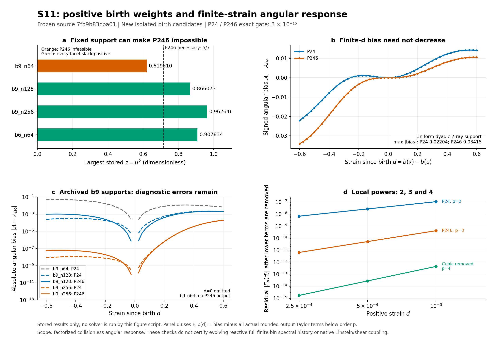

# S11 결과 — 양의 P246 birth 보정과 유한 전단 응답

## 1. 이번에 확인한 결과와 승인 범위

**고정 support에서 새 등방 birth의 P2/P4/P6 모멘트를 맞추는 양의 KL projector를 구현했고, 등록한 14개 입력·차수 쌍에서 12개 양의 해와 두 개의 정확한 support 실패를 확인했다.** 기존 S8 실패 입력의 새 pointwise P24 경로는 원래 exact gate를 통과했다. 다만 P6 추가가 유한 strain 전체의 오차를 줄인다는 결론은 성립하지 않았다. 고정 dyadic support의 49점 최대 각도 bias는 P24의 `0.022042599461602855`에서 P246의 `0.03414707018952904`로 커졌다. 두 최대가 발생한 d=-0.6에서 비율은 **1.54913989382294**다. [Main receipt](evidence/run_r1/RETURN.json), [정확 support·weight 검토](evidence/c9_physics/C9_REVIEW_RESULTS_KO.md), [고정 grid 통계](evidence/figure/FIGURE_STATS.json).

이 결과가 승인하는 것은 **명시적으로 새 등방 birth라고 선언한 고정 source-frame quadrature의 독립 보정과 factorized collisionless angular response**다. 기존 photon field, physical anisotropic stock, 이전 birth weights, spectral owner 또는 원래 default P24 경로를 바꾸지 않는다. full native finite-bin 보존, evolving reactive spectral-history 수렴, production/full EoR 또는 merge를 승인하지 않는다. [계약](CONTRACT.json), [실행 전 addendum](CONTRACT_ADDENDUM.json), [구현 범위](SOURCE_KO.md).

Main 검증 **101/101**, 독립 수학·응답 readback **235/235**, 별도 provenance·저장 출력 감사 **152/152**는 각각의 검사 집합이다. 서로 일부 자료가 겹치므로 하나의 독립 과학 실험 분모로 합치지 않는다. 이 문서는 완료한 과학 결과를 정리한 단계의 기록이며, **새 S11 결과 게시와 이중 provider 배송·readback의 최종 상태는 별도 closeout에서 확정한다.** 존재하지 않는 result commit이나 배송 receipt를 기입하지 않는다. 이미 완료된 S9/S10 배송 상태는 이 새 배송 대기로 되돌리지 않는다.

## 2. 고정 source와 실제 실행의 연결

| 항목 | 고정 identity |
|---|---|
| S11 main 실행 source | `7fb9b83cba01d37ce4cabbc4772527710601cd96` |
| S11 source tree | `963a43f26df1f9c6f462b9df9a2c34cf99f525c9` |
| 사전 계약·intake checkpoint | `e9f8eccc8d86764ebebe9bb98cc68ecb9aad09d8` |
| 재사용한 S10 배송 metadata HEAD | `d0c0313d6c063037fd8e067744aee66235df1a58` |
| 재사용한 S10 배송 tree | `e62a42c3227114a5657538a75e034af5a5823703` |
| 고정 original REI owner | `0e25846433170d0f420c4cda44a0bedbf02cd177` |
| S11 실행 binary SHA256 | `b1c9690f84de3b9fc52290b7e27417750256fa5fe653134af30b48012f55ced1` |

S11 source는 2026-10-20 17:47:51 UTC에 게시됐고, main process는 17:49:10.887911 UTC에 시작했다. 실행 전 18개 source/input 파일의 전체 bytes·SHA256·Git blob을 게시된 rooted Git tree에 연결했다. 별도 감사는 GitHub의 commit·최상위 tree를 다시 읽고 351개 tree object를 직접 해시하여 저장된 2,972개 recursive tree 항목과 같은 root를 확인했다. 게시 manifest의 44개 항목도 대조했다. 이 provenance는 문서에 적은 commit 문자열만으로 인정한 것이 아니다. [Execution binding](evidence/delivery/STAGE2_EXECUTION_BINDING.json), [원격 readback](evidence/delivery/STAGE2_REMOTE_READBACK.json), [독립 provenance 보고서](evidence/c9_provenance/AUDIT_REPORT_KO.md), [Git source](https://github.com/cosmosapjw-quantum/bass/commit/7fb9b83cba01d37ce4cabbc4772527710601cd96).

Main run은 한 번의 보존된 실행으로 완료됐다. 실제 기록은 compiler probe 1회, 새 독립 Rust 모듈 build 1회, projection CLI 14회, domain CLI 10회이며, 이에 대응하는 Python reference와 독립 certificate controls를 runner가 수행했다. 26개 하위 호출의 command/stdin/stdout/stderr/exit가 남아 있다. Main은 exit 0, stderr 0 bytes, timeout false, wall `2.3758596949919593`초였다. 이 wall time은 compile 등을 포함한 새 검증 process의 시간이며 projector의 성능 가속비로 사용하지 않는다. [Process receipt](evidence/run_r1/PROCESS_RECEIPT.json), [원시 호출](evidence/run_r1/EXECUTIONS.json), [build](evidence/run_r1/BUILD.json).

## 3. 물리 convention과 양의 KL 구성

Non-tilted axisymmetric Bianchi I와 signature `(-,+,+,+)`를 유지한다.

\[
a_\perp=a e^{-b},\qquad a_\parallel=a e^{2b},\qquad
s=\dot b,\qquad \Sigma=\sqrt3\,|s|/H.
\]

Birth source frame의 방향 \(\mu\)와 birth 이후 고정된 weights를 사용하고, \(d=b(x)-b(u)\), \(z=\mu^2\)로 놓는다. 기존 S3의 collisionless ray kernel은

\[
R=\sqrt{e^{2d}(1-z)+e^{-4d}z},\qquad
D=\frac{e^{-4d}z-e^{2d}(1-z)/2}{R}=-\tfrac12\partial_dR,
\]

\[
F=\langle R\rangle,\qquad G=\langle D\rangle,\qquad
\mathcal A=G/F=\Delta P/U
\]

다. 이 차원 없는 angular ratio를 사용한 진단을 실제 native source·Einstein history와 구분한다. 공간 공변 운동량 보존을 통한 Bianchi I ray map은 [Fleury–Pitrou–Uzan의 원 논문](https://www2.iap.fr/users/pitrou/publi/1410.8473.pdf), Sec. IV A와 연결되며, 이번에는 기존 [S3 유도](../S3_THEORY_KO.md)를 재사용했다.

새 API는 엄격히 정렬된 distinct \(\mu_i\), 양의 reflection prior \(q_i\), literal boolean `True` birth 선언을 요구한다. 결과 파일의 `_P4`는 P2와 P4를 함께 맞추는 **P24**, `_P6`는 P2·P4·P6를 함께 맞추는 **P246**을 뜻한다. 목적함수는 \(\bar q_i=q_i/\sum_jq_j\)에 대해

\[
\min_{\alpha_i>0}\sum_i\alpha_i\log(\alpha_i/\bar q_i),\qquad
\sum_i\alpha_i=1,\quad\sum_i\alpha_iP_\ell(\mu_i)=0
\]

이며, P246은 \(\ell=2,4,6\)을 부과한다. \(\bar q\)는 목적함수의 내부 정규화이며 caller의 prior나 기존 birth를 수정하는 동작이 아니다. Full-rank strict feasible support에서 해는

\[
\alpha_i(\lambda)=\frac{q_i e^{\lambda\cdot\phi_i}}
 {\sum_jq_j e^{\lambda\cdot\phi_j}},\qquad
\phi_i=(P_2,P_4,P_6)(\mu_i)
\]

로 쓸 수 있다. Dual gradient는 모멘트, Hessian은 centered covariance다. 닫힌 nonnegative simplex에서 KL 최소점의 존재를 얻고, 양의 feasible 분포와의 혼합 방향으로 boundary 최소점을 배제한다. strict convexity가 유일성을 준다. 이 finite exponential-family 구조는 [Wainwright–Jordan의 저자 공개본](https://people.eecs.berkeley.edu/~jordan/sail/readings/wainwright-jordan-fnt.pdf), Secs. 3.5–3.6과 연결된다. BASS의 support 조건·고정 control·적용 제한은 [THEORY.md](THEORY.md)에 별도로 유도했다.

Reflection orbit의 distinct \(0\le z_1<\cdots<z_m\le1\)에 대한 목표는
\(E[z],E[z^2],E[z^3]=(1/3,1/5,1/7)\)다. \(m\ge4\)이면

\[
J(a,b,c)=\tfrac17-\tfrac{a+b+c}{5}
+\tfrac{ab+ac+bc}{3}-abc
\]

를 사용한 모든 lower facet \(J(z_1,z_i,z_{i+1})\), \(i=2,\ldots,m-1\),
모든 upper facet \(-J(z_i,z_{i+1},z_m)\), \(i=1,\ldots,m-2\), 이 엄격히
양수일 때 정확 목표가 내부에 있다. Python은 실제 binary64 \(\mu\)의 유리수 값을
먼저 만든 뒤 제곱하여 정확히 판정한다. Rust는 outward interval이 확실히
양인 경우만 내부로 인정한다. 음의 facet은 `INFEASIBLE_SUPPORT`, 0을 포함하는
interval이나 부족한 rank는 `FEASIBILITY_UNRESOLVED`로 남는다.

Python의 Decimal80 simultaneous Newton과 Rust의 compensated simultaneous Newton은
서로 다른 수치 경로다. Rust는 작은 objective 차이를 `expm1/log1p`로 계산하며,
고정된 내부 guard를 통과해도 상태를 `PROJECTED_NEEDS_EXACT_CERTIFICATE`로
돌려준다. 실제 저장 weights에는 재정규화하지 않은 exact gate

\[
|\sum_i\alpha_i-1|\le3/10^{15},\qquad
|\sum_i\alpha_iP_\ell(\mu_i)|\le3/10^{15}
\]

를 별도로 적용한다. P2/P4의 원 기준은 그대로이고 P6도 같은 기준이다.
음의 weights 절단, tolerance 완화, 모호한 feasibility의 성공 치환은 없다.
[Python source](projector.py), [Rust source](rust/projector.rs), [독립 소스 검토](evidence/c9_physics/S11_INDEPENDENT_SOURCE_REVIEW_R2.json).

## 4. S8 pointwise 정밀도 문제와 P246 support 실패

기존 S8 raw gzip `959,031` bytes, SHA256
`fdc70eaaea45804aa16e60bba495b283eb5e4a18a576f52d5519bfd5a1f05839`, Git blob
`0dd1c3a13f393f9274c4e1a0d14409a28b1f9138`에서 birth index 11의 \(\mu\)와
prior만 읽었다. 원 numeric tokens와 binary64 bits를 저장된 prior/P2 행 및
원 실패 support와 대조했다. 기존 S8 history를 실행하거나 입력을 새로 제조하지
않았다. [추출 receipt](inputs/INPUT_EXTRACTION.json), [원 실패](inputs/ORIGINAL_S8_FAILURE.json).

| 고정 입력 | P24 | P246 |
|---|---|---|
| dyadic support, uniform prior | 양쪽 구현 exact PASS | 양쪽 구현 exact PASS |
| 같은 dyadic support, symmetric biased prior | 양쪽 구현 exact PASS | 양쪽 구현 exact PASS |
| P24-only support | 양쪽 구현 exact PASS | exact infeasible: 최소 slack `-1/42` |
| 저장된 b9, n64, birth 11 | 양쪽 구현 exact PASS | exact infeasible: 최소 slack `-0.019107014686788677` |
| 저장된 b9, n128, birth 11 | 양쪽 구현 exact PASS | 양쪽 구현 exact PASS |
| 저장된 b9, n256, birth 11 | 양쪽 구현 exact PASS | 양쪽 구현 exact PASS |
| 저장된 b6, n64, birth 11 | 양쪽 구현 exact PASS | 양쪽 구현 exact PASS |

12개 양의 쌍에서 24개 저장 weight 목록을 독립 검산했다. 최대 exact residual은
Rust `1.0280045769226785e-16`, Python `4.163336342344337e-17`, 양쪽 weight의
최대 절대 차이는 `6.938893903907228e-17`이었다. [Projection 원자료](evidence/run_r1/PROJECTIONS.json), [독립 exact weights](evidence/c9_physics/EXACT_WEIGHT_READBACK.json), [별도 감사](evidence/c9_provenance/AUDIT_REPORT_KO.md).

특히 원 `INNER_P2_PRECISION_LIMIT`의 `b9_n64` 입력은 새 pointwise P24에서
Python 최대 잔차 `11/1152921504606846976`, Rust 최대 잔차
`1.0280045769226785e-16`을 보였다. 최소 weight는 각각
`0.0030436855068409854`, `0.003043685506840988`이며 방향 hash는 원래의
`10983ba1978e2c342d23e034871c9ec3588bae80bf1e0de20442d99850e08417`을 유지한다.
이는 중첩 inner P2 정밀도 요구를 새 simultaneous solve로 피한 구체적인
pointwise 결과다. **과거 S8 failed history와 receipt를 성공으로 변경하지 않는다.**

같은 n64 support의 P246 실패는 정밀도 문제가 아니다. 양의 weights에는 항상
\(E[z^3]\le z_{\max}E[z^2]\)이므로 정확 P246에는 \(z_{\max}\ge5/7\)가 필요하다.
이 입력의 최대 z는 약 `0.6195099475928701`이다. P24의 대응 필요조건
\(z_{\max}\ge3/5\)와는 양립할 수 있다. 독립 exact facet 계산도 P246의 음수
slack을 확인했다. [Support 전체 분수](evidence/c9_physics/EXACT_SUPPORT_READBACK.json).
이것은 특정 support의 실패 증거이며, 모든 finite support에 관한 배제 정리가
아니다. 음의 weights나 기존 stock의 support 변경으로 우회하지 않는다.

독립 rational control은 \(\mu_{\ge0}=(0,1/2,3/4,1)\), orbit masses
\((286/945,32/105,2048/6615,61/735)\)다. 네 orbit의 네 모멘트 조건이 해를
정하므로 이 control의 P246 결과가 두 prior에서 같은 것은 예상한 성질이다.
일반적인 더 큰 support에서 KL 결과가 prior와 무관하다는 뜻은 아니다.

## 5. 재사용한 S3 cubic과 새 quartic 응답

S3의 P8 cubic 항을 새 발견으로 세지 않았다. 이상적인 정확 P246 조건
\(M_0=1\), \(M_2=M_4=M_6=0\)에서

\[
\begin{aligned}
\mathcal A(d)={}&-\frac85d+\frac87d^2
+\left(\frac{368}{175}+\frac{288}{143}M_8\right)d^3\\
&+\left(-\frac{248}{77}-\frac{7200}{2717}M_8
+\frac{136080}{46189}M_{10}\right)d^4+O(d^5).
\end{aligned}
\]

새 항은 quartic의 P8/P10 결합이다. 이를 위해 독립적으로

\[
D^{(4)}(0)=-\frac{320}{77}P_0+\frac{4528}{143}P_2
+\frac{10080}{143}P_4-\frac{116640}{1309}P_6
-\frac{172800}{2717}P_8+\frac{3265920}{46189}P_{10}
\]

를 구하고 \(G/F\)로 정규화했다. 기존 P24에서 남는 leading bias는
\((108/77)M_6d^2\)이며, P246의 leading bias는 \((288/143)M_8d^3\)다.
[이론](THEORY.md), [25개 exact 수학 검사](evidence/theory/EXACT_DERIVATION_CHECKS_RECOVERY_R1.json).

실제 float 출력에는 작지만 비영인 낮은 모멘트·normalization 잔차가 있으므로
위 이상식을 그대로 모든 저장값에 대입하지 않았다. Root는 실제 weights의
유리수 \(R^2\) recurrence로 Taylor 계수를 구했고, 독립 C9는 Rodrigues
모멘트와 D0–D4 Legendre 전개로 12개 행의 계수를 정확하게 대조했다. 작은 d
비교에서는 실제 저장된 낮은 차수의 bias를 먼저 제거했다.
[원 Taylor 계수](evidence/run_r1/TAYLOR_COEFFICIENTS.json), [독립 계수](evidence/c9_physics/EXACT_TAYLOR_READBACK.json).

| dyadic uniform의 작은 양의 d 진단 | 0.001→0.0005 관측 차수 | 0.0005→0.00025 관측 차수 |
|---|---:|---:|
| P24의 leading bias | 2.0016436684 | 2.0008250907 |
| P246의 leading bias | 2.9992158314 | 2.9996092449 |
| P246 cubic 제거 후 quartic | 4.0028794191 | 4.0014429756 |

세 양의 d에서 계수의 상대 차이는 등록한 2% 안에 있었다. 음의 작은 d 세 점도
저장했지만, 위 asymptotic PASS 검사는 양의 세 점에 적용한 것이다. `1e-12`
P8/P10 계수 consistency allowance와 `5e-13` 독립 scalar reference 기준은
새 진단 기준이며 원 `3e-15` 모멘트 gate를 대체하지 않는다.
[작은 strain 원자료](evidence/run_r1/SMALL_STRAIN_CHECKS.json), [차수 산술](evidence/run_r1/ASYMPTOTIC_SLOPES.json), [사전 addendum](CONTRACT_ADDENDUM.json).

## 6. 유한 d의 고정 49점: 국소 차수와 전역 개선은 다르다

성공한 각 projection에 대해 \(d=k/40\), \(k=-24,\ldots,24\)의 49점과
작은 부호 있는 여섯 점을 저장했다. 12×55=660개 response 중 49점 grid는
588개다. 아래 값은 **등록한 49점의 최대 절대 angular bias**이며
\([-0.6,0.6]\) 연속구간 supremum이나 전체 history 오차가 아니다.
[원 response](evidence/run_r1/ANGULAR_RESPONSES.json), [49점 CSV](evidence/figure/ANGULAR_RESPONSE_GRID.csv), [그림 통계](evidence/figure/FIGURE_STATS.json).

| 입력 | P24 grid 최대 \(|\mathcal A-\mathcal A_{iso}|\) (d) | P246 grid 최대 (d) |
|---|---:|---:|
| dyadic uniform | 0.02204259946 (-0.6) | **0.03414707019 (-0.6)** |
| dyadic biased prior | 0.02220497278 (-0.6) | 0.03414707019 (-0.6) |
| P24-only support | 0.04368609736 (-0.45) | support infeasible |
| b9 n64 | 0.04944640483 (-0.525) | support infeasible |
| b9 n128 | 0.002276709574 (0.5) | 0.002145471283 (0.525) |
| b9 n256 | 0.0001963206843 (0.6) | 0.0001963038173 (0.6) |
| b6 n64 | 0.001176933928 (0.575) | 0.001158248187 (0.575) |

Dyadic uniform에서는 d=-0.6의 signed bias가 P24
`-0.02204259946160285462361908217`, P246
`-0.03414707018952904237483855275`다. P246/P24의 절대 bias 비율
`1.54913989382294`를 실패 사례로 유지한다. 작은 d에서 M6 항을 없애는 국소
차수 개선은 M8·M10 이후 항과 유한 strain에서의 전체 오차를 제어하지 않는다.
다른 세 저장 support에서 grid 최대가 줄었다는 사실도 모든 d·모든 support의
단조 개선으로 일반화하지 않는다.

[PDF](evidence/figure/S11_P246_RESPONSE.pdf) · [SVG](evidence/figure/S11_P246_RESPONSE.svg) ·
[실제 그림 readback](evidence/figure/FIGURE_REVIEW.json). 그림은 완료한 저장값의
후처리로 만들었으며, 그림 수정 때문에 solver나 history를 다시 실행하지 않았다.

## 7. 독립 검토가 무엇을 확인했는가

| 증거 집합 | 결과 | 의미와 독립성 |
|---|---:|---|
| Main 새 고정 검증 | 101/101 | 새 source/input·domain·모멘트·구현 비교·국소 계수 검사 |
| 새 exact 수학 단위 | 25/25 | 다항식 recurrence와 별도 tetrahedron barycentric support 대조 |
| C9 수학·응답 readback | 235/235 | solver import 없이 Rodrigues exact moments, support, Taylor, 별도 scalar integration |
| C9 provenance·저장 출력 감사 | 152/152 | source/tree/process/원시 출력·별도 exact 다항식 검산 |

235개 검토에서 양쪽 구현의 24개 certificate, 12개 Taylor 행, 다섯 continuum
reference 점, 60개 finite-ray readback을 확인했다. 등록한 d=-0.6,-0.3,0,0.3,0.6에서
별도의 양의 composite Simpson·refinement 경로와 Decimal analytic reference의
최대 절대 차이는 F `1.65209654547353e-16`, G `1.4947003428522293e-16`,
A `8.244345804509617e-17`이었다. 60개 finite-ray readback의 최대 차이는
`1.5925899911076854e-16`이었다. [C9 보고서](evidence/c9_physics/C9_REVIEW_RESULTS_KO.md), [235개 receipt](evidence/c9_physics/RETURN.json).

Simpson의 분석적 truncation bound 추정은 모든 floating 연산을 감싼 outward
interval 인증이 아니다. 위 작은 차이는 기준 구현끼리의 일치이며, 유한 birth
quadrature와 물리적 continuum 사이의 실제 discretization error를 대신하지 않는다.
독립 수학·응답 검토자는 Python reference와 Rust solver를 작성하지 않았고,
고정 Rust numerical core도 별도로 읽었다.

152개 감사자는 Rust projector/CLI의 작성자이므로 단독의 독립 Rust 구현 승인자로
세지 않는다. 그 감사의 독립 범위는 작성하지 않은 root Python runner의 증거 구조,
source/process 연결 및 별도 exact output 검산이다. 두 감사 집합의 독립 범위와
겹침을 명시한 상태로 사용한다. [152개 감사 보고서](evidence/c9_provenance/AUDIT_REPORT_KO.md), [원 감사](evidence/c9_provenance/AUDIT_R1.json).

게시 전 source 검토에서는 독립 certificate의 잘못된 order 및 비물리적 mu를
통과시키는 실제 반례를 보존했다. 또 임의의 native nonzero exit를 정상 거부로
세는 검사, success status 미확인, 중복 방향, 예외 증거 누락을 고쳤다. 모든
수정은 원 moment gate를 유지한 채 새 source에 들어갔다.
[원 반례](evidence/prepublication_review/PROJECTOR_PRE_FIX_FINDINGS.json), [최종 source 검토](evidence/c9_physics/S11_INDEPENDENT_SOURCE_REVIEW_R2.json).

## 8. Runtime interruption과 채택하지 않은 증거

도구·skill 갱신 뒤 scratch source, 추출 input, Rust 설치와 게시되지 않은 smoke
raw receipt가 소실됐다. 이미 게시한 계약·intake와 원 S10 배송은 보존됐다.
복구는 고정 Git blob, 남은 실제 tool-call source, 원 hash 및 고정 S8 raw를
사용했다. 소실된 Rust smoke는 `TRANSCRIPT_ONLY_NOT_DURABLE`로 표시하고
실행 PASS 근거에서 제외했다. **복구 뒤 게시한 source의 실제 main run이 현재
새 solver 검증 근거다.** [Root recovery](evidence/runtime_recovery/ROOT_RECOVERY.json),
[Rust recovery](evidence/runtime_recovery/PR175_RUST_AGENT_RECOVERY.json).

원 exact 수학 결과는 deterministic Fraction 출력과 보존된 원 elapsed 값을
복원하여 **원 SHA256과 정확히 일치하는 경우에만** 원 record로 인정했다.
그 elapsed를 새 측정으로 표현하지 않았다. 사라진 새 S11 수학 단위의 현재
실행 증거를 만들기 위해 25개 검사만 한 번 새로 실행했고, 원 복원 record와
새 recovery R1을 분리했다. 문구 교정은 monic cubic 조건, 닫힌 simplex에서의
존재 증명, boundary·minimum-slack·중복 support 표현을 명확히 했으며 수식은
변경하지 않았다. [수학 recovery receipt](evidence/theory/RECOVERY_RECEIPT.json),
[원 복원 결과](evidence/theory/EXACT_DERIVATION_CHECKS.json),
[새 복구 실행](evidence/theory/EXACT_DERIVATION_CHECKS_RECOVERY_R1.json),
[문구 교정 기록](evidence/theory/THEORY_WORDING_CORRECTION.json).

위 recovery receipt의 `main ... not yet executed` 같은 문장은 그 복구 시점의
상태다. 현재 main의 실제 완료는 이 문서와 `evidence/run_r1/`의 고정 기록을
따른다. 사라진 원시 기록을 사후 성공으로 채우거나 완료 캠페인을 재생하지 않았다.

## 9. 재사용한 S9/S10 완료와 계속 남는 의무

S9 고정 8 history, S10 targeted 11/11, kernel 108/108, 대표 RAW 24/24의
scientific identity, science 68/68, 원 독립 검토 155/155는 재사용했다.
S10 실행 source `d5a173644f5c7c0dbe9eb8757dfc4ccad6c4f4c8`, 결과
`26e9e1ba8f39788d98ec33c60f6e9fd2605f8b8a`, 검토
`0771f0610987eb9f900674e83063912150733255`를 새 S11 실행으로 대체하지 않는다.
[S10 결과](../S10_RESULTS_KO.md), [원 C9](../evidence_s10/c9_review_r1/C9_REVIEW_RECEIPT.json),
[전체 인계](../NEW_THREAD_HANDOFF_KO.md).

MF의 closed **2.973배**, FLRW **4.115배**는 원 고정 workload의 paired 중앙
가속비다. Closed small/clock4의 SIMD+cache 중앙 1.055배, IQR 0.957–1.243은
일관된 이득을 인정하지 않았고, changing n16/cohort2의
**0.9498173837599284배 회귀**도 보존한다. 이번에 이 성능 캠페인이나 자동
최적화 주기를 다시 실행하지 않았다.

2026-10-20의 원 S10 배송은 원 8 ZIP과 복구 보충 ZIP 1개, 합계 9 ZIP·
4,399,983 bytes·중복 포함 payload 383항목 및 최종 JSON의 양쪽 검증으로
완료된 상태를 재사용한다. 초기 read-only intake에서 양쪽 최종 JSON 전체
24,280 bytes/SHA256과 기존 ZIP identity를 대조했다. S10 문서의 역사적 Drive
pending 문구를 현재 미완료 상태로 다시 채택하지 않는다.
[초기 대조](INTAKE_KO.md), [cloud intake](CLOUD_INTAKE.json),
[기존 배송 closeout](../PUBLICATION_CLOSEOUT.json).

발견한 PR175 `4940770c7904ed6f6fd5caca8e525905593bb683`의 shared-Q C99
normalizer/event adapter는 읽어 재사용 대상으로 확인했다. 그 소스 17파일과
manifest, 11/11·exit0을 기록한 receipt를 확인했지만 게시 payload에는 unittest
raw stdout/stderr가 없었다. 따라서 이를 이번 S11의 새 실행 또는 physical
donor closure의 완료로 세지 않는다. [PR175 identity](PR175_IDENTITIES.json),
[intake의 범위](INTAKE_KO.md).

| 의무 | S11 이후 상태 |
|---|---|
| P6 알고리즘 | 고정 support의 양의 P246 구성·정확 인증·등록 진단 범위에서 완료. 모든 support/strain에 대한 보증은 아님 |
| S8 `INNER_P2_PRECISION_LIMIT` | 보존한 입력의 새 pointwise P24는 해결. 원 failed history와 더 넓은 native history 의무는 유지 |
| 실제 MD14 정규화·native Einstein/shear shared-Q 결합 | physical donor closure, 측정된 paired-event 입력, native 결합·검증 의무 유지. 기존 PR175 구성요소는 재사용 |
| Evolving reactive full finite-bin spectral history | 미완료 |
| 더 넓은 finite-d/angular 고차 모멘트 | 미완료. 이번 49점 반례와 두 support 실패를 후속 설계의 근거로 유지 |
| 새 Rust client의 full birth-memory parameter tangent | 미완료 |

원 `5.369926725506957e-12`는 제한된 source-deposition 비교의 설명이다.
이번 angular projector나 C9 scalar 대조를 근거로 full spectral-history 수렴
완료로 바꾸지 않는다. S6/S7 및 S8의 다른 기존 실패도 삭제하지 않는다.

## 10. 자원과 후속 배송

Main은 science process 1개, timeout 1,750초, address-space 6 GiB로 실행했다.
관측 환경은 8 CPU quota·8 GiB cgroup이며, 기록한 최대 개별 child RSS는
238,364 KiB다. 이 RSS를 동시 process-tree 전체의 peak로 표현하지 않는다.
독립 수학·응답 C9는 0.767497초·40,064 KiB, provenance 감사는 약 0.343754초였다.
사용자의 추가 worker≤16·RAM≤16 GiB·disk≤4 GiB·개별 job≤1,800초 범위 아래의
새 단위로 수행했으며, 전체 disk 및 배송 payload의 최종 bytes/readback은
별도 closeout에서 기록한다. [Main 자원](evidence/run_r1/PROCESS_RECEIPT.json),
[물리 C9 process](evidence/c9_physics/C9_PROCESS_R1.json),
[provenance process](evidence/c9_provenance/AUDIT_R1_PROCESS_RECEIPT.json).

이번 단위의 완료된 과거 campaign 재실행, 기존 native history 재실행, 새
최적화 cycle, NCP 실행은 모두 0회다. 기존 owner 작업을 유지하며 새 결과·DAG·
인계를 단계별로 게시하고 새 payload의 이중 backup/readback을 별도 완료한다.
이 문서의 과학 판정은 그 배송 완료를 선취하지 않는다. 기계 판독용 범위·집계·
고정 identity와 증거 경로는 [RESULT_LEDGER.json](RESULT_LEDGER.json)에 정리했다.
