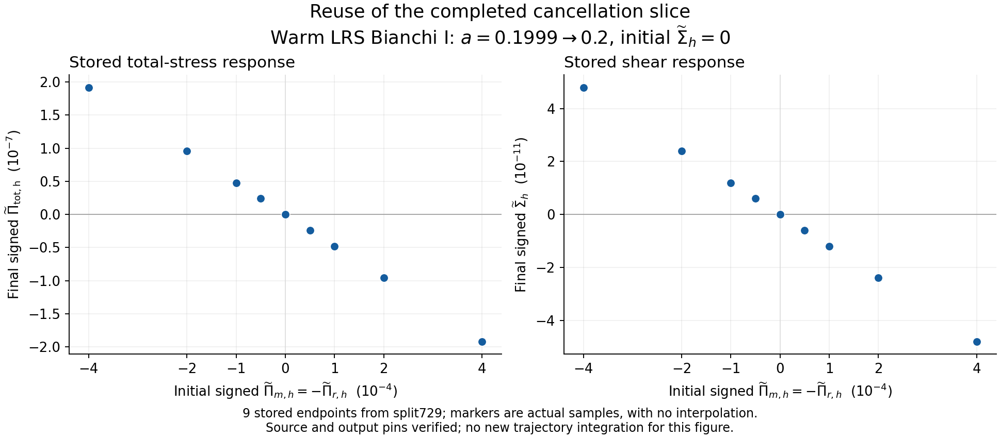

# ACCEL01: 완료된 split729를 보존하는 정확 캐시·재개·공존 병렬 실행

2026-10-21 UTC / KST · physmath-research-loop R1–R10, C1–C10의 범위를 정한 후속 연구 단위

## 1. 이번에 확보한 결과

완료한 **729 cases / 243 PASS groups / history 47,385행 / numerical gates 5,832개**를 재사용하면서, C15 finite-mass moment의 정확 캐시와 case별 완료 재사용을 실제 코드로 연결했다. 기본 입력을 계획하고 배치를 준비하는 실제 CLI 결과는 **729개 완료 재사용, pending 0, jobs 0, launched jobs 0**이다. 기존 trajectories를 다시 계산할 필요가 없도록 구현했다.

새 구현은 `cached_context.py`, `work_plan.py`, `batch_worker.py`다. 원래 C15의 이산화, reduction 식, stepper, photon compression, warm thermal/rate closure는 그대로 호출한다. 변경 의존성에 대한 25개 테스트가 실제 exit 0으로 종료됐고, 한 차례 독립 C9 검토에서 3개 finding을 수정한 후 29개 guard probe를 통과했다. 새 custom 입력 한 개의 2-step 실제 worker 연결 검사는 기존 8개 gate를 통과했다. 상세 성능 benchmark, 기존 729 전체 trajectory 재실행, 새 수렴 캠페인은 수행하지 않았다. [검증 receipt](evidence/VERIFICATION.json), [독립 검토](evidence/INDEPENDENT_REVIEW.json), [worker 실행](evidence/worker_smoke/EXECUTION_RECEIPT.json).

신규 작업은 [BASS PR177](https://github.com/cosmosapjw-quantum/bass/pull/177)과 [REI PR214](https://github.com/cosmosapjw-quantum/rei_bianchi/pull/214), 공통 branch `research/rei-sigma-pi-acceleration-20261021`에 게시한다. 각 게시·백업의 실제 commit, provider ACK, readback 수준은 [delivery](delivery/)와 [DAG](DAG.json)를 기준으로 한다. PR은 draft이며 merge하지 않는다.

### 유지한 baseline

| 항목 | 고정 identity |
|---|---|
| BASS PR176 | `26f4a89a54462c4e7c5705f281f187f33f45166a` |
| REI PR213 | `d32cd99fa19c65aa1ca63dbc8aab8741834270e8` |
| 원 729 실행 adapter | `82372ed8db68085868603d4267a630ed9cde6abb` |
| C15 physics owner | `80825585f9fe31d2ee0d5af545ada3fa1f52be72` |
| baseline 경로 | `research/rei_sigma_pi_pilot_20261021` |
| 원 cases.csv SHA256 | `c322453eed4c4c236ff19501ea6eca50353d6ebecc604a6cab9647b3a090255c` |
| 원 source binding SHA256 | `9a3a36bf03885245e6910f2d544d13634fb1b82dac45ddcb484efc7ecdb91334` |

baseline 112개 파일의 크기·SHA256·Git blob SHA1을 확인했고 변경은 0개다. 원 보고서, source manifest, result review, component/slice 그림과 Stage5/Stage6 delivery 근거를 먼저 읽었다. 이 새 작업 단위의 완료는 **warm conditional non-tilted LRS Bianchi I, a=0.1999→0.2** 범위의 계산 경로에 해당한다. 전체 EoR, 일반 non-LRS, full emitter/escape Qᵃ closure와 전역 수렴은 원래의 열린 과제로 유지한다. [원 보고서](../rei_sigma_pi_pilot_20261021/REPORT_KO.md), [원본 무결성](evidence/BASELINE_DOWNLOAD.json).

## 2. 최신 다른 작업과 백업에서 종합한 내용

조사 시점의 4개 저장소 branch 목록은 마지막 페이지까지 수집했다. BASS 261, REI 254, bass_cr 167, VigilODE 184개로 **총 866개 branch 이름·head SHA**다. 2026-10-19 이후 갱신된 PR 35개를 조사했고, 관련 PR 14개의 정확한 metadata와 선택한 source 12개를 실제 읽고 Git blob에 대조했다. 이는 모든 branch의 모든 파일을 읽었다는 뜻은 아니다. 상세 읽기는 현재 최적화의 의존성과 최신 실행 근거에 집중했다. [조사 범위와 결정](evidence/INTAKE_SUMMARY.json), [전체 목록](evidence/LATEST_BRANCH_INVENTORY.json).

| 작업 | 현재 조사에서 채택한 근거 | C15에 반영한 판단 |
|---|---|---|
| [BASS #174](https://github.com/cosmosapjw-quantum/bass/pull/174), S10/S12 | exact-bit cache, 불변 SoA, 동일점 재사용, 독립 lane SIMD, fused traversal | 정확한 입력 key와 불변 준비 패턴을 채택했다. S12의 17 jobs 완료 근거가 PR 본문의 오래된 NOT_RUN을 대체한다. 그 완료 실행을 반복하지 않는다. |
| [REI #210](https://github.com/cosmosapjw-quantum/rei_bianchi/pull/210), BRPERF01 | prepared rates/native data, photon pool | 현재 owner의 준비된 PCHIP/source를 group 내에서 재사용한다. 다른 owner의 근사 rate table을 현재 물리식에 넣지 않는다. |
| [REI #211](https://github.com/cosmosapjw-quantum/rei_bianchi/pull/211), RUN19 | 동일 T의 정확한 coefficient 재사용, caller-owned workspace | 불변 준비와 case별 상태를 분리하는 수명 설계를 재사용했다. 커널 의존성이 다른 계수 캐시를 그대로 연결하지 않았다. |
| [bass_cr #89](https://github.com/cosmosapjw-quantum/bass_cr/pull/89), C21K | epoch identity, cgroup ancestry, 가용 자원 admission | 원 C15 shared_executor의 실측 admission을 사용한다. 다른 물리 상태를 epoch 이름 하나로 묶지 않는다. CR 전용 CPU55 규칙은 그 작업에 남긴다. |
| [bass_cr #90](https://github.com/cosmosapjw-quantum/bass_cr/pull/90), C21L | 원 reduction을 보존하는 공통항 재사용, 별도 81-case 자료 | 순서 보존 원칙을 채택한다. 해당 collisionless momentum operator와 현재 C15 owner는 같은 구현이라고 가정하지 않는다. |
| [REI #198](https://github.com/cosmosapjw-quantum/rei_bianchi/pull/198) | 별도 PR147 계열 z20→4 계산, 40→8 상태 축소, 저장 625개 및 신규 matter/mixed 606개 근거 | 이미 계산된 다른 모델의 결과로 보존한다. warm reactive C15의 photon/chemistry state를 이 8변수로 대체할 근거는 별도로 필요하다. |
| [BASS #175](https://github.com/cosmosapjw-quantum/bass/pull/175) | shared-Q 정규화·compensated paired event ledger | 실제 donor/event 입력이 주어졌을 때의 재사용 지점이다. helper 구현을 full Qᵃ closure 완료로 승격하지 않는다. |
| [VigilODE #73](https://github.com/cosmosapjw-quantum/vigilode/pull/73), [#77](https://github.com/cosmosapjw-quantum/vigilode/pull/77), 최신 NCP audit | 구조화 Jacobian/인수분해 재사용, JVP 기반 dense 재구성의 숨은 RHS 비용 | 구조가 일치하는 후속 solver 연구의 근거다. 다른 adapter의 비용을 현재 C15 병목으로 단정하거나 solver를 교체하지 않았다. |

대화 검색에서도 완료729와 다른 장구간 계산을 구분했다. 다른 진행 중 대화의 91/175-point 확장, C21L 성분 후처리, PHYS75 전달본은 commit/output/ACK가 확인된 범위만 채택한다. 검색된 assistant 설명만으로 새 계산·게시 완료를 판정하지 않았다. 이번 보완 검색은 19개 대화 label의 관련 요약을 반환했으며, 모든 대화 전문의 열람이나 미게시 local branch의 전수 확인은 아니다. [대화 조사 기록](evidence/CONVERSATION_INTAKE.json).

외부 원전 조사는 SciSpace 검색 1회가 반환한 10개 record와 Exa 검색 2회를 사용했고, 선택한 원 논문 2개와 공식 versioned 문서 6개를 검토했다. 검색 index의 중복·잘못된 날짜는 원 논문의 서지 정보와 대조했다. Wolfram은 별도로 tensor contraction과 fixed-geometry affine/P₂ 항등식을 실제 계산했다. 긴 원문 retrieval transcript는 게시하지 않고 출처·위치·채택 조건과 직접 유도를 [SOURCES.json](evidence/SOURCES.json), [THEORY.md](THEORY.md)에 남겼다.

백업은 Dropbox `/BASS_BACKUPS` 직접 목록 94개, C21 검색 88개, BRPERF 검색 6개와 관련 Drive 자료를 확인했다. 기존 Stage6 두 ZIP part와 INDEX는 현재 file ID·크기·provider block hash가 원 receipt와 일치한다. 기존 full readback 근거를 재사용하고 이번에 원 Stage5 423 MB 전체를 다시 받지 않았다. Drive atomic 폴더 조회는 1,000개 상한, Dropbox REI 일반 검색은 100개 반환이라는 범위가 있다. **공개 branch 목록은 완주했지만 계정 전체·대화 전체·미게시 bytes까지 완전 열람했다는 주장은 하지 않는다.** [백업 intake](evidence/BACKUP_INTAKE.json).

## 3. 물리식과 최적화의 허용 경계

signature는 `(-,+,+,+)`, 축척은 a⊥=a exp(-b), a∥=a exp(2b), s=db/dt다. 같은 LRS 축에서

\[
\sigma^a{}_b=\mathrm{diag}(-s,-s,2s),\qquad
\pi_A{}^a{}_b=\mathrm{diag}(-D_A/3,-D_A/3,2D_A/3),\quad A=m,r.
\]

물질의 D_m은 **massive nonbaryonic collisionless Vlasov** 성분이다. 현재 baryonic gas/cold isotropic 성분의 이방응력은 0이다. 복사의 D_r은 gamma+massless nu+실제 evolving UV를 합한다. 초기 alpha_m과 alpha_r은 독립이며 gamma/nu는 현재 같은 alpha_r family를 공유한다.

기본 half-contraction convention은

\[
\Sigma_h=\sqrt3\frac{|s|}{H},\qquad
\widetilde\Sigma_h=\sqrt3\frac{s}{H},\qquad
\widetilde\Pi_{A,h}=\frac{\kappa_t D_A}{\sqrt3H^2},\qquad
\Pi_{A,h}=|\widetilde\Pi_{A,h}|,
\]

\[
\kappa_t=\frac{8\pi G}{c^2}=3\,\mathrm{C15.KAPPA},\quad
\Pi_{{\rm tot},h}=|\widetilde\Pi_{m,h}+\widetilde\Pi_{r,h}|,\quad
\sigma:\pi_A=2sD_A.
\]

D_A는 Pa=J/m³, H는 s⁻¹이다. Einstein equation의 κ=8πG/c⁴를 사용하면 proper-time source에는 κc²가 들어간다. Frobenius norm 출력은 각각 √2배다. Signed 좌표는 norm과 구분한다. 두 양의 component norm을 더하면 상쇄면의 실제 Einstein source를 보존하지 못한다. Wolfram으로 half contractions, work 합, P₂의 평균 0 및 제곱평균 1/5를 검산했다. [기호 계산](evidence/WOLFRAM_CHECK.json).

### 고정된 Vlasov 분포에서 재사용 가능한 양

Bianchi I collisionless 종의 공변량 운동량은 보존되므로 f=f₀(q_i)로 나타낼 수 있다. 에너지·압력은 현재 metric에 의존한다. 이 표현은 [Heinzle–Uggla의 원전 §2, 식 (2d),(2f),(3)](https://arxiv.org/pdf/gr-qc/0512031)과 일치한다. 현재 단위로 쓰면

\[
E=\sqrt{m^2c^4+c^2a^{-2}
 [e^{2b}(q_1^2+q_2^2)+e^{-4b}q_3^2]}.
\]

C15의 dimensionless kernel에서 x=ln(a/a₀), r=exp(-x), M=mc²/(k_BT_ref)이고

\[
R_j^2=e^{2b}(1-\mu_j^2)+e^{-4b}\mu_j^2,\quad
p_{ij}^2=r^2q_i^2R_j^2,\quad E_{ij}=\sqrt{M^2+p_{ij}^2},\quad
v_{ij}^2=p_{ij}^2/E_{ij}^2,
\]

\[
\bar\mu_j^2=e^{-4b}\mu_j^2/R_j^2,\quad
W_{ij}=\frac{w_{r,i}}{\mathcal Z}w_{\mu,j}[1+\alpha_mP_2(\mu_j)].
\]

원 함수는 r³W E, r³W E v², r³W E v²P₂(μ̄)의 세 합을 계산한다. **한 case의 고정된 M, q², μ², W 아래에서는 세 반환값이 (x,b)에만 의존한다.** 현재 photon cloud, gas, H, total stress 또는 predictor-corrector proxy 전체를 같은 key로 재사용하지 않는다. 상세 식–코드 대응, 단위, 원전과 조건부 동등성 증명은 [THEORY.md](THEORY.md)에 있다.

## 4. 실제로 채택한 세 가지 개선

### 4.1 정확한 per-model moment cache

`cached_context.PreparedContext`는 원 prepared context를 이용하고 case마다 새 model과 cache를 만든다. key는 `struct.pack('>dd', x, b)`로, signed zero와 인접한 binary64 입력을 구분한다. x∈[0,4], |b|≤1, 유한값이라는 원 domain을 lookup 전에 검사한다. miss 때 원 `massive_source_3moments` 본문을 그대로 실행하고 세 immutable float를 저장한다. hit 때 같은 입력의 원 반환값을 반환한다.

cache는 기본 128 entries, 허용 1–4096의 LRU다. q²·μ²·weights는 bytes-backed immutable 배열로 복사하고, model/grid/array identity, mass bits, params binding, fast path와 dtype·shape·strides·C-contiguity를 매번 확인한다. 읽기 전용 NumPy 배열도 metadata 변경은 가능하므로 이 추가 검사까지 필요했다. 변경된 binding에서 예전 결과를 주는 대신 새 model을 요구한다.

조건부 동등성은 호출 순서에 대한 귀납으로 보인다. miss는 원 함수, hit는 같은 K와 같은 입력 bytes에서 이미 얻은 원 함수값이다. eviction은 다음 miss만 증가시킨다. **K와 floating-point 환경이 고정된다는 조건 아래 반환값 동등성**이며, 연속 방정식의 오차나 다른 platform 사이의 bitwise 동등성을 증명하는 명제는 아니다.

원 커널 요청이 R회, 실제 miss가 U회, quadrature 크기가 N_q×N_μ라면 moment 평가량은 R개의 구적에서 U개의 구적으로 바뀌고 각 요청에는 작은 binding/key/LRU 연산이 붙는다. 이론적으로 기대되는 절감의 위치가 분명하지만 전체 wall time의 지배항과 실제 speedup은 이번에 측정하지 않았다. 최종 5개 short-step 비교에서 각각 12 hit·61 miss가 기록돼 합계 60회 원 moment 재평가를 피했다. 이 call count를 60/365의 전체 프로그램 가속률로 해석하지 않는다. [캐시 검산](evidence/CACHE_CHECK.json), [Python binary packing](https://docs.python.org/3.12/library/struct.html).

### 4.2 완료 과학 결과와 실행 배치를 분리

`work_plan.py`는 source, 계약, cases.csv, summary, 독립 result review를 pinned hash로 확인한다. 완료729를 scientific coordinate별로 등록하며, Parameters·seed·nsteps·compress/feedback·toolchain이 과학 identity에 들어간다. case label, group 묶음, host path, CPU profile은 실행 정보로 다룬다.

이미 완성된 64-step 좌표는 원 실행의 근거를 그대로 읽는다. 새 backend가 생겼다고 그 결과를 새 backend의 계산으로 바꾸거나 다시 큐에 넣지 않는다. input/schema/source pin이 바뀌면 검증 없이 과거 완료로 인정하지 않는다. 새로운 nsteps나 새 좌표에는 원 `seed_for`와 현재 toolchain을 적용해 새 identity를 만든다. 이미 완료된 729개를 pending으로 위조한 plan은 worker 준비 단계에서도 거부한다.

`batch_worker.py`는 pending인 항목만 기존 executor의 표준 manifest로 바꾼다. group 내 immutable 준비는 한 번, alpha-dependent weights와 evolving state는 case마다 새로 생성한다. 자동 group 크기는 pending 수와 계획 시 가용 worker 폭에서 계산하며 최대 16이다. 작은 작업에서 동시성을 우선하면 명시적 group size 1을 선택할 수 있다. 이 선택은 scientific identity를 바꾸지 않는다.

새 case의 저장 위치는 `CASE_STORE/backend_source_id/science_id/`다. 두 파일 `case.json`과 `receipt.json`을 staging directory에 완성한 뒤 directory rename으로 함께 공개한다. case별 fcntl lock으로 같은 store를 사용하는 동시 요청의 중복 계산을 막는다. group 중간 실패 때도 앞서 완료한 case를 재사용하고 checkpoint와 실패 기록을 남긴다. 손상된 committed entry는 조용히 덮어쓰거나 재계산하지 않는다.

완료 여부는 SHA만으로 판정하지 않는다. 원 owner schema/config/source, initial mapping, history 길이, 마지막 history와 final의 일치, 원 4개 error reduction과 8개 gate, finite JSON과 물리 domain을 확인한다. 이 layer는 지정된 source/input/output의 일관성을 검사한다. 독립 물리 오차 인증을 대신하지 않는다.

### 4.3 기존 vectorized kernel과 가용 자원 admission의 연결

현재 NumPy quadrature와 원 prepared PCHIP/source를 유지하고, 독립 case/group을 process로 실행한다. 각 worker의 BLAS/OMP/MKL/NumExpr 등 내부 numeric thread는 1이다. 원 `shared_executor`가 affinity, cgroup quota/사용량, sampled idle, host MemAvailable, cgroup memory remaining, 자기 실행 중 job의 아직 resident가 아닌 메모리 추정량을 반영해 **새 admission**을 조정한다.

다른 세션이 있다는 이유로 실행 전체를 중단하지 않는다. 현재 여유에서 가능한 pending 작업을 실행하고, 여유가 없으면 기존 resource wait/checkpoint 동작을 따른다. 다른 세션의 process를 종료하거나 checkout/branch를 수정하지 않는다. 공유 case store의 동일 case 잠금과 scope 잠금은 있지만, 서로 다른 모든 외부 scheduler를 포괄하는 전역 자원 예약기는 아니다. 여러 session의 시작 시점 경쟁 가능성은 live 재측정과 reserve로 관리한다.

## 5. 이번에 계산식을 더 바꾸지 않은 이유

고정된 geometry에서는 moment가 alpha_m에 대해 affine이다.

\[
J(x,b;\alpha_m)=J_0(x,b)+\alpha_m J_2(x,b).
\]

이 식은 다음 seed-basis 구현의 유효한 출발점이며 Wolfram으로 algebraic identity도 확인했다. 다만 완전 결합된 case마다 b(x)와 photon/gas 상태가 달라진다. 같은 geometry의 두 basis sum으로 재결합해도 floating-point reduction 순서가 바뀐다. interpolation table은 별도의 근사 오차를 추가한다. 이번에는 원 rounding 순서를 보존하는 캐시를 구현했고, affine basis·table·fused native kernel은 명시적 오차 계약을 가진 후속 후보로 남긴다.

[NumPy sum 문서](https://numpy.org/doc/2.3/reference/generated/numpy.sum.html)는 partial pairwise summation과 축·memory layout에 따른 정밀도 차이를 명시한다. 따라서 `einsum`, BLAS dot, parallel reduction, FMA 또는 새 SIMD 배치가 수학적으로 동등하다는 사실만으로 원 bit pattern이 유지된다고 가정할 수 없다. 특히 이번 목적은 큰 성분 응력의 작은 차를 관찰하는 것이므로 component absolute error와 signed total/work residual이 유효한 판별량이다.

massless radial factorization, REI PR198의 40→8 축소, 새 JIT/MPI/solver는 해당 전제와 코드 의존성을 따로 검증해야 한다. 이를 금지하는 일반 no-go를 제시한 것이 아니다. 이번 연구의 구성적 결과는 정확한 재사용 경계, 실행 가능한 wrapper, 완료 결과의 이식 가능한 소비와 부분 실패 복구다. 새 strong no-go 채택은 없으며 NG1–NG7은 적용 대상이 없다.

## 6. 실제 검증과 그 해석

| 근거 | 실제 수행 | 지지하는 결론 |
|---|---|---|
| kernel 비교 | 4개의 독립 alpha 조합, 6개 x, 6개 b의 144점, 원 평가와 반복 cache 평가 bytes 비교 | 해당 입력의 원 tuple과 bitwise 일치, domain/zero/eviction/freshness 확인 |
| short integration | isotropic, 양·음 cancellation, 양·음 initial shear를 포함한 5개 case 각각 2 step | row dict, moment bytes, a/b/s/H가 원 owner와 같고 원 number/energy gate 통과 |
| planner | 완료729·relocation·label/group/profile/backend 변화·입력 변경·synthetic resource cases | 완료 결과 소비와 새로운 scientific identity 경계 |
| worker I/O | toy runner를 명시적으로 주입한 부분 실패·손상·재개·2-process 중복 요청 | 저장/동시성/완료 판정 경로; toy 출력은 과학 자료에 합치지 않음 |
| 실제 worker | 새 custom case 하나, nsteps=2, a=.1999→.2, 기존 8개 gate PASS | CLI→prepared context→owner→case receipt 연결 확인 |
| C9 | 15 cache mutation, 5 pending-identity, 1 thread isolation, 8 output corruption probes | 발견한 세 구현 결함 수정 후 명시된 guard 동작 확인 |
| 원 파일 | 112개 size·SHA256·Git blob SHA1 | baseline 불변, 결과 재사용 identity 유지 |

실제 custom 입력은 (signed Sigma, signed Pi_m, signed Pi_r)=(-2.5e-4,-1e-5,-2e-5)이다. 이는 기존 grid 밖의 wiring 확인이며 새로운 parameter sweep 결과로 집계하지 않는다. 해당 실행 당시 backend source는 `dae6a5e9b49b309ae2c6ab7efdcf0bbc4dc5d91c476bfb8143b27156c30b5238`였다. 이후 output validator만 좁게 강화했고 저장 결과에 새 validator를 재적용해 통과했다. 실행 source와 재검증 source를 분리해 남겼으며 추가 solve는 하지 않았다. [당시 source snapshot과 receipt](evidence/worker_smoke/EXECUTION_RECEIPT.json), [저장 결과 재검증](evidence/worker_smoke/VALIDATOR_RECHECK.json).

최초 검사에서 발견된 dtype/shape/stride 방어 누락, THREAD_ENV 참조 공유, owner 출력과 error summary의 일관성 누락은 모두 수정됐다. 회귀검사 작성 중 q²에 원래와 같은 shape를 지정한 no-op fixture 실패도 원인과 수정을 남겼다. 최종 25개 테스트의 명령·exit·로그·코드 hash는 [VERIFICATION.json](evidence/VERIFICATION.json), 최초 finding과 교정은 [CORRECTION_HISTORY.json](evidence/CORRECTION_HISTORY.json)에 있다. C9는 한 pass에서 닫았고 미해결 finding은 없다.

## 7. 기존 데이터로 재표현한 cancellation 그림

이 그림은 원 cases.csv의 **9개 실제 endpoint**를 그대로 사용한다. 새 trajectory, interpolation, smoothing, fit은 없다. 원 component/cancellation 및 parameter-sweep slice 그림도 원 경로에 그대로 있다. 재사용 그림의 점·원 CSV SHA·script SHA는 [provenance](figures/REUSED_CANCELLATION.provenance.json)에 기록했다.

초기 (0,+4e-4,-4e-4)에서 최종 signed Pi_total은 `-1.9176362919464883e-7`, signed Sigma는 `-4.795410954946239e-11`이다. 반대 초기 응력에서는 반대 부호의 반응을 얻는다. 이 값은 원 finite warm 계산의 관찰값이다.

물리적으로 massive collisionless pressure와 radiation pressure의 희석/진화가 다르므로 초기 D_m+D_r=0이 계속 유지될 이유가 없다. signed shear 방정식은

\[
\frac{d\widetilde\Sigma_h}{d\ln a}
=\widetilde\Pi_{{\rm tot},h}
-\left(3+\frac{\dot H}{H^2}\right)\widetilde\Sigma_h.
\]

초기 shear와 total stress가 모두 0이면 component sum의 1차 변화가 total stress를 만들고 shear는 짧은 구간에서 2차로 생긴다. 원전의 trace-free Einstein 식과의 대응은 [Lee–Nungesser–Tod §2.1](https://arxiv.org/pdf/1911.04937) 및 [THEORY.md](THEORY.md)를 참조한다. 초기 total=0을 영구 cache하거나 component norm을 더하는 최적화는 이 관찰량을 지우므로 허용되지 않는다. 원 pilot의 열화학적 차이가 수렴된 검출이라는 주장은 그대로 열려 있다.

## 8. 실제 자원과 NCP 실행 계약

| 항목 | 현재 확인 상태 |
|---|---|
| 이번 local Python/C++ | 실제 작은 실행으로 PYTHON_PASS, CPP_PASS |
| 현재 CPU | affinity 9 logical, cgroup quota 8 cores |
| 현재 RAM | cgroup limit 8 GiB |
| 08:04:11 UTC 순간 여유 | quota 기준 약 7.05 cores, cgroup memory remaining 약 6.72 GiB |
| 1 GiB reserve 후 admission 예 | 7 workers, worker당 384 MiB 추정; 실제 pending729는 0 |
| NCP 목표 | 64 CPU / 128 GiB profile |
| NCP 현재 여유 | UNOBSERVED: Desktop Commander 월 한도 오류, 이 sandbox에 지정 SSH key 없음 |
| 별도 NCP audit | 06:21–07:15 UTC의 과거 관측: 64 logical CPU, RAM 135.05 GB, telemetry available 77.6–82.9 GiB |

순간 여유는 [RUNTIME_CURRENT.json](evidence/RUNTIME_CURRENT.json)의 시각과 함께 읽어야 한다. 다른 작업의 시작·종료에 따라 달라지므로 저장된 7-worker 예를 미래 실행의 고정 할당으로 쓰지 않는다. 384 MiB도 실제 peak RSS 측정치가 아니라 기존 admission estimate다. NCP 역사 관측을 이번 세션의 live capacity로 사용하지 않는다.

NCP에서는 기존 executor에 `--profile ncp --max-workers 64 --reserve-mb 1024`를 넘기되, host/cgroup/live headroom이 작은 경우 그 한도가 우선한다. 자동 group 크기나 명시적 group size 1은 다음 실제 pending 작업 수에 따라 선택할 수 있다. 자원 계획은 정확히 준비됐고 현재 코드도 실행 가능하지만, 이번 작업에서 새로운 NCP solve나 NCP speedup 측정은 없다. 원 729 pilot의 실제 실행환경은 사용자 확인대로 8 CPU/8 GiB다.

## 9. 단계·백업·게시와 다음 인계

운영상 checkpoint는 A=최신 intake, B=구현·변경 검증·동일 C9 검토·재사용 그림, C=보고·두 handoff·최종 delivery로 묶는다. 각 R/C 세부 단계는 [DAG.json](DAG.json)의 evidence와 checkpoint를 참조한다. 과학/구현 완료와 Git 게시, provider 저장, remote full readback은 서로 다른 상태로 기록한다. ZIP에는 자기 자신의 SHA나 이후 만들어지는 ACK가 순환 포함될 수 없으므로, archive manifest를 고정한 뒤 생성한 receipt는 다음 delivery commit에서 연결한다.

다음 실행자는 [CODEX_HANDOFF.md](CODEX_HANDOFF.md)를, 다음 대화는 [NEXT_THREAD_HANDOFF.md](NEXT_THREAD_HANDOFF.md)를 먼저 읽는다. 유지된 source/input의 완료 결과와 통과 검증은 재사용하고, 사용자가 지정하는 다음 물리 구간·grid·정확도에 필요한 변경 의존성부터 이어간다. 기존 고정729 aggregator에 custom smoke나 다른 장구간 모델의 결과를 섞지 않는다.

이번 단위에서 얻은 코드는 **동일 계산의 중복 평가와 재실행을 줄이는 정확한 경로**다. 다음 물리 범위는 아직 지정되지 않았으며, 이 코드의 국소 검증을 전체 EoR·full Qᵃ·일반 비-LRS·수렴 완료로 확장하지 않는다.

## 자료 안내

- 이론·조건·원전: [THEORY.md](THEORY.md), [SOURCES.json](evidence/SOURCES.json).
- 완료 재사용 실제 출력: [REUSED729_WORK_PLAN.json](evidence/REUSED729_WORK_PLAN.json), [no_work.json](evidence/reused729_no_work/no_work.json).
- 최종 코드검사: [VERIFICATION.json](evidence/VERIFICATION.json), [TARGETED_TESTS.log](evidence/TARGETED_TESTS.log).
- 독립 검토·교정: [INDEPENDENT_REVIEW.json](evidence/INDEPENDENT_REVIEW.json), [CORRECTION_HISTORY.json](evidence/CORRECTION_HISTORY.json).
- 전달·백업: [delivery](delivery/), [DAG](DAG.json), [Codex handoff](CODEX_HANDOFF.md), [다음 대화 handoff](NEXT_THREAD_HANDOFF.md).
