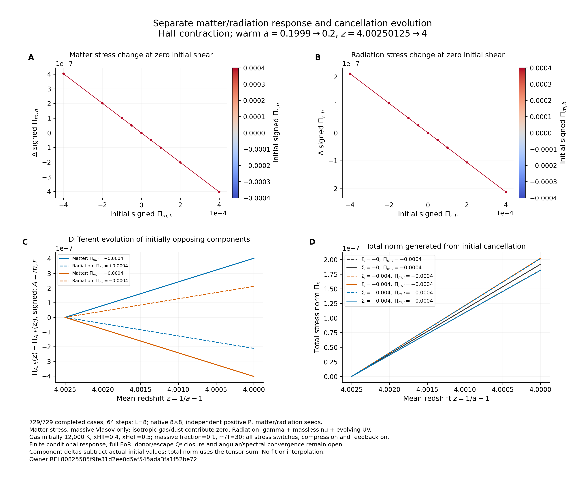

# BASS → REI: 독립 물질·복사 응력의 729-case pilot 완료

2026-10-21 실제 계산: **729 cases, 243 PASS groups, 47,385 history rows**.
먼저 끝낸 81-case 공통-alpha pilot도 보존했다. 추가 지시에 따라 물질의
Pi_m과 복사의 Pi_r를 독립 초기조건으로 설정했다. 주 보고서는
[REPORT_KO.md](REPORT_KO.md), 구현 설명은 [README_SPLIT.md](README_SPLIT.md)다.

고정 contract는 `SPLIT_CONTRACT.json`, owner는 REI PR141
`80825585f9fe31d2ee0d5af545ada3fa1f52be72`, 실제 split 실행 source는 BASS
`82372ed8db68085868603d4267a630ed9cde6abb`다. 원본 source/rate bytes는
`vendor/rei_c15/`에 보존했다. 기본 norm은 half contraction이고 signed 및
Frobenius 출력도 포함한다. Total은 tensor sum 후 norm이며 component norm 합이 아니다.

범위는 warm a=0.1999→0.2, non-tilted **LRS** Bianchi I, H/He, native MD14,
gamma/massless-nu/UV, massive Vlasov와 Einstein shear feedback이다. Full emitter/
escape Qᵃ, cold full-EoR, general non-LRS와 전역 수렴은 열려 있다.

현재 host의 실제 8 CPU/8 GiB 범위에서 완료했다. NCP 64 CPU/128 GiB profile은
현재 가용 자원에 맞춰 새 작업을 배분한다. 다른 세션 때문에 중단하거나 다른
process를 종료하지 않는다. 상세 performance benchmark와 speedup 주장은 없다.

- [독립 결과 검토](physics/SPLIT_RESULT_REVIEW.json)
- [실제 실행 관측](evidence/SPLIT_EXECUTION_OBSERVATIONS.json)
- [결과 CSV](results/split729/aggregate/cases.csv)
- [DAG](DAG.json), [Codex handoff](CODEX_HANDOFF.md), [다음 대화 handoff](NEXT_THREAD_HANDOFF.md)
- [BASS PR176](https://github.com/cosmosapjw-quantum/bass/pull/176), [REI PR213](https://github.com/cosmosapjw-quantum/rei_bianchi/pull/213): draft, merge 없음.

최신 branch/PR catalogues와 선택한 원본 backup을 종합했다. Personal Context
service error와 Drive 1,000-item cap으로 모든 대화·저장물을 완전 열람하지는
못했다. Stage3의 손상 ZIP은 복원 금지이며 검증된 대체 parts를 사용한다.
정확한 게시·백업 상태는 `delivery/` receipt를 따른다.

